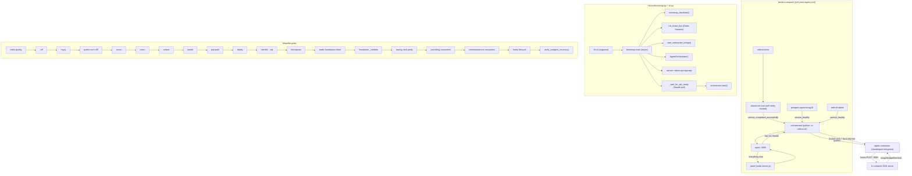

## Purpose
This slice is the packaging, build, and runtime-tooling layer of RoboCo: the Docker compose topologies (build-from-source and pre-built registry), per-service Dockerfiles (orchestrator + a family of agent role images extending a shared agent-base, plus the Next.js panel and nginx proxy), the uv/pnpm dependency manifests, the Makefile quality-gate and ops targets, the Pydantic-settings config (roboco/config.py) that every service reads, the bootstrap/CLI entrypoints that start the orchestrator, the structured-logging + exception hierarchy wired across the app, and the ops/CI helper scripts (lifecycle-artifact regeneration, postgres enum-parity verification, markdown reflow, runtime-state reset) and per-agent Claude/Grok hook scripts.

## Files

| Path | Role | LOC |
|---|---|---|
| docker-compose.yaml | Build-from-source compose: postgres/redis/ollama/ollama-init, 14 agent-*-image builders, orchestrator, panel, nginx, `backup` pg_dump sidecar on the `roboco_data` DB-isolation network; NAS prod env vars + volume mounts, `ROBOCO_OBSIDIAN_VAULT_ENABLED`/`ROBOCO_VAULT_INTAKE_ENABLED` default `true` | 1370 |
| docker-compose.yml | Byte-identical copy of docker-compose.yaml (kept for the canonical name compose picks up by default) | 1370 |
| docker-compose.registry.yml | Pull-and-run compose using pre-built GHCR/Docker Hub images (ROBOCO_REGISTRY + ROBOCO_VERSION); infra services byte-identical to build compose (incl. `backup` + vault defaults), agent-* services are one-shot pre-pulls, own `roboco_data` network | 913 |
| Makefile | Ops + quality targets: infra, dev/run/orchestrator, quality gate (ruff/mypy/pytest/xenon/radon/vulture/bandit/pip-audit/deptry/lint-imports/alembic/foundation-check), fast pre-submit `gate` target (ruff format/check, mypy, xenon, lint-imports), per-Python test matrix, docs, lifecycle regen | 627 |
| pyproject.toml | Project + dependency manifest: requires-python >=3.13,<3.15, deps, dev/docs extras, console scripts, ruff/mypy/pytest/coverage/vulture/bandit/radon/xenon/deptry/importlinter config | 704 |
| roboco/config.py | Pydantic Settings (env prefix ROBOCO_, cached via lru_cache); every tunable: DB, Redis, RAG, LLM/Ollama, workspaces, agent guardrails, gateway thresholds, autonomy-engine flags | 3283 |
| roboco/__init__.py | Package root: __version__ + re-exports settings, exceptions, logging helpers | 36 |
| roboco/bootstrap.py | Async bootstrap: git-user drop self-test (every role but indexer; SystemExit(1) on failure), DB init, Redis event bus, websocket bridge, orchestrator construction, uvicorn API server task, wait-for-ready poll, optional agent spawn, graceful shutdown | 232 |
| roboco/cli.py | argparse CLI wrapper around bootstrap.main / db-only; the ENTRYPOINT invoked by `python -m roboco.cli` | 64 |
| roboco/logging.py | structlog setup (dev ConsoleRenderer / prod JSONRenderer), secret-redaction processor, rotating file handler under /data/logs, LogContext context-manager | 256 |
| roboco/exceptions.py | Exception hierarchy (RobocoError base + NotFound/Validation/InvalidState/Permission/Auth/Task/TaskLifecycle/Agent/Notification/Service/Database/Git/MergeConflict/GitCommand/GitTimeout); includes TaskLifecycle transition hints and git-secret scrubbing | 432 |
| docker/npm/agent-base/package.json | Exact version of the npm CLI agent-base installs globally (`@anthropic-ai/claude-code`); the Dockerfile reads it and runs `npm install -g <name>@<version>`, Dependabot bumps it weekly (`.github/dependabot.yml`). Nothing installs from this directory | 9 |
| docker/npm/orchestrator/package.json | Exact version of the npm CLI the orchestrator image installs globally (`pnpm`); read by orchestrator.Dockerfile, bumped by Dependabot like the agent-base pins | 9 |
| docker/orchestrator.Dockerfile | Multi-stage build: uv venv builder (python:3.13-slim) + `entire` stage (both architectures' Entire CLI tarballs fetched by `ADD --checksum` against the global ENTIRE_* pins, TARGETARCH's unpacked, any other architecture refused) + runner with docker-cli/git/make/node/npm/pnpm and the Entire CLI off PATH at /usr/local/lib/entire/entire; apt pinned to bookworm's upstream series (NodeSource/Docker repos to their major, ca-certificates by suite), pnpm version read from docker/npm/orchestrator/package.json (Dependabot-bumped); global ARGs ROBOCO_GIT_USER_UID (1500) / ROBOCO_AGENT_GID (1000); the builder compiles docker/as-git-user/as-git-user.c statically with both compiled in, the runner creates group `agent` + user `roboco-git` and installs the helper at /usr/local/libexec/roboco/as-git-user (1500:1000, 6750) and sets ROBOCO_WORKSPACE_GIT_DROP=required; root-owned /opt/roboco/git (git-support hooks + workspace.gitconfig + private.gitconfig); no global safe.directory; runs as root by design (socket, fchown repair, /data/private relays); HEALTHCHECK GET :8000/health (the indexer role and throwaway workspace containers turn it off); ENTRYPOINT python -m roboco.cli | 266 |
| docker/agent-base.Dockerfile | Shared agent runtime: uv venv + Node 22 + @anthropic-ai/claude-code (version read from docker/npm/agent-base/package.json, Dependabot-bumped), apt pinned to bookworm's upstream series, Entire CLI (same ENTIRE_* pins as the orchestrator, sha256-checked; real binary off PATH, `entire` on PATH is docker/scripts/entire-wrapper.sh), agent user (explicit uid/gid 1000, USER 1000:1000), hook scripts, safe.directory * (clones are owned by the orchestrator's git user), HEALTHCHECK NONE (task-scoped job the orchestrator supervises; not every runtime serves the SDK /health), ENTRYPOINT umask-exec.sh claude (umask 002 so the git user can edit what the agent writes) | 214 |
| docker/agent-pm.Dockerfile | PM and Board image (main-pm, cell-pm, product-owner, head-marketing, auditor share it) — FROM roboco-agent-base, MCP tools only, plus the same `chromium-headless-shell` + `@playwright/mcp` as agent-qa-fe for the Product Owner's Dogfood walk (mounted only on a `source=board_dogfood` spawn) | 42 |
| docker/agent-dev-be.Dockerfile | Backend dev — adds postgresql-client + redis-tools on top of base | 17 |
| docker/agent-dev-fe.Dockerfile | Frontend dev — adds pnpm on top of base (Playwright was dropped by the lean-images change) | 14 |
| docker/agent-qa-be.Dockerfile | Backend QA — adds postgresql-client on top of base | 18 |
| docker/agent-qa-fe.Dockerfile | Frontend QA — pnpm + `chromium-headless-shell` (not full chromium, under `/app/.playwright`) + `@playwright/mcp` for browser-based verification, wrapped by `playwright-mcp-entrypoint.sh` | 35 |
| docker/agent-ux.Dockerfile | UX/UI agent (shared by ux-dev + ux-qa) — FROM base + the same `chromium-headless-shell` + `@playwright/mcp` as agent-qa-fe (role-gated at registration, not image-gated, so ux-dev never sees the MCP server despite sharing the image) | 40 |
| docker/agent-doc.Dockerfile | Documenter — FROM base, no extra tools | 11 |
| docker/agent-prompter.Dockerfile | Intake (Prompter) — persistent Claude Agent SDK session, ENTRYPOINT python -m roboco.agent_sdk.intake_main | 16 |
| docker/agent-secretary.Dockerfile | Secretary — persistent Claude Agent SDK session with gated CEO-authority tools, ENTRYPOINT python -m roboco.agent_sdk.secretary_main | 18 |
| docker/agent-pr-reviewer.Dockerfile | PR Reviewer — FROM base, keeps claude entrypoint; read-only reviewer dispatched per review task | 15 |
| docker/agent-grok.Dockerfile | Grok runtime — base + official grok CLI install (NO version pin since 2026-07-28, latest-at-build), ENTRYPOINT grok-cli-agent-entrypoint.sh | 52 |
| docker/agent-grok-prompter.Dockerfile | Grok intake — FROM grok, ENTRYPOINT python -m roboco.agent_sdk.grok_intake_main, EXPOSE 9000 | 22 |
| docker/agent-grok-secretary.Dockerfile | Grok secretary — FROM grok, ENTRYPOINT python -m roboco.agent_sdk.grok_secretary_main, EXPOSE 9000 | 22 |
| docker/agent-kimi.Dockerfile | Kimi (Moonshot) runtime — base + official kimi-code CLI install (NO version pin, latest-at-build, resolved version stamped to /etc/kimi-cli-version), ENTRYPOINT kimi-cli-agent-entrypoint.sh | 71 |
| docker/panel.Dockerfile | Multi-stage Next.js build (node:22-alpine, pnpm, shamefully-hoist), non-root nextjs:nodejs runtime (USER 1001:1001) serving server.js on :3000, HEALTHCHECK GET /login (the one prerendered page proxy.ts never sends to the backend) | 86 |
| docker/postgres-pgvector.Dockerfile | Example custom pgvector build (pg17) — currently unused; compose uses pgvector/pgvector:pg16 image directly | 14 |
| deploy/nginx.conf | nginx default.conf template (moved from `docker/` with the NAS blue-green deploy): the colour-suffixed upstreams come from the `front/active-upstreams.conf` include and resolve per request through Docker's DNS; /health /ready /api/ /ws/ -> the active orchestrator (with X-Agent-Token header), /api/orchestrator/ and /api/{secretary,prompter}/live/ -> the active dispatcher, a deny-list for scanner paths, everything else -> the active panel | 151 |
| docker/postgres-init/01-create-extensions.sql | First-init SQL: CREATE EXTENSION IF NOT EXISTS vector + availability check (used by the pgvector image entrypoint) | 16 |
| docker/scripts/entrypoints/backup-entrypoint.sh | `backup` sidecar's own loop (not a Claude hook): `pg_dump -Fc` on start + every `BACKUP_INTERVAL_SECONDS` (default 24h), `.tmp`-suffix-then-rename, prune to newest `BACKUP_KEEP` (default 14) by mtime; runs on the data-only network; env-gated off-disk mirror step (`ROBOCO_BACKUP_MIRROR_DIR`) after every successful dump | 80 |
| docker/scripts/entrypoints/playwright-mcp-entrypoint.sh | Wrapper entrypoint for `@playwright/mcp`: points it at the image's own baked `chromium-headless-shell` instead of letting the MCP package download a second browser | 20 |
| docker/scripts/hooks/sdk-startup-hook.sh | Claude SessionStart hook: start SDK server on :9000 with UV_PROJECT_ENVIRONMENT=/app/.venv + --no-sync, reset budget, print briefing/precompact | 61 |
| docker/scripts/hooks/a2a-check-hook.sh | Retired PostToolUse hook, kept registered as a non-blocking no-op (always exits 0): the SDK /inbox/count endpoint it polled was deleted; A2A is pull-only through read_a2a | 15 |
| docker/scripts/hooks/bash-guard-hook.sh | PreToolUse Bash guard: deny compound shell git network ops, PR/merge bypass, credential exfil, and uv run --active / uv targeting /app/.venv (exit 2 to deny) | 410 |
| docker/scripts/hooks/post-tool-budget-hook.sh | PostToolUse: per-session budget counter + loop detector via SDK /budget/tool_called; halts on hard cap, denies on loop+halt | 84 |
| docker/scripts/hooks/usage-report-hook.sh | PostToolUse+Stop: fire-and-forget POST /usage/sync with the transcript_path so the SDK parses token usage | 35 |
| docker/scripts/hooks/stop-hook.sh | Stop hook: block ungraceful exits (exit 2 first time, role-specific terminal-verb reminder); auto-substitute after exceeding allowance | 70 |
| docker/scripts/hooks/user-prompt-hook.sh | UserPromptSubmit: prompt-injection guard (deny classic jailbreak patterns, exit 2) + budget nudge | 71 |
| docker/scripts/hooks/pre-compact-hook.sh | PreCompact: snapshot budget + terminal status to /tmp/roboco-precompact-<agent>.md for session resume | 47 |
| docker/scripts/hooks/session-end-hook.sh | SessionEnd: post a reflective journal post-mortem (tool count, halt/loop, last terminal tool) to the SDK | 48 |
| docker/scripts/hooks/fable-{stop-gate,bash-discipline,honesty-nudge,prompt-nudge,precompact}-hook.sh | 5 vendored fable-mode hook scripts (from `opus-fable-playbook` v0.1.3), installed only when `fable_mode_enabled`: Stop/SubagentStop turn-discipline gate, PreToolUse[Bash] read-tool discipline, PostToolUse[Bash] honesty nudge (the one also ported to grok), UserPromptSubmit shape-matched reminder, PreCompact survival-list injection; all fail-open | ~200 |
| docker/scripts/entrypoints/grok-cli-agent-entrypoint.sh | Grok runtime entrypoint: render ~/.grok/config.toml, prompt-guard, symlink auth.json from RO mount, grok_auth --check (exit 78 on stale), run grok -p streaming-json, capture usage, exit 75 on 429/quota | 114 |
| docker/scripts/entrypoints/kimi-cli-agent-entrypoint.sh | Kimi runtime entrypoint: symlink credentials/+oauth/ from the shared RW mount, render config.toml/mcp.json/AGENTS.md, prompt-guard, kimi_cli_config --check (exit 78 on missing/expired credential), run kimi -p stream-json, capture wire.jsonl usage, exit 75 on rate-limit/quota sniff | 147 |
| docker/scripts/hooks/kimi-bash-guard-wrapper.sh | Wrapper `command` for kimi's [[hooks]] TOML entry: exports ROBOCO_GUARD_SKIP_GIT=1 then execs bash-guard-hook.sh — a kimi hooks entry has no `env` field (it silently drops the WHOLE hooks section on one), so the wrapper carries what a hook `env` block would elsewhere | 9 |
| docker/scripts/hooks/tests/bash-guard-tests.sh | bash-guard-hook test harness: run_case allow/deny table incl. the new /app venv-protection cases | 188 |
| scripts/build_lifecycle_artifacts.py | Deterministic regeneration of lifecycle artifacts (intent-verbs.md, status-transitions.md, panel/lib/lifecycle.json, per-role prompt fragments) from foundation.policy.lifecycle | 56 |
| scripts/regenerate_verb_tables.py | Regenerate agents/prompts/_generated/verbs.md + per-role verb tables from role_config ROLE_CONFIGS + Pydantic flow/do schemas (skips driver-based prompter/secretary) | 238 |
| scripts/verify_postgres_enums.py | Foundation drift gate: compare postgres agentrole/team enum labels to foundation identity; exit 0 on match/skip(unreachable or unmigrated), 1 on drift | 126 |
| scripts/reflow_md.py | Reflow hard-wrapped markdown prose to one line per paragraph (token-invariant safety check); --apply / --check modes for the CI gate | 238 |
| scripts/verify_codebase_map.py | docs/map reference gate: every path and symbol a map table names must exist (exit 1 otherwise); line-number, LOC and Alembic-range drift are warnings that --fix rewrites; risk/change rows only get suggestions | 1225 |
| scripts/rebuild_map_concat.py | Rebuild docs/map/_complete_map.md from _front.md + the slices in a fixed order; --check exits 1 when the committed concat is behind | 104 |
| scripts/reset_runtime_state.sh | Host/container smoke-test reset: stop agent containers, run reset_runtime_state.sql, FLUSH Redis, optional FULL_RESET data wipe, per-workspace git hard-reset + stray-branch prune | 262 |
| scripts/bootstrap.sh | `make quickstart` entrypoint: idempotent one-command bring-up for the registry compose — copies `.env.example` to `.env` on first run (never touches a reused `.env`), injects the three required secrets via documented one-liners (the panel token via the exact `issue_panel_token` HMAC formula) with a standing-credential warning (louder if cloud auth is detected), pre-validates the three required vars with pointed remedies before `docker compose ... up -d` (compose's own `:?` guard on an empty token is an opaque interpolation error otherwise), then runs a doctor-style readiness sweep (root `/health`, `/api/auth/status` through nginx, the verbatim "Alembic upgrade finished" log line, `ollama list`), each stage failing loud with the exact next command | 333 |
| scripts/reset_runtime_state.sql | Transactional DELETE of runtime tables (tasks/.../a2a_*) preserving agents/projects/alembic_version; resets agents.metrics | 126 |
| `docker/agent-codex.Dockerfile` | Codex agent image: OpenAI's `codex` CLI on `roboco-agent-base`, authenticated by a ChatGPT subscription via a mounted `~/.codex/auth.json` | 52 |
| `docker/agent-codex-live.Dockerfile` | codex live-chat image: the persistent intake/secretary session (`POST /turn` on :9000, one headless CLI run per turn) on top of the one-shot codex image; auth from the same `~/.codex` mount | 22 |
| `docker/agent-gemini.Dockerfile` | Gemini agent image: Google's `gemini` CLI on `roboco-agent-base`, authenticated by an OAuth login via a mounted `~/.gemini/oauth_creds.json` | 50 |
| `docker/agent-gemini-live.Dockerfile` | gemini live-chat image: the persistent intake/secretary session (`POST /turn` on :9000, one headless CLI run per turn) on top of the one-shot gemini image; auth from the same `~/.gemini` mount | 22 |
| `docker/agent-hummin.Dockerfile` | Hummin agent image: the GLM-native `hummin` CLI (pi-harness fork) on `roboco-agent-base`, authenticated by the operator's Z.ai key | 56 |
| `docker/agent-hummin-live.Dockerfile` | hummin live-chat image: the persistent intake/secretary session (`POST /turn` on :9000, one headless CLI run per turn) on top of the one-shot hummin image; auth `ZAI_API_KEY` passed at spawn | 22 |
| `docker/agent-kimi-live.Dockerfile` | kimi live-chat image: the persistent intake/secretary session (`POST /turn` on :9000, one headless CLI run per turn) on top of the one-shot kimi image; auth from the `~/.kimi-code` mount | 22 |
| `docker/agent-nebius.Dockerfile` | Nebius Token Factory agent image: open models (Nemotron, DeepSeek, Qwen and others) through the opencode CLI on `roboco-agent-base`, authenticated by a metered API key from env | 55 |
| `docker/agent-nebius-live.Dockerfile` | nebius live-chat image: the persistent intake/secretary session (`POST /turn` on :9000, one headless CLI run per turn) on top of the one-shot nebius image; auth `NEBIUS_API_KEY` passed at spawn | 22 |
| `docker/agent-openrouter.Dockerfile` | OpenRouter agent image: any OpenRouter model through the opencode CLI on `roboco-agent-base`, authenticated by a metered API key from env | 55 |
| `docker/agent-openrouter-live.Dockerfile` | openrouter live-chat image: the persistent intake/secretary session (`POST /turn` on :9000, one headless CLI run per turn) on top of the one-shot openrouter image; auth `OPENROUTER_API_KEY` passed at spawn | 22 |
| `docker/agent-devops.Dockerfile` | DevOps floater image: the infra toolchain the agent validates its own output with (compose config, kubectl dry-run from a tag-pinned `registry.k8s.io/kubectl` stage, helm template, terraform validate, hadolint, yamllint, shellcheck), per-architecture pinned downloads | 99 |
| `docker/sandbox-pg.Dockerfile` | Sandbox Postgres image on `pgvector/pgvector:pg16` carrying every allowlisted extension, so the sandbox provisioner can `CREATE EXTENSION` any requested subset; built at deploy time by the `sandbox-pg-image` one-shot | 45 |
| `docker/as-git-user/as-git-user.c` | The git-user exec helper (`as-git-user --timeout SECONDS --grace SECONDS -- PROGRAM [ARG...]`), static C compiled in the orchestrator builder stage with `-DGIT_USER_UID`/`-DAGENT_GID` (0 fails the build) and installed set-uid/set-gid to the git user, mode 6750: refuses (126) unless its set-id bits took effect, clears groups for a root caller and refuses any other caller with a group besides AGENT_GID, setresgid/setresuid, no_new_privs, empties every capability set; then, as a child subreaper, forks PROGRAM into its own session with the environment it got and owns the deadline: INT/QUIT/HUP/TERM forwarded to the group, TERM to the group and its children at TIMEOUT, SIGKILL to the group and to every child (orphans of the tree included) after GRACE until none is left; exit 124 on the deadline, else PROGRAM's status or signal (a failed exec: 127/126, no `as-git-user:` prefix); `roboco/services/workspace_git.py` is its only caller | 520 |
| `docker/git-support/private.gitconfig` | Global git config of the orchestrator's own git in the dispatcher-owned repositories under /data/private (the `GIT_CONFIG_GLOBAL` that `roboco/services/git_relay.py` sets): `safe.directory = *`, since both deploy colors share those repositories and need not share a uid; root-owned and read-only in the orchestrator image | 12 |
| `scripts/orchestrator_image_suites.sh` | `IMAGE WORKDIR`: runs, inside a built orchestrator image as root (docker socket and WORKDIR mounted at the same path, tests/.entire/docker/git-support read-only, dev extras synced from the image's lock), the git-user helper live suite, the hostile-clone suite and the live workspace-container and Entire hook suites, and fails when any test skips; what the "Orchestrator image suites" workflow runs | 66 |
| `docker/git-support/workspace.gitconfig` | Global git config of the workspace git user (`roboco-git`, the `GIT_CONFIG_GLOBAL` that `roboco/services/workspace_git.py` sets): `safe.directory = *`; root-owned and read-only in the orchestrator image | 10 |
| `docker/scripts/entire-wrapper.sh` | Installed as `/usr/local/bin/entire` in agent images: with `ROBOCO_ENTIRE_ENABLED` off every hook call is a silent no-op; on, session hooks run the pinned CLI while Brain commands stay unprovisioned | 32 |
| `docker/scripts/umask-exec.sh` | Entrypoint prefix for images whose real entrypoint is a binary: `umask 002` then exec, so the workspace git user (agent group) can rewrite agent-made files | 9 |
| `docker/scripts/entrypoints/codex-cli-agent-entrypoint.sh` | Entrypoint of the one-shot `roboco-agent-codex` image (delivery roles): renders the codex runtime config, runs the agent turn, then classifies the terminal state and captures token usage | 126 |
| `docker/scripts/entrypoints/codex-live-entrypoint.sh` | codex live-chat entrypoint: renders the codex config (role blueprint and tool scoping) from the mounted live mcp-config, then execs the provider-generic driver `roboco.agent_sdk.live_main` | 12 |
| `docker/scripts/entrypoints/gemini-cli-agent-entrypoint.sh` | Entrypoint of the one-shot `roboco-agent-gemini` image (delivery roles): renders the gemini runtime config, runs the agent turn, then classifies the terminal state and captures token usage | 128 |
| `docker/scripts/entrypoints/gemini-live-entrypoint.sh` | gemini live-chat entrypoint: renders the gemini config (role blueprint and tool scoping) from the mounted live mcp-config, then execs the provider-generic driver `roboco.agent_sdk.live_main` | 12 |
| `docker/scripts/entrypoints/hummin-cli-agent-entrypoint.sh` | Entrypoint of the one-shot `roboco-agent-hummin` image (delivery roles): renders the hummin runtime config, runs the agent turn, then classifies the terminal state and captures token usage | 183 |
| `docker/scripts/entrypoints/hummin-live-entrypoint.sh` | hummin live-chat entrypoint: renders the hummin settings and the pi tool extension (hummin has no MCP client, so the Secretary/Intake tools bridge through it), then execs `roboco.agent_sdk.live_main` | 14 |
| `docker/scripts/entrypoints/kimi-live-entrypoint.sh` | kimi live-chat entrypoint: renders the kimi config (role blueprint and tool scoping) from the mounted live mcp-config, then execs the provider-generic driver `roboco.agent_sdk.live_main` | 11 |
| `docker/scripts/entrypoints/nebius-agent-entrypoint.sh` | Entrypoint of the one-shot `roboco-agent-nebius` image (delivery roles): renders the opencode (Nebius dialect) runtime config, runs the agent turn, then classifies the terminal state and captures token usage | 182 |
| `docker/scripts/entrypoints/nebius-live-entrypoint.sh` | nebius live-chat entrypoint: renders the opencode config (role blueprint and tool scoping) from the mounted live mcp-config, then execs the provider-generic driver `roboco.agent_sdk.live_main` | 12 |
| `docker/scripts/entrypoints/openrouter-agent-entrypoint.sh` | Entrypoint of the one-shot `roboco-agent-openrouter` image (delivery roles): renders the opencode (OpenRouter dialect) runtime config, runs the agent turn, then classifies the terminal state and captures token usage | 182 |
| `docker/scripts/entrypoints/openrouter-live-entrypoint.sh` | openrouter live-chat entrypoint: renders the opencode config (role blueprint and tool scoping) from the mounted live mcp-config, then execs the provider-generic driver `roboco.agent_sdk.live_main` | 12 |
| `docker/scripts/hooks/tests/fable-hooks-tests.sh` | Test harness for `docker/scripts/hooks/fable-*.sh`: feeds each hook synthetic Claude Code JSON on stdin and asserts the output shape (mirrors `bash-guard-tests.sh`) | 163 |
| `scripts/deploy-nas.sh` | NAS blue-green deploy in one compose file (run on the NAS as root, `--color green|blue`, `--skip-build`): brings up the target color, polls container health instead of `up --wait`, flips `front/active-upstreams.conf` and reloads nginx; the stopped color is the rollback; never `down -v` | 510 |
| `scripts/gen_docs_redirects.py` | One-off generator of the committed `docs-redirects/` stubs (meta-refresh plus `rel=canonical` to docs.roboco.tech) for every page the retired MkDocs site published; the docs workflow deploys the directory as-is | 177 |

## Key Symbols

| Name | Kind | File:Line | Responsibility |
|---|---|---|---|
| Settings | class | roboco/config.py:23 | Pydantic BaseSettings; all ROBOCO_ env-backed tunables + derived URL properties (database_url, redis_url, internal_api_url, rag_store_url) |
| get_settings | function | roboco/config.py:3277 | lru_cache-backed singleton factory returning the cached Settings instance |
| internal_api_url | property | roboco/config.py:136 | service-to-service API base URL (api_url override or http://host:port/api, maps 0.0.0.0 to 127.0.0.1) |
| database_url | property | roboco/config.py:211 | asyncpg connection URL |
| database_url_sync | property | roboco/config.py:219 | sync psycopg URL for Alembic |
| redis_url / redis_url_for_db | property / method | roboco/config.py:235 | Redis connection URL carrying the URL-quoted ROBOCO_REDIS_PASSWORD (required by every compose file; Redis runs with requirepass) |
| _BootstrapHolder | class | roboco/bootstrap.py:29 | Module-level holder for the singleton AgentOrchestrator instance |
| _run_api_server | function | roboco/bootstrap.py:35 | Build a uvicorn.Config for roboco.api.app:app and serve it (no reload in prod/container) |
| _wait_for_api_ready | function | roboco/bootstrap.py:97 | Poll http://127.0.0.1:port/health until 200 (up to max_wait) so the orchestrator starts only after lifespan indexing completes |
| main | function | roboco/bootstrap.py:120 | Async entrypoint: bootstrap_database, init Redis event bus + handlers, websocket bridge, orchestrator, DI wiring, API task, ready poll, optional spawns, graceful shutdown |
| parse_args | function | roboco/cli.py:16 | argparse: --skip-db, --skip-orchestrator, --spawn, --db-only |
| cli | function | roboco/cli.py:42 | Console-script entry: dispatch db-only or full bootstrap via asyncio.run |
| add_app_context | function | roboco/logging.py:26 | structlog processor injecting app/version/environment into every event dict |
| _redact_secrets | function | roboco/logging.py:59 | Regex-replace GitHub PAT / bearer / embedded-URL-credential shapes with <REDACTED> |
| redact_event_dict | function | roboco/logging.py:69 | structlog processor running last; redacts every value in the event dict |
| setup_logging | function | roboco/logging.py:85 | Configure structlog (dev ConsoleRenderer / prod JSONRenderer), stdlib root logger, rotating file handler under /data/logs, quiet noisy libs |
| _resolve_log_dir | function | roboco/logging.py:174 | Resolve log dir: ROBOCO_LOG_DIR > /data/logs > ${ROBOCO_DATA_DIR:-./data}/logs > None |
| get_logger | function | roboco/logging.py:197 | Return a configured structlog BoundLogger |
| LogContext | class | roboco/logging.py:215 | Context manager binding/unbinding contextvars for scoped log context |
| log_operation | function | roboco/logging.py:236 | Build a structured-log context dict for an operation |
| RobocoError | class | roboco/exceptions.py:13 | Base exception with message/code/details and to_dict() for API responses |
| NotFoundError | class | roboco/exceptions.py:50 | Resource not found (code NOT_FOUND) |
| ValidationError | class | roboco/exceptions.py:77 | Input validation failure (code VALIDATION_ERROR) |
| InvalidStateError | class | roboco/exceptions.py:98 | Operation not allowed in current state (code INVALID_STATE) |
| PermissionDeniedError | class | roboco/exceptions.py:128 | Agent lacks permission (code PERMISSION_DENIED) |
| AuthenticationError | class | roboco/exceptions.py:151 | Auth required (code AUTHENTICATION_REQUIRED) |
| TaskError | class | roboco/exceptions.py:171 | Base task error (code TASK_ERROR), carries task_id |
| TaskLifecycleError | class | roboco/exceptions.py:191 | Invalid transition; _TRANSITION_HINTS table appends procedural tool-call hints for common footguns |
| AgentError | class | roboco/exceptions.py:273 | Base agent error carrying agent_id |
| NotificationError | class | roboco/exceptions.py:298 | Notification error base |
| ServiceError | class | roboco/exceptions.py:315 | External service error carrying service name |
| DatabaseError | class | roboco/exceptions.py:334 | Database operation failed |
| GitError | class | roboco/exceptions.py:358 | Base git operation error |
| _scrub_git_secrets | function | roboco/exceptions.py:373 | Redact creds a git command may echo into stderr (URL creds, Authorization basic, PATs) |
| MergeConflictError | class | roboco/exceptions.py:392 | PR merge refused for conflict; routes completion to conflict resolution |
| GitCommandError | class | roboco/exceptions.py:403 | git command failed; surfaces a secret-free stderr tail in .message |
| GitTimeoutError | class | roboco/exceptions.py:423 | git command timed out after Ns |
| write | function | scripts/build_lifecycle_artifacts.py:24 | mkdir -p + write_text, print relative path |
| main | function | scripts/build_lifecycle_artifacts.py:30 | Render intent-verbs.md, status-transitions.md, panel/lib/lifecycle.json, per-role lifecycle-{role}.md via foundation._generators |
| fetch_enum_values | function | scripts/verify_postgres_enums.py:26 | Query pg_enum for a type's labels |
| type_exists | function | scripts/verify_postgres_enums.py:40 | True iff a postgres enum type exists |
| should_skip_for_unmigrated | function | scripts/verify_postgres_enums.py:49 | Skip only when BOTH agentrole and team absent (DB not migrated); partial = drift |
| enum_drift | function | scripts/verify_postgres_enums.py:59 | Compare DB enum sets vs foundation Role/Team; return (has_drift, messages) |
| main | function | scripts/verify_postgres_enums.py:82 | Connect via asyncpg, fetch enums, skip-or-report drift against foundation identity (exit 0 skip/match, 1 drift) |
| reflow | function | scripts/reflow_md.py:164 | Token-invariant reflow of markdown prose (paragraphs, list items, front matter, code fences verbatim) |
| in_scope | function | scripts/reflow_md.py:187 | Skip SKIP_DIRS / EXCLUDE_PREFIXES (docs/internal, agents/prompts/_generated) / EXCLUDE_GLOBS |
| main | function | scripts/reflow_md.py:196 | Walk *.md, reflow, enforce token-invariant safety, --apply / --check (exit 1 on wrapped files) |
| check_map | function | scripts/verify_codebase_map.py:1096 | Check every map file's tables against the tree and return the findings (errors: missing-path / missing-symbol) |
| apply_fixes | function | scripts/verify_codebase_map.py:1156 | Rewrite every fixable finding (line numbers, LOC, migration range) in place |
| _render_role_section | function | scripts/regenerate_verb_tables.py:144 | Render one role's flow + do verb tables from role_config + schemas |
| main | function | scripts/regenerate_verb_tables.py:187 | Write agents/prompts/_generated/verbs.md + per-role {role}.md, skipping driver-based prompter/secretary |
| _reset_workspace | function | scripts/reset_runtime_state.sh:177 | Per-clone git hard-reset to default branch + clean -fdx + delete stray feature branches (as owner) |
| _resolve_workspaces_root | function | scripts/reset_runtime_state.sh:154 | Resolve WORKSPACES_ROOT from env, then NAS /volume1/roboco/data/workspaces, then /data/workspaces |

## Data Flow
Compose brings up infra (postgres/redis/ollama + ollama-init verifying models) then the orchestrator image, whose ENTRYPOINT `python -m roboco.cli` calls `roboco.cli.cli` -> `asyncio.run(bootstrap.main(...))`. bootstrap.main reads `roboco.config.settings` (env-injected by compose), runs `bootstrap_database()` (Alembic/migrations via the sync URL), inits the Redis event bus, starts the websocket bridge, constructs `AgentOrchestrator`, sets it on the API deps, launches uvicorn on `roboco.api.app:app`, polls `/health`, then `orchestrator.start()`. The orchestrator spawns per-role agent containers from the agent-*-image family (or registry pre-builts when ROBOCO_AGENT_IMAGE_REGISTRY set); each agent container runs `claude` (or the grok-cli entrypoint / agent_sdk driver for prompter/secretary/grok-*), with host volumes (workspaces, manifests, briefings, grok-usage, logs, ~/.claude, ~/.grok) bind-mounted in. Inside an agent container, Claude Code's hook system calls the docker/scripts/* hooks, which POST to the in-container SDK server on :9000 (budget/terminal/usage/inbox); the usage-report + post-tool-budget hooks feed token/loop state back to the SDK, and stop-hook forces a terminal verb before exit. nginx (port 3000) proxies /api and /ws to the orchestrator with the CEO panel token injected, and everything else to the Next.js panel. The Makefile `quality`/`foundation-check` gates run offline (ruff/mypy/pytest/xenon/.../verify_postgres_enums/build_lifecycle_artifacts) and are the merge barrier. reset_runtime_state.sh/.sql wipe runtime rows between smoke runs while preserving org scaffolding.

## Mermaid


## Logical Tree
```
deployment-tooling
├─ Compose topologies
│  ├─ docker-compose.yaml / .yml (build-from-source)
│  │  ├─ infra: postgres, redis, ollama, ollama-init, backup (pg_dump sidecar, always on)
│  │  ├─ agent-*-image builders (14, FROM docker/agent-*.Dockerfile)
│  │  ├─ orchestrator (build context=.)
│  │  ├─ panel (build)
│  │  └─ nginx (image) — single :3000 entry, ROBOCO_PANEL_AGENT_TOKEN envsubst
│  └─ docker-compose.registry.yml (pre-built images via ROBOCO_REGISTRY/ROBOCO_VERSION)
│     ├─ infra (byte-identical)
│     ├─ agent-* one-shot pre-pulls
│     ├─ orchestrator (image, ROBOCO_AGENT_IMAGE_REGISTRY/TAG)
│     └─ panel + nginx (image)
├─ Dockerfiles (docker/)
│  ├─ orchestrator.Dockerfile (builder + entire + runner w/ docker-cli, git, make, node, pnpm, uv, Entire CLI off PATH)
│  ├─ agent-base.Dockerfile (venv + Node22 + claude-code + Entire CLI + hooks, USER agent)
│  │  └─ docker/scripts/*.sh (sdk-startup, a2a-check, bash-guard, post-tool-budget, usage-report, stop, user-prompt, pre-compact, session-end, + 5 default-off fable-*.sh gated by fable_mode_enabled)
│  ├─ role images FROM agent-base: pm, dev-be, dev-fe, qa-be, qa-fe, ux, doc, prompter, secretary, pr-reviewer
│  ├─ grok family: agent-grok.Dockerfile (+ grok CLI latest-at-build, grok-cli-agent-entrypoint.sh)
│  │  └─ agent-grok-prompter / agent-grok-secretary (FROM grok, agent_sdk drivers)
│  ├─ panel.Dockerfile (Next.js standalone, non-root nextjs)
│  ├─ postgres-pgvector.Dockerfile (example, unused)
│  ├─ nginx.conf (proxy template)
│  └─ postgres-init/01-create-extensions.sql
├─ Python runtime core
│  ├─ roboco/config.py (Settings + derived URL properties + get_settings lru_cache)
│  ├─ roboco/__init__.py (version + re-exports)
│  ├─ roboco/cli.py (argparse -> bootstrap.main / db-only)
│  ├─ roboco/bootstrap.py (DB+bus+orchestrator+uvicorn+ready-poll)
│  ├─ roboco/logging.py (structlog + secret redaction + file rotation + LogContext)
│  └─ roboco/exceptions.py (hierarchy + transition hints + git secret scrub)
├─ Build/quality manifest
│  └─ pyproject.toml (deps, dev/docs extras, ruff/mypy/pytest/coverage/vulture/bandit/radon/xenon/deptry/importlinter/roboco.commits)
├─ Makefile (infra, run, quality gate, per-Python test matrix, docs, lifecycle, foundation-check)
└─ Ops/CI scripts (scripts/)
   ├─ build_lifecycle_artifacts.py (render lifecycle artifacts)
   ├─ regenerate_verb_tables.py (per-role verb tables from schemas)
   ├─ verify_postgres_enums.py (foundation enum parity gate)
   ├─ reflow_md.py (markdown prose reflow CI gate)
   ├─ reset_runtime_state.sh + .sql (smoke-test state wipe + workspace git reset)
   └─ docker/scripts/hooks/tests/bash-guard-tests.sh (hook deny/allow table)
```

## Dependencies
- Internal: roboco.api.app, roboco.api.deps, roboco.api.websocket, roboco.api.websocket_bridge, roboco.db (bootstrap_database), roboco.events (init_event_bus, register_default_handlers, set_event_context), roboco.runtime (AgentOrchestrator, set_reasoning_stream_callback), roboco.services.notification.NotificationService, roboco.foundation._generators, roboco.foundation.policy.lifecycle.Role, roboco.foundation.identity (Role, Team), roboco.foundation._validate, roboco.foundation.policy.lifecycle, roboco.api.schemas.v1.flow / .do, roboco.services.gateway.role_config.ROLE_CONFIGS, roboco.agent_sdk (intake_main/secretary_main/grok_*_main referenced by Dockerfiles), roboco.llm.providers.grok_cli_config / grok_auth / grok_cli_usage (referenced by grok entrypoint), roboco.agent_sdk.prompt_guard, roboco.agents_config.issue_panel_token (Makefile panel-token)
- External: python>=3.13,<3.15, pydantic / pydantic-settings, fastapi / uvicorn[standard] / websockets / sse-starlette, sqlalchemy[asyncio] / asyncpg / alembic, redis / hiredis, anthropic / openai / tiktoken / claude-agent-sdk, mcp / tomli-w, httpx / python-multipart / python-jose[cryptography] / passlib[bcrypt] / tenacity / structlog, cryptography / packaging / pyyaml / tree-sitter(-python/-typescript), docker (compose, cli, daemon socket mount), nginx:alpine, pgvector/pgvector:pg16, ollama/ollama:latest, curlimages/curl:latest, redis:8-alpine, node:22-alpine (panel), python:3.13-slim-bookworm (orchestrator + agent-base), @anthropic-ai/claude-code, pnpm, Playwright, chromium, xAI grok CLI (latest-at-build), uv (astral), ruff, mypy, pytest(-asyncio/-cov/-xdist), vulture, bandit, pip-audit, radon, xenon, deptry, import-linter, mkdocs-material, pymarkdownlnt, make, git, jq

## Entry Points

| Name | File | Trigger |
|---|---|---|
| python -m roboco.cli / roboco console script | roboco/cli.py | orchestrator container ENTRYPOINT (docker/orchestrator.Dockerfile:220); `make orchestrator`; `make dev`; `make db-init` (--db-only) |
| roboco-bootstrap console script | roboco/bootstrap.py | pyproject [project.scripts] alias (points at roboco.bootstrap:cli which does not exist — see drift) |
| uvicorn roboco.api.app:app | roboco/bootstrap.py | spawned as asyncio task inside bootstrap.main (make api / make run run it directly) |
| make quality / foundation-check / lifecycle | Makefile | CI merge gate |
| make gate | Makefile | Fast local pre-submit (`quality_command`, runs at dev `i_am_done`): ruff format/check, mypy, xenon, lint-imports — no tests |
| scripts/build_lifecycle_artifacts.py | scripts/build_lifecycle_artifacts.py | make lifecycle (foundation-check runs it) |
| scripts/verify_postgres_enums.py | scripts/verify_postgres_enums.py | make foundation-check (final step) |
| scripts/reflow_md.py --check | scripts/reflow_md.py | make reflow-check / make quality |
| scripts/verify_codebase_map.py | scripts/verify_codebase_map.py | make quality (check) / make map (--fix) |
| scripts/rebuild_map_concat.py | scripts/rebuild_map_concat.py | make quality (--check) / make map / make codegen |
| scripts/regenerate_verb_tables.py | scripts/regenerate_verb_tables.py | manual after role_config / schema change (not wired into make quality) |
| scripts/reset_runtime_state.sh | scripts/reset_runtime_state.sh | manual smoke-test reset (host or ssh into NAS) |
| scripts/bootstrap.sh | scripts/bootstrap.sh | `make quickstart` (pull-and-run registry-compose deploy) |
| docker compose up | docker-compose.yaml | operator deploy (build) or -f docker-compose.registry.yml up (pull) |

## Config Flags
- ROBOCO_DATABASE_HOST/PORT/USER/PASSWORD/NAME
- ROBOCO_REDIS_HOST/PORT/DB/PASSWORD
- ROBOCO_HOST/PORT/API_URL/CORS_ORIGINS/CORS_ALLOW_CREDENTIALS
- ROBOCO_ENCRYPTION_KEY (required by compose)
- ROBOCO_AGENT_AUTH_SECRET / ROBOCO_AGENT_AUTH_REQUIRED
- ROBOCO_ENVIRONMENT (development|staging|production; selects structlog renderer)
- ROBOCO_DEBUG
- ROBOCO_LOCAL_LLM_MODEL / ROBOCO_LOCAL_LLM_BASE_URL / ROBOCO_OLLAMA_BASE_URL / ROBOCO_DEFAULT_EMBEDDING_MODEL / ROBOCO_EMBEDDING_DIMENSIONS
- ROBOCO_RAG_CHUNK_STRATEGY/SIZE/OVERLAP/USE_HYDE/USE_HYBRID_SEARCH/AUTO_UPDATE_*
- ROBOCO_WORKSPACES_ROOT / ROBOCO_WORKSPACE_AUTO_CLONE / ROBOCO_WORKSPACE_CLONE_TIMEOUT / ROBOCO_WORKSPACE_REFRESH_FETCH_TIMEOUT_SECONDS / ROBOCO_WORKSPACE_INSTALL_DEV_DEPS / ROBOCO_WORKSPACE_DEP_INSTALL_TIMEOUT_SECONDS
- ROBOCO_AGENT_IMAGE_REGISTRY / ROBOCO_AGENT_IMAGE_TAG (registry vs local build)
- ROBOCO_HOST_PROJECT_DIR / ROBOCO_HOST_CLAUDE_DIR / ROBOCO_HOST_GROK_DIR / ROBOCO_HOST_DATA_DIR / ROBOCO_PUBLIC_BASE_URL
- ROBOCO_MANIFEST_HOST_DIR
- ROBOCO_CLAIM_STALE_SECONDS / ROBOCO_STALE_CLAIM_REAP_SECONDS / ROBOCO_PM_CLOSURE_RECENTLY_PAUSED_SECONDS / ROBOCO_GROK_IDLE_KILL_SECONDS / ROBOCO_GROK_MAX_COST_USD / ROBOCO_INTERACTIVE_IDLE_REAP_SECONDS / ROBOCO_CLAIMED_NO_AGENT_GRACE_SECONDS / ROBOCO_PM_DECISION_WINDOW_SECONDS
- ROBOCO_SPAWN_COOLDOWN_SECONDS / ROBOCO_ROLE_SPAWN_RATE_PER_MINUTE
- ROBOCO_TOOLCHAIN_MATCH_ENABLED
- ROBOCO_ROUTING_STRICT
- ROBOCO_OVERLOAD_BREAK_ENABLED
- ROBOCO_GATEWAY_HEALTH_ENABLED / ROBOCO_GATEWAY_HEALTH_GRACE_SECONDS
- ROBOCO_CONVENTIONS_ENABLED
- ROBOCO_GUARD_ENABLED / _PASSIVE_MODE / _FAIL_SECURE / _TELEMETRY_ENABLED / _AGENT_API_KEY / _PROJECT_ID / _EMERGENCY / _EMERGENCY_WHITELIST / _TRUSTED_CHAIN_PEERS / _SCAN_RESPONSE_BODY (fastapi-guard HTTP security layer, `roboco/security.py`, fastapi-guard 8.0.0 / guard-core 4.0.0)
- ROBOCO_RESEARCH_ENABLED / ROBOCO_RESEARCH_PROVIDER / ROBOCO_RESEARCH_API_KEY / ROBOCO_RESEARCH_*_QUOTA
- ROBOCO_PROVISIONING_ENABLED / ROBOCO_PROVISIONING_TOKEN / ROBOCO_PROVISIONING_ORG / ROBOCO_GITHUB_API_BASE_URL
- ROBOCO_STRATEGY_ENGINE_ENABLED / _INTERVAL_SECONDS / _STRANDED_BLOCKED_MINUTES
- ROBOCO_EXTERNAL_PR_ENABLED / _POLL_INTERVAL_SECONDS / _AUTHOR_ALLOWLIST / _REQUIRE_HUMAN_CONFIRM
- ROBOCO_INTERNAL_PR_ENABLED
- ROBOCO_SELF_HEAL_ENABLED / _ORIGINATE_ENABLED / _PROJECT_SLUG / _CI_WORKFLOW / _INTERVAL_SECONDS / _MAX_OPEN_TASKS / _MAX_PER_CYCLE / _NOTIFY_DEDUPE_SECONDS
- ROBOCO_CI_WATCH_ENABLED / _DEFAULT_WORKFLOW / _INTERVAL_SECONDS / _MAX_OPEN_TASKS / _MAX_PER_CYCLE
- ROBOCO_DEP_UPDATE_ENABLED / _INTERVAL_SECONDS / _MAX_OPEN_TASKS / _MAX_PER_CYCLE
- ROBOCO_RELEASE_MANAGER_ENABLED / _MIN_COMMITS / _INTERVAL_SECONDS / _CI_WORKFLOW
- ROBOCO_ORG_MEMORY_ENABLED / _TOP_K / _MIN_SCORE
- ROBOCO_SANDBOX_DB_ENABLED — sandboxed per-agent-spawn engine provisioner (`roboco/runtime/sandbox.py` + registry in `roboco/models/sandbox.py`); a project also needs its `sandbox_services` column set
- ROBOCO_DB_NETWORK_ISOLATED — set true only by the compose topology carrying the `roboco_data` data-only network; suppresses the legacy prod-creds gate-env injection
- ROBOCO_CLOUD_AUTH_ENABLED / _EMAIL / _PASSWORD / _SECRET / _COOKIE_MAX_AGE — FastAPI Users cookie login for the single seeded CEO; `Settings` fails loud at startup if armed with no secret
- ROBOCO_X_ENGINE_ENABLED / _MENTIONS_INTERVAL_SECONDS / _MENTIONS_MAX_PER_CYCLE / _MENTIONS_MIN_ENGAGEMENT / _MAX_OPEN_POSTS / ROBOCO_X_ACCOUNT_USER_ID / _REQUEST_TIMEOUT_SECONDS — the X (Twitter) engine; inert without stored OAuth 1.0a credentials regardless of the flag
- ROBOCO_ROADMAP_ENGINE_ENABLED / _INTERVAL_SECONDS (default 604800) / _MIN_ITEMS_PER_CYCLE / _MAX_ITEMS_PER_CYCLE — the board roadmap engine
- ROBOCO_X_FEATURE_SPOTLIGHT_ENABLED / _INTERVAL_SECONDS (default 259200/3d) — X-engine feature-spotlight sub-switch (requires ROBOCO_X_ENGINE_ENABLED also on), default off
- ROBOCO_PEST_REWORK_THRESHOLD (default 0.3, config.py ~1432) — the only compose-settable knob for any of the twelve new Board Programs (Pest Control's off-schedule rework-rate-spike accelerator); every other new program is armed exclusively via its per-program settings-store row (`board_program.{key}.enabled`, toggled from the Board Programs panel page), not an env flag — see `docs/rag/architecture/board-programs.md` / CLAUDE.md's "Board Program registry"
- ROBOCO_OBSIDIAN_VAULT_ENABLED / ROBOCO_VAULT_PATH (default `/data/vault`) — Obsidian vault V1 projection master switch, config-default off but both compose files set it `true`; ROBOCO_VAULT_INTAKE_ENABLED / _INTERVAL_SECONDS / _DIR / _MAX_PER_CYCLE / _MAX_OPEN_DRAFTS — the independently-gated `#roboco`-tag inbox watcher
- ROBOCO_FABLE_MODE_ENABLED — opus-fable-playbook adoption (doctrine layer in the composed prompt + 5 Claude-path hook scripts + 1 grok-path hook), default off; off = byte-for-byte unchanged spawn path
- `ROBOCO_BACKUP_MIRROR_DIR` (unset by default) — arms the `backup` sidecar's off-disk mirror step; the host path should live on a DIFFERENT disk (external/remote mount) — a same-disk mirror protects nothing. Compose only sets the container env when the `.env` variable is set.
- ROBOCO_MINIO_ENDPOINT / _ACCESS_KEY / _SECRET_KEY / _BUCKET / _REGION — MinIO object storage (default-off; empty endpoint = disabled, media route falls back to `FileResponse`; when set, `video_renderer_client._save` PUTs each render to MinIO after the local write and `GET /api/video/posts/{id}/media` streams it via `StreamingResponse` over `minio_client.get_object_stream`, key = basename, `_require_ceo` kept so auth stays end-to-end — no presigned URLs; `S3Error` falls back to `FileResponse`); NAS compose runs `minio` + `minio-init` on the `data` network with a named `minio-data` volume, registry compose omits MinIO; see `docs/rag/architecture/minio-storage.md`
- ROBOCO_TRANSCRIPT_RETENTION_DAYS / ROBOCO_TRANSCRIPT_PRUNE_ENABLED / _INTERVAL_SECONDS
- ROBOCO_IMAGE_PRUNE_ENABLED / _INTERVAL_SECONDS
- ROBOCO_GIT_COMMAND_TIMEOUT_SECONDS / _COMMIT_TIMEOUT_SECONDS / _NETWORK_TIMEOUT_SECONDS
- ROBOCO_PROTECTED_GIT_URLS
- ROBOCO_AGENT_TOOL_CALL_WARN/HALT / ROBOCO_AGENT_LOOP_THRESHOLD/WINDOW / ROBOCO_AGENT_STOP_ATTEMPT_ALLOWANCE / ROBOCO_AGENT_SLA_* / ROBOCO_CLAUDE_STUCK_KILL_SECONDS
- ROBOCO_QA_NOTES_MIN_CHARS / DOCS / DEV / PR_REVIEWER / QUICK_CONTEXT_MIN_CHARS
- ROBOCO_COMMIT_SUBJECT_MIN_CHARS / COMMIT_BANNED_WORDS
- ROBOCO_LOG_DIR / ROBOCO_DATA_DIR (logging.py + compose volume resolution)
- ROBOCO_REGISTRY / ROBOCO_VERSION (registry compose image selection)
- ROBOCO_PANEL_AGENT_TOKEN / NGINX_ENVSUBST_FILTER (nginx)
- ROBOCO_AGENT_ROLE / ROBOCO_AGENT_ID / ROBOCO_SDK_PORT / ROBOCO_SDK_URL / ROBOCO_INITIAL_PROMPT / ROBOCO_AGENT_MODEL / ROBOCO_GROK_ARGS_FILE / ROBOCO_WORKSPACE / ROBOCO_MCP_CONFIG / ROBOCO_GUARD_SKIP_GIT (hook scripts)
- OLLAMA_API_KEY (compose)


## Gotchas
- docker-compose.yml and docker-compose.yaml are byte-identical duplicates maintained in lockstep — the registry compose comment explicitly warns to mirror service changes across both. Drift between them is a silent footgun.
- pyproject.toml requires-python is >=3.13,<3.15 but the Makefile test matrix and PYTHON_VERSIONS span 3.10–3.14 and DEFAULT_PYTHON=3.10; `make test-3.10` will build an image the project cannot actually install into (ruff target-version py313, mypy python_version=3.13). The matrix is stale relative to the floor.
- orchestrator.Dockerfile pins the builder to python:3.13-slim-bookworm and forces UV_PYTHON_PREFERENCE=only-system so the venv symlinks survive the COPY to the runner; switching the base image Python (e.g. to 3.14) without re-validating the uv-managed-python path would brick the runner.
- The orchestrator image installs the pnpm pinned in `docker/npm/orchestrator/package.json` (Dependabot bumps it) and ships `libatomic1`. A project pinning another version in `packageManager` makes pnpm fetch that version's standalone binary, and pnpm 11's (`@pnpm/exe`) is linked against `libatomic.so.1`: before the image shipped `libatomic1`, every pnpm command of a project pinned to pnpm 11 exited 127 (seen 2026-10-28 with image pnpm 12.16.1 vs `pnpm@11.10.0` / `pnpm@11.7.0`). Dropping `libatomic1` from the runner's apt list brings that back.
- The orchestrator container runs as root (no USER directive: it drives the Docker socket and owns /data/private), but it never runs git — or anything else — inside an agent workspace as root: workspace git drops to `roboco-git` through the set-id helper `as-git-user` (roboco/services/workspace_git.py; ROBOCO_WORKSPACE_GIT_DROP=required in the image makes a missing or refusing helper raise, and the api/dispatcher refuse to start unless it works) and a workspace's own code (dep installs, quality gate, codegen, toolchain smoke, dep probe) runs in a throwaway `docker run --rm` as the agent uid (roboco/services/workspace_container.py). There is no global safe.directory for root any more: root runs git only in its own repos under /data/private. agent-base keeps `safe.directory '*'` because clones are owned by uid 1500.
- Agent images run their entrypoints through `umask 002` (`docker/scripts/umask-exec.sh` for binary entrypoints, `umask 002` at the top of the shell entrypoints): the git user and the agent share gid 1000 and must be able to edit each other's files. A new agent image or entrypoint that skips it leaves files the git user cannot update (one EACCES-triggered regroup repairs it, at a cost).
- `ROBOCO_REDIS_PASSWORD` is required (`:?`) by the orchestrator/indexer services in every compose file and Redis runs with `--requirepass`. `scripts/deploy-nas.sh` generates one into `.env` the first time it is missing (appended on a fresh line, never overwriting a value set in `.env` or the environment); `scripts/bootstrap.sh` generates it for a fresh `.env` and names it for an existing one (quickstart leaves an existing `.env` untouched). A manual `docker compose up` without it fails on the interpolation error.
- `${ROBOCO_DATA_DIR:-./data}/private` is mounted at /data/private in the orchestrator ONLY (relays, read/release clones, scratch). Never mount it into an agent or sandbox container: the relays are the only repositories that ever see a project token.
- ollama-init deliberately runs WITHOUT `set -e` and gates success on model PRESENCE (/api/tags grep), not on the pull succeeding — a degraded registry used to block the orchestrator's service_completed_successfully gate. Any 'fix' that adds set -e or makes the pull mandatory re-breaks cold caches.
- sdk-startup-hook sets UV_PROJECT_ENVIRONMENT=/app/.venv AND passes --no-sync because bare `uv run` from a workspace cwd re-syncs the image venv against the clone's drifted lock (multi-minute stall). The generated mcp-config.json must keep both in sync — changing one without the other re-stalls the SDK bring-up.
- bash-guard-hook denies `uv run --active` and any `uv run`/`uvx` targeting /app — VIRTUAL_ENV is no longer baked globally in the agent image (removed in 7be10057; was the be-dev-1 2026-06-29 root cause). With VIRTUAL_ENV absent, --active finds no active env and errors rather than retargeting /app/.venv; an explicit /app target still bricks the gateway venv. A bare `uv run` (workspace venv) is the only allowed form.
- grok-cli-agent-entrypoint symlinks ~/.grok/auth.json -> /home/agent/.grok-auth-ro/auth.json because a single-file bind mount pins the inode and the atomic auth.json refresh never reached a running container; the directory RO mount sees the host rename. Breaking the symlink (or a stale baked stub auth.json) makes grok hang at an interactive login prompt forever.
- grok exit codes are load-bearing: 78 = expired/missing auth (EX_CONFIG, refuse to start), 75 = 429/quota (EX_TEMPFAIL, orchestrator parks the provider). The orchestrator's _handle_stopped_container branches on these; reusing them for other semantics would misroute.
- logging._resolve_log_dir prefers /data/logs only if it OR its parent exists; on a host run with no /data it falls back to ./data/logs. A host-side `./logs` at repo root is NOT the same directory and would duplicate logs.
- verify_postgres_enums.py now embeds skip semantics (exit 0 on unreachable OR both-enum-types-absent) so the Makefile must NOT pipe it through `|| echo skipped` — that masks a real drift exit(1) as a skip. The baseline did exactly that; 15effce0 removed the `|| echo`.
- reset_runtime_state.sql DELETEs in a hand-ordered FK-safe array and guards each with information_schema EXISTS — a new runtime table referencing tasks/journals must be added to drop_order or the DELETE will FK-violate. A partial schema (some a2a_* absent) is tolerated by the IF EXISTS guard.
- reset_runtime_state.sh deletes every local branch except the resolved default (main/master/fallback) per workspace; if a workspace's default can't be resolved (no origin, no main, no master) it SKIPs rather than nukes — safe, but leaves stale branches that can collide with next-run branch creation.
- TaskLifecycleError._TRANSITION_HINTS is a hand-maintained (current_status,target_status)->hint map; adding a new lifecycle state/transition without a matching hint means weak models fall back to guessing the tool sequence (the exact failure the hints exist to prevent).
- ROBOCO_CLAIM_STALE_SECONDS and ROBOCO_STALE_CLAIM_REAP_SECONDS are intentionally distinct fields — claim_stale_seconds drives trigger_filter spawn queueing, stale_claim_reap_seconds drives the reaper's release. Splitting them opens a duplicate-spawn window; merging them delays spawn decisions. NAS compose raises both to 1800.
- pyproject [project.scripts] declares `roboco-bootstrap = roboco.bootstrap:cli` but roboco/bootstrap.py defines NO `cli` symbol (only `main`); the canonical entry is `roboco = roboco.cli:cli`. The bootstrap-script entry is dead/broken (see drift).
- The Dockerfiles COPY pyproject.toml uv.lock README.md into /app for the uv sync layer; a missing/stale uv.lock at build time breaks the --frozen sync. The Makefile's `make upgrade` re-locks but does not rebuild images.
- Both NAS composes (`docker-compose.yml`/`.yaml`) set `ROBOCO_GUARD_ENABLED=true` / `ROBOCO_GUARD_PASSIVE_MODE=true` / `ROBOCO_GUARD_FAIL_SECURE=false` — the fastapi-guard HTTP security layer runs in detect-and-log calibration mode on the NAS, never blocking; `docker-compose.registry.yml` does not set these three and stays off (`guard_enabled` default `false`). Flipping `_PASSIVE_MODE` to `false` to enforce is a deliberate later step, not part of this arming.
- Both NAS composes now also arm `ROBOCO_SANDBOX_DB_ENABLED` / `ROBOCO_DB_NETWORK_ISOLATED` / `ROBOCO_CLOUD_AUTH_ENABLED` / `ROBOCO_X_ENGINE_ENABLED` / `ROBOCO_ROADMAP_ENGINE_ENABLED` all `${VAR:-true}` (config default is `false` for every one), alongside the pre-existing `${VAR:-true}` flips for `ROBOCO_SELF_HEAL_ENABLED`, `ROBOCO_PROVISIONING_ENABLED`, `ROBOCO_TRANSCRIPT_PRUNE_ENABLED`, and `ROBOCO_ROUTING_STRICT` — this is a personal-deploy posture (override any via `.env`), not the published conservative default. `docker-compose.registry.yml` keeps `ROBOCO_SELF_HEAL_ENABLED:-false` (and does not set `SANDBOX_DB`/`CLOUD_AUTH`/`X_ENGINE`/`ROADMAP_ENGINE` at all, so they fall through to the config `False` default) — it arms only `ROBOCO_DB_NETWORK_ISOLATED:-true`, with its own `roboco_data` network in the `networks:` stanza, so the registry compose ships DB-isolated but otherwise conservative.
- Surface N (scanner honeytrap) is two-layered because nginx only proxies `/api|/ws|/health|/ready` to the orchestrator: `docker/nginx.conf` has a `location ~*` block that `return 444`s the classic root scanner paths (`/.env`, `/.git`, `/wp-login.php`, `/phpmyadmin`, `actuator`, `cgi-bin`, `vendor/`, …) at the edge before they reach the panel (anchored to scanner fingerprints; `/.well-known` + real routes untouched; always on), while `roboco/security.py`'s `_THREAT_BAN_CONFIG` gained `recon`/`sensitive_file`/`cms_probing` so `/api`-path probes that DO reach guard trip an adaptive per-IP redis auto-ban (active mode only; passive logs).
- `.github/workflows/release.yml` must build every image `docker-compose.registry.yml` pulls: `roboco-agent-base` and `roboco-agent-grok` build first (outside the loop — the Grok-family images and two interactive Grok roles `FROM` them respectively, so they must exist in the daemon before the loop runs), then a 15-entry `IMAGES` associative array covers the rest — 17 images total. The two Grok sub-images (`roboco-agent-grok-prompter` / `roboco-agent-grok-secretary`) were previously missing from the loop and were never published, so a fresh registry-compose pull 404'd on them; adding an image anywhere in the compose files without a matching `IMAGES` entry (or the two pre-loop builds) silently re-breaks a cold registry pull.


## Drift from CLAUDE.md
- CLAUDE.md lists `agent-base-image / agent-*-image` as 'Pre-built images spawned per agent' under the services table, but the build compose defines them as one-shot build-and-exit builder services (entrypoint echo) that merely tag the image; the orchestrator spawns containers FROM those images later. The 'Pre-built images spawned per agent' phrasing conflates the build step with the spawn step.
- CLAUDE.md's Docker compose services table omits the panel and nginx services that are present in both compose files (it only lists postgres/redis/ollama/ollama-init/agent images/orchestrator).
- CLAUDE.md states the orchestrator container 'Depends on all above' and the startup sequence shows `orchestrator -> panel -> nginx`, but compose has panel depend_on orchestrator and nginx depend_on panel+orchestrator — the panel/orchestrator build order is reversed in the prose vs the compose depends_on graph (orchestrator does NOT depend on panel/nginx).
- pyproject.toml [project.scripts] declares `roboco-bootstrap = "roboco.bootstrap:cli"` but roboco/bootstrap.py has no `cli` callable (only `main` and `__main__` that imports roboco.cli.cli). The documented console script would fail to resolve; only `roboco = "roboco.cli:cli"` is valid.
- CLAUDE.md (Configuration section) still documents `ROBOCO_LOCAL_LLM_MODEL=glm-5:cloud` while config.py and all three compose files now default to `glm-5.3:cloud` (changed in 15effce0). The doc and code are out of sync on the model name.
- CLAUDE.md lists the agent image family but not the grok-prompter / grok-secretary images or the pr-reviewer image that exist in compose; the documented image set is incomplete vs the 14 builder services actually declared.
- CLAUDE.md says healthcheck for the orchestrator is not listed (table shows '—' for agent images and panel), which matches compose (no healthcheck on orchestrator/panel/nginx), but the startup-sequence prose implies an orchestrator healthcheck-driven dependency that does not exist — depends_on uses postgres/redis/ollama/ollama-init/agent-base-image conditions, not the orchestrator's own /health (that is polled in-process by bootstrap._wait_for_api_ready).


## Changes Since Baseline

| SHA | Subject | Impact |
|---|---|---|
| 15effce0 | Chore: 141 Gaps fill-in (#283) — squash of megatask per-cell project map + multi-fix | Bumped version 0.13.0 -> 0.14.0 in pyproject.toml, roboco/__init__.py, config.app_version, and the agent_image_tag doc example; renamed the local LLM model glm-5:cloud -> glm-5.3:cloud in config.py default and in all three compose files' ollama-init pull/verify + ROBOCO_LOCAL_LLM_MODEL env; rewrote verify_postgres_enums.py to embed skip semantics (exit 0 on unreachable/unmigrated, 1 on drift) with new type_exists/should_skip_for_unmigrated/enum_drift helpers and removed the Makefile's masking `// echo skipped`; added two bash-guard-hook deny rules for `uv run --active` and any uv run/uvx targeting /app/.venv (with matching bash-guard-tests cases) to prevent the be-dev-1 venv-brick; updated grok-cli-agent-entrypoint.sh to symlink ~/.grok/auth.json from a read-only host directory mount (F005) so the atomic auth refresh reaches running containers. |

> Post-snapshot updates (since 2026-06-29): 7be10057 `[bug] agent image: stop baking VIRTUAL_ENV=/app/.venv` — removed `VIRTUAL_ENV=/app/.venv` from the global ENV in agent-base.Dockerfile; updated bash-guard-hook.sh comment/deny message to reflect that `--active` now errors (no active env) rather than retargeting /app/.venv. 536bbb64 `Chore/all/logical gaps sweep (#286)` — added `routing_strict` (ROBOCO_ROUTING_STRICT), `self_heal_notify_dedupe_seconds` (ROBOCO_SELF_HEAL_NOTIFY_DEDUPE_SECONDS), and `claude_stuck_kill_seconds` (ROBOCO_CLAUDE_STUCK_KILL_SECONDS) to config.py; minor type-annotation strip fix in scripts/regenerate_verb_tables.py. 2759edf7 `[B-REL] release executor` — added `release_ci_workflow` (ROBOCO_RELEASE_CI_WORKFLOW) to config.py, decoupled from self_heal_ci_workflow.

> **fastapi-guard adoption (merged).** `feature/fastapi-guard-hardening` landed `ROBOCO_GUARD_ENABLED` / `_PASSIVE_MODE` / `_FAIL_SECURE` / `_TELEMETRY_ENABLED` / `_AGENT_API_KEY` / `_PROJECT_ID` / `_EMERGENCY` / `_EMERGENCY_WHITELIST` in `config.py` (6 commits, `896532a3`..`99ee666e`) and set both NAS composes' `ROBOCO_GUARD_ENABLED=true` / `ROBOCO_GUARD_PASSIVE_MODE=true` / `ROBOCO_GUARD_FAIL_SECURE=false` (`c496b677`, Phase 5); `docker-compose.registry.yml` stays off. Now merged onto the mainline; the pinned version is fastapi-guard 8.0.0 / guard-core 4.0.0. See api-core-websocket for the `roboco/security.py` module + `create_app` wiring detail.

> **Off-disk backup mirror (#645, `98a96bcd`).** The `backup` sidecar wrote its dumps to the same disk it protects — one disk failure lost both the live DB and the backups. `mirror_backup()` (backup-entrypoint.sh) copies the fresh dump to `BACKUP_MIRROR_DIR` (tmp+rename, same crash safety as the primary write) after every successful `pg_dump` and prunes the mirror to the same `BACKUP_KEEP`; an unmounted/unwritable mirror logs and skips without blocking the primary dump. Unset (the default) means the script never attempts a copy. `docs/backend/ops/database-backups.md` gained the mirror setup plus a quarterly restore-drill procedure (throwaway pgvector container, `pg_restore`, row-count sanity check).
>
> **`make quickstart` (#653, `31a489b4`).** New `scripts/bootstrap.sh` backs a one-command pull-and-run bring-up for `docker-compose.registry.yml`: idempotent `.env` bootstrap (copies `.env.example` on first run, never touches a reused file), the three required secrets pre-validated with pointed remedies instead of compose's opaque interpolation error, then pull + `up -d` + a doctor-style readiness sweep grounded in real surfaces (root `/health`, `/api/auth/status` through nginx, the verbatim "Alembic upgrade finished" log line, `ollama list`). `.github/workflows/release.yml` gained a `pull-smoke` job (fresh runner, own GHCR login, needs `publish-images`) that literally pulls the registry compose against the just-published tag on every release, guarding the missing-image regression class documented elsewhere in this file's own Gotchas.
>
> **v0.18.0** (2026-07-04): Fable mode — `agent-base.Dockerfile` now `COPY`s 5 vendored `docker/scripts/fable-*.sh` hook scripts (stop-gate, bash-discipline, honesty-nudge, prompt-nudge, precompact), installed at spawn time only when `ROBOCO_FABLE_MODE_ENABLED` is set (default off; `session-start.sh` from the upstream `opus-fable-playbook` was deliberately not ported — redundant with the doctrine layer). X feature-spotlight adds `ROBOCO_X_FEATURE_SPOTLIGHT_ENABLED`/`_INTERVAL_SECONDS` to `config.py` as a sub-switch of the existing X-engine flag.
>
> **Dispatcher hardening (branch `feature/claude/dispatcher-git-hardening`, 2026-10-28).** Redis gained `requirepass` (`ROBOCO_REDIS_PASSWORD`, all three compose files + bootstrap + release placeholder + `.env.example`); `docker run` secrets for agent/provider containers are passed by name (`-e NAME` + the CLI's env) instead of `-e NAME=value` in argv (`roboco/utils/docker_env.py`); grok/codex credential files are written agent-owned 0600 (`roboco/llm/providers/_credential_file.py`); the orchestrator image gained the `agent` group, the `roboco-git` user, `setpriv` (since replaced by the `as-git-user` helper), and /opt/roboco/git (`docker/git-support/`), and lost `safe.directory '*'`; every agent image runs under `umask 002`; the orchestrator mounts `${ROBOCO_DATA_DIR:-./data}/private` at /data/private; log dir 0700 and agent log dumps 0600.

## Regression Risks

| Title | File:Line | Claim | Severity |
|---|---|---|---|
| LLM model rename breaks cached ollama deployments / stale env | docker-compose.yaml:86 | The ollama-init verify now greps for `glm-5.3` exactly. A NAS volume that only has the old `glm-5:cloud` model cached (no network, or a slow registry) will hit the FATAL exit and block the orchestrator's service_completed_successfully gate — whereas the old `glm-5` grep would have passed. Operators with a pre-existing cached `glm-5:cloud` and no pull will fail to boot until the new model is pulled. | high |
| verify_postgres_enums skip-on-unmigrated masks a real enum drift on a partially-migrated DB | scripts/verify_postgres_enums.py:49 | should_skip_for_unmigrated returns True only when BOTH agentrole and team are absent. A partial schema where one enum type exists and the other does not correctly falls through to enum_drift (exit 1). But if a future migration drops one type temporarily, a DB that previously had both now reports drift instead of skipping — the gate could fail CI on a transitional schema. Low likelihood but the behavior change (baseline exited 1 on any connection failure; now exits 0) shifts the failure mode from 'hard fail' to 'skip' for unreachable postgres, which a CI without a migrated DB used to surface as a real signal. | medium |
| bash-guard `uv run --active` deny may false-positive on legitimate workspace commands | docker/scripts/hooks/bash-guard-hook.sh:341 | The rule denies any `uv run` containing the literal `--active` token anywhere in the command. A command like `uv run --active pytest` is denied even if the agent's intent was a workspace venv (VIRTUAL_ENV is no longer image-baked — 7be10057 — so `--active` simply errors, but the deny still fires first). Conversely the second rule's regex for /app targets (cd /app, --project /app, --directory /app, UV_PROJECT_ENVIRONMENT=/app) could match a benign command that mentions /app in an unrelated argument (e.g. a path under /app/data). The deny is a hard exit 2 with no override. | medium |
| grok auth.json symlink assumes the host directory mount path | docker/scripts/entrypoints/grok-cli-agent-entrypoint.sh:44 | The entrypoint unconditionally `rm -f /home/agent/.grok/auth.json` then symlinks to /home/agent/.grok-auth-ro/auth.json. If the orchestrator's mount layout changes (e.g. the RO dir is not mounted at .grok-auth-ro, or a future image bakes a real auth.json that should not be replaced), the symlink breaks and grok_auth --check exits 78 on every spawn. The rm -f also removes any pre-baked stub with no fallback. | medium |
| Makefile foundation-check no longer tolerates verify_postgres_enums failure | Makefile:540 | The `// echo skipped` was removed, so any non-zero exit from verify_postgres_enums now fails the gate. Correct by design (drift must fail), but if the script's asyncpg connect raises an exception type not in (OSError, asyncpg.PostgresError) — e.g. a permissions error classified differently — the unhandled exception exits non-zero and fails CI where the baseline would have masked it as a skip. | low |
| Version 0.14.0 bump without a corresponding release tag / image build | pyproject.toml:3 | pyproject, __init__.py, and config.app_version all say 0.14.0 but the branch feature/metrics-granularity is NOT deployed and memory notes say metrics-granularity was stopped mid-Phase-1. If a registry image is built from this tree it will be tagged 0.14.0 while the deployed NAS is on 0.14.0-memory-but-actually-0.13-ish. The agent_image_tag doc example ('0.14.0') could mislead an operator into pulling an unbuilt tag. | low |

## Health
This slice is the load-bearing deployment surface and it is internally coherent: the compose topologies are kept in lockstep (with an explicit reminder), the Dockerfiles form a clean FROM-chain (agent-base -> role images -> grok variants), config.py is the single env-backed source of truth that bootstrap.py wires through, and the Makefile gate is comprehensive and deterministic. The main integrity concerns are (1) the byte-identical docker-compose.yml/.yaml pair that must be edited together or they silently drift, (2) the stale `roboco-bootstrap = roboco.bootstrap:cli` console script that points at a non-existent symbol, (3) the Makefile test matrix advertising Python 3.10-3.14 while pyproject requires >=3.13 (the 3.10/3.11/3.12 targets will fail to build), (4) the LLM model rename glm-5:cloud -> glm-5.3:cloud that will block boot on a NAS with only the old cached model, and (5) the CLAUDE.md configuration doc still referencing the old model name. The recent 15effce0 changes are well-scoped (version bump, model rename, enum-gate semantics fix, bash-guard /app venv protection, grok auth symlink) and each ships with matching tests or clear failure semantics, but the model-rename boot risk on cached deployments and the dead console-script entry are the items most likely to bite an operator. No state-machine holes or concurrency regressions were introduced in this slice by the baseline diff.
