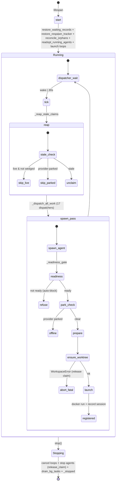

## Purpose
The AgentOrchestrator is the runtime brain of RoboCo: it owns the per-agent Docker container lifecycle, the per-tick dispatcher that matches tasks to agents, the stale-claim reaper, the provider rate-limit/overload park-and-probe recovery loop, and the default-off background engines (self-heal, CI-watch, dep-update, release-manager, strategy, external-PR poll, X-engine mentions poll, board roadmap engine, video render loop). It claims tasks on behalf of agents before spawning, injects briefings/manifests/git context at spawn time, provisions a per-spawn sandbox (postgres/redis/mongo via the engine registry) when opted in, captures per-session token usage, and persists durable runtime state (WaitingRecord, respawn_tracker) across restarts. Since the 2026-09-06 decomposition (`10b47ec9`) `roboco/runtime/orchestrator.py` keeps the module helpers and the composed `AgentOrchestrator` class (`__init__`, `start`, `stop` and class-scope state); every other method moved verbatim into one per-family mixin under `roboco/runtime/engines/`, which is why the Key Symbols below are named `AgentOrchestrator.<method>` but point into those files.

## Files

| Path | Role | LOC |
|---|---|---|
| roboco/runtime/orchestrator.py | Module helpers (system/agent API headers, workspace/worktree/cwd path formulas, manifest writer, dispatch predicates, prompt-block formatters) + the composed `AgentOrchestrator` class: its mixin bases, `__init__`, `start` (launches every loop), `stop`, and class-scope state. | 2333 |
| roboco/runtime/engines/_types.py | `AgentOrchestratorSelf`, a TYPE_CHECKING-only Protocol naming the full cross-mixin surface (`*args`/`**kwargs` stubs with real return types) so mypy checks each mixin against the whole composed class. | 351 |
| roboco/runtime/engines/_shared.py | `SharedEngine`: helpers every family uses (loop heartbeat, audit fire, background scheduling, repo key, one-project-per-key, uptime refresh, pause check, subtask fetch). | 215 |
| roboco/runtime/engines/spawn_launch.py | `SpawnLaunchEngine`: image ensure, spawn preflight + readiness gate, git-context resolution, worktree ensure, `spawn_agent`, docker run argument assembly (mounts, env, provider env, manifest, sandbox marker), `_spawn_container`. | 2120 |
| roboco/runtime/engines/spawn_config.py | `SpawnConfigEngine`: per-spawn settings/permissions, fable-mode hook groups, MCP config, composed system prompt + conventions ambient layer, agent briefing (incl. steering block). | 1320 |
| roboco/runtime/engines/spawn_exit.py | `SpawnExitEngine`: container exit handling, expected-stop breadcrumbs, waiting records, per-provider usage capture (Claude transcript, Grok/Codex/Gemini/Kimi/Hummin/OpenRouter/Nebius usage files) and final token/cost resolution. | 2715 |
| roboco/runtime/engines/dispatch_claim.py | `DispatchClaimEngine`: the `_dispatcher_loop`, task/notification fetch, spawn validation, parent-branch readiness, claim-in-flight bookkeeping, claim-and-spawn, the lane barrier, PM auto-submit (`_try_auto_submit`) and closure safety. | 1931 |
| roboco/runtime/engines/dispatch_work.py | `DispatchWorkEngine`: `_dispatch_all_work` and the per-family dispatchers (PM, board, Board Program explorations, dev, PM review, a2a, audit, revision coordination roots, PM closure). | 2508 |
| roboco/runtime/engines/dispatch_prompts.py | `DispatchPromptsEngine`: the dev's spawn prompt (`_get_prompt_for_agent` role routing, workflow state and instructions, the open-findings and revision-bounced blocks, the video block, the B38 submit-now veto); `DevPromptContextEngine`: the task history it carries (B30 context pruning, the B33 delta brief); `CellReviewPromptsEngine`: QA, PR review, the in-path PR gate, the DevOps gate and the documenter. | 906 |
| roboco/runtime/engines/dispatch_prompts_management.py | `ManagementPromptsEngine`: Main and Cell PM triage, PM review, closure and blocker prompts, the board and marketing prompts; `NotificationPromptsEngine`: the escalation, approval and A2A prompts. | 551 |
| roboco/runtime/engines/dispatch_prompts_programs.py | The Board Programs' one-shot prompts by owner: `ProductOwnerProgramPromptsEngine` (Roadmap, Pest Control, Scales, Spackle, Dogfood), `MarketingProgramPromptsEngine` (War Room, Mirror, feature spotlight, Periscope, Barfly, Megaphone) and `AuditorPromptsEngine` (Coroner, Sentinel, decisions audit, Librarian, the audit alert, vault curation). | 1121 |
| roboco/runtime/engines/dispatch_routing.py | `DispatchRoutingEngine`: task routing classification (keyword/type/cell), routing-target resolution, stranded-code-task PM, review-PM and blocker-resolver slugs. | 436 |
| roboco/runtime/engines/dispatch_breaker.py | `DispatchBreakerEngine`: notification-spawn cooldown/cap, PM-respawn circuit breaker + durable persist, Grok/Gemini cost budget, gateway-health probe and recovery, wedged/stuck container kills, the stale-claim reaper. | 1944 |
| roboco/runtime/engines/sweeps.py | `SweepsEngine`: `_sweeper_loop` and its sweeps (token snapshots, daily rollup, member performance, superseded PRs, umbrella reconcile, dangling images, transcript retention, task budgets), `stop_agent`, interactive-session reaping. | 2870 |
| roboco/runtime/engines/reconcile.py | `ReconcileEngine`: startup restore (waiting records, respawn tracker), orphan claim/spawn-session reconcile, readopting running containers, stale agent token heal, `_health_loop`, and the Board Program loop. | 663 |
| roboco/runtime/engines/rate_limit_probe.py | `RateLimitProbeEngine`: `resolve_wait`, provider park/lift stamping, resume liveness confirmation, `_rate_limit_probe_loop` and its probe success/failure handling, CEO rate-limit notification. | 528 |
| roboco/runtime/engines/interactive_sessions.py | `InteractiveSessionsEngine`: intake and secretary sessions (start/spawn/relay, scope cloning, host paths, run command), live-provider images, auth and MCP config, per-provider usage dirs. | 1519 |
| roboco/runtime/engines/video_render.py | `VideoRenderEngine`: `_video_render_loop`, rendering both cuts of a video task, failure notification, materializing the held `video_post`. | 273 |
| roboco/runtime/engines/vault.py | `VaultEngine`: vault asset ensure at startup + the vault intake, janitor and KB loops. | 126 |
| roboco/runtime/engines/ci_watch.py | `CiWatchEngine`: `_ci_watch_loop` (dormant unless `ci_watch_enabled`), the watch set (one per repo/workflow), effective workflow. | 111 |
| roboco/runtime/engines/dep_update.py | `DepUpdateEngine`: `_dep_update_loop` and its opted-in project set. | 95 |
| roboco/runtime/engines/release_manager.py | `ReleaseManagerEngine`: `_release_manager_loop` / `_run_release_manager_cycle`, and also `_self_heal_loop`. | 90 |
| roboco/runtime/engines/strategy.py | `StrategyEngine`: `_strategy_engine_loop`, its failure-tracking state and the one-shot CEO failure alert. | 90 |
| roboco/runtime/engines/env_sync.py | `EnvSyncEngine`: `_env_sync_loop` (dormant unless `env_sync_enabled`) cascading each opted-in project's environment ladder prod to head, one project per repo. | 87 |
| roboco/runtime/engines/telegram_poll.py | `TelegramPollEngine`: `_telegram_poll_loop` / `_run_telegram_poll_cycle`. | 61 |
| roboco/runtime/engines/x_mentions.py | `XMentionsEngine`: `_x_mentions_poll_loop` / `_run_x_mentions_cycle`. | 54 |
| roboco/runtime/engines/decisions_labeler.py | `DecisionsLabelerEngine`: `_decisions_labeler_loop` / `_run_decisions_labeler_cycle`. | 54 |
| roboco/runtime/engines/entire_trails.py | `EntireTrailsEngine`: `_entire_trails_loop` / `_run_entire_trails_pass` (the Entire trails drain). | 51 |
| `roboco/services/uptime.py` | Fleet active-time clock from `dispatcher.alive` audit rows: derives downtime windows (heartbeat gaps and dispatch-paused stretches), clips them to the process's own running-since mark, and subtracts their union from wall-clock time; feeds the engines' `_refresh_uptime`, notification re-escalation and the task stall sweeps | 320 |
| `roboco/runtime/compose_labels.py` | Discovers the orchestrator's own Docker Compose project once per process and returns the `--label` argv every sibling container (agent spawns, intake/secretary chats, sandbox sidecars) carries, so `docker compose down` removes them with the stack and `up -d` never resurrects them | 218 |
| `roboco/utils/docker_env.py` | Moves `docker run -e NAME=value` values out of the docker CLI argv into its environment (`-e NAME`), so agent tokens, provider keys and the test-DB password never show in `/proc/<pid>/cmdline`; used by every spawn path | 70 |
| `roboco/utils/docker_subcommands.py` | `DOCKER_SUBCOMMANDS`: every docker CLI subcommand RoboCo runs, management commands with their verb (`container inspect`); exact both ways, enforced by `tests/unit/utils/test_docker_runs_only_listed_subcommands.py` | 45 |

## Key Symbols

| Name | Kind | File:Line | Responsibility |
|---|---|---|---|
| _system_api_headers | function | roboco/runtime/orchestrator.py:253 | System-identity headers (X-Agent-ID/Role/Token) for the orchestrator's internal self-API calls so silent recovery ops pass auth-required. |
| _is_coordination_task | function | roboco/runtime/orchestrator.py:839 | True for branchless tasks (product fan-out, ad-hoc cell map, MegaTask umbrella) via is_branchless_coordination; gates git-exemption sites. |
| _branch_is_expected | function | roboco/runtime/orchestrator.py:872 | True iff a code task should already have a branch_name (claimed/in_progress/verifying, non-coordination); gates the missing-branch readiness/stuck condition. |
| _agent_worktree_path | function | roboco/runtime/orchestrator.py:917 | Per-task worktree path under the clone root (F123) so parallel roots/tasks never clobber one shared checkout. |
| _agent_cwd_path | function | roboco/runtime/orchestrator.py:931 | ONE formula for the container cwd + Edit/Write allowlist scope (worktree when branch present, else clone root) so -w and the allowlist never drift. |
| _build_manifest_for_agent | function | roboco/runtime/orchestrator.py:1005 | Write the per-role gateway SpawnManifest JSON to disk and return the host bind-mount path; None for non-gateway roles. |
| AgentReadinessError | class | roboco/runtime/orchestrator.py:1075 | Raised when spawn_agent refuses (task not ready / human role / worktree fatal); caller logs and moves on. |
| _SpawnAbortedDuringShutdown | class | roboco/runtime/orchestrator.py:1083 | Signals a non-blocking intake/secretary spawn completed docker run after shutdown began; raiser already removed the container. |
| AgentOrchestrator.__new__ | method | roboco/runtime/orchestrator.py:1442 | Pre-initialize `_instances = {}`, `_last_audit_spawn_at = None`, and `_notification_spawn_at = {}` so tests/helpers that construct an orchestrator via bare `AgentOrchestrator.__new__(...)` to bypass `__init__` do not crash when `_is_agent_active`, `_dispatch_audit_work`, or notification-cooldown paths read those attributes. `__init__` still re-initializes `_instances` for normal construction. |
| AgentOrchestrator.__init__ | method | roboco/runtime/orchestrator.py:1462 | Initialize instance/waiting/bg-task registries, locks (dispatch, supersede, intake/secretary spawn, respawn-persist), TTLs from settings, grok backoff state. |
| AgentOrchestrator.start | method | roboco/runtime/orchestrator.py:1756 | Ensure agent image, restore WaitingRecord + respawn_tracker, reconcile orphan claims, readopt running containers, launch all background loops. |
| AgentOrchestrator.stop | method | roboco/runtime/orchestrator.py:1928 | Idempotent shutdown: cancel loops, stop agents (release_claim=True, skip provider-parked), drain bg writes, set _stopped. |
| AgentOrchestrator._drain_bg_tasks | method | roboco/runtime/orchestrator.py:1873 | Bounded wait for fire-and-forget bg writes to commit before exit; cancels past _SHUTDOWN_DRAIN_TIMEOUT_SECONDS. |
| AgentOrchestrator._ensure_agent_image | method | roboco/runtime/engines/spawn_launch.py:104 | Build/pull base + role-specialized agent Docker images; idempotent; registry-mode pulls pre-built images. |
| AgentOrchestrator._get_role_permissions | method | roboco/runtime/engines/spawn_config.py:57 | Build the Edit/Write/Read allowlist scoped to the agent's cwd (worktree or clone root) and cell workspace for documenters. |
| AgentOrchestrator._fable_hook_groups | method | roboco/runtime/engines/spawn_config.py:181 | Default-off (`fable_mode_enabled`) Claude-path hook groups for 5 vendored fable-mode scripts (stop-gate/bash-discipline/honesty-nudge/prompt-nudge/precompact); appended AFTER RoboCo's own per-event hooks inside `_generate_agent_settings`. |
| AgentOrchestrator._task_git_context | method | roboco/runtime/engines/dispatch_claim.py:53 | Build SpawnGitContext from a task payload; sets task_short_id (first 8 chars) only when a branch exists. |
| AgentOrchestrator._prepare_agent_spawn | method | roboco/runtime/engines/spawn_launch.py:365 | Resolve project/team/cwd, ensure worktree, generate settings/permissions, write briefing + MCP config, compose prompt, ensure image, register STARTING instance. |
| AgentOrchestrator._ensure_worktree_before_spawn | method | roboco/runtime/engines/spawn_launch.py:466 | Idempotently re-attach a pruned task worktree before -w lands on it; fatal WorkspaceError releases claim + aborts, transient aborts without release. |
| AgentOrchestrator.spawn_agent | method | roboco/runtime/engines/spawn_launch.py:703 | Chokepoint spawn entry: validate path-segment, refuse human-only roles, readiness gate, resolve git context, provider-park pre-check, TOCTOU re-check, prepare + launch. |
| AgentOrchestrator._resolve_host_paths | method | roboco/runtime/engines/spawn_launch.py:821 | Compute host bind-mount paths for containerized vs host runtime (docs/workspaces/claude/mcp/grok-usage/prompt/settings/briefing). |
| AgentOrchestrator._spawn_container | method | roboco/runtime/engines/spawn_launch.py:1349 | Run the Claude Code SDK container via docker with all mounts/env/manifest/cwd args; returns container id. |
| AgentOrchestrator._generate_mcp_config | method | roboco/runtime/engines/spawn_config.py:567 | Write the per-agent MCP servers config (flow/do/git-readonly/optimal/docs) to disk and return the path; delegates the role-scoped extras to `_append_role_scoped_mcp_servers`. |
| AgentOrchestrator._append_role_scoped_mcp_servers | method | roboco/runtime/engines/spawn_config.py:734 | Registers `roboco-docs` (documenter/PM/board roles), `roboco-search` (Board+PM roles, `research_enabled`), and `playwright` — role-gated via `agent_role == "qa"` + team in `{frontend, ux_ui}` (`fe-qa`/`ux-qa`), OR a `video_authoring=True` caller flag (a ux-dev spawned onto a `source=video` task, probed by `_is_video_authoring_spawn`) — `command: /app/scripts/playwright-mcp-entrypoint.sh`, no args (the wrapper resolves the image's own baked `chromium-headless-shell`). Not image-gated either way: `agent-ux`'s image bakes the binary for both the QA and the video-authoring-dev cases, but an ordinary (non-video) `ux-dev` still never sees it. Split out of `_generate_mcp_config` to keep it under the xenon complexity budget. |
| AgentOrchestrator._is_video_authoring_spawn | method | roboco/runtime/engines/spawn_launch.py:1415 | Fail-closed spawn-time probe (`fd621f0d`, PR #544): true only when `agent_role == "developer"`, `get_agent_team(agent_id) == "ux_ui"`, and the spawning task's `source == VIDEO_SOURCE`; any lookup error is caught and logged, returning `False` (no browser, never a broken spawn). Feeds `_append_role_scoped_mcp_servers`'s `video_authoring` flag via `_generate_mcp_config`'s new `task_id` param. |
| AgentOrchestrator._generate_composed_prompt | method | roboco/runtime/engines/spawn_config.py:821 | Compose the spawn prompt (identity + task briefing + ambient conventions block + tool-load block) via compose_prompt. |
| AgentOrchestrator._resolve_conventions_ambient | method | roboco/runtime/engines/spawn_config.py:873 | Resolve the in-scope projects for the ambient architectural-conventions block (single repo / product / ad-hoc cell map). |
| AgentOrchestrator._readiness_gate | method | roboco/runtime/engines/spawn_launch.py:1478 | Pre-flight refusal: missing project/cell-map, missing AC, role/status mismatch, missing git token, bad task shape, unmet dependencies. |
| AgentOrchestrator._build_mount_args | staticmethod | roboco/runtime/engines/spawn_launch.py:903 | Compose the `docker run -v/-e` mount + env argv for an agent: `--name`, `--network AGENT_NETWORK`, `--add-host host.docker.internal:host-gateway`, Claude auth/JSON mounts, optional host mounts, then role-scoped core volumes + env via `_core_volume_and_env_args`. The `--add-host host.docker.internal:host-gateway` (PR #705, task `5cc75f71`) lets spawned containers resolve `host.docker.internal` so the eval harness's disposable orchestrator (bound `0.0.0.0` on the host) is reachable via `host.docker.internal:<port>` — **production-inert**: prod MCP servers use `http://roboco-orchestrator:8000` (the container hostname), never `host.docker.internal`. Docker 20.10+ (May 2021) supports `host-gateway` on Linux. Added unconditionally (simpler than threading `spawned_by="eval_bench"` through); no production spawn observes it. |
| AgentOrchestrator._write_agent_briefing | method | roboco/runtime/engines/spawn_config.py:1112 | Fetch task + institutional memory + workflow state and render the per-agent briefing markdown at the cwd path. |
| AgentOrchestrator.start_intake_session | method | roboco/runtime/engines/interactive_sessions.py:621 | Open the intake relay + schedule the guarded spawn of the single persistent intake container. |
| AgentOrchestrator._spawn_intake_container | method | roboco/runtime/engines/interactive_sessions.py:724 | Spawn the intake container under _intake_spawn_lock: clone intake scope, build cmd, run, abort-if-shutdown, register instance, record usage session. |
| AgentOrchestrator._spawn_secretary_container | method | roboco/runtime/engines/interactive_sessions.py:944 | Spawn the secretary container under _secretary_spawn_lock with authenticated identity env; same abort-if-shutdown shape as intake. |
| AgentOrchestrator._reap_idle_interactive_sessions | method | roboco/runtime/engines/sweeps.py:88 | Reap idle intake/secretary containers past interactive_idle_reap_seconds. |
| AgentOrchestrator._clone_intake_scope | method | roboco/runtime/engines/interactive_sessions.py:1159 | Clone the intake chat's project/product/multi-project scope into the intake workspace; returns cwd + cloned slug list. |
| AgentOrchestrator.stop_agent | method | roboco/runtime/engines/sweeps.py:191 | Stop a container; release_claim=True hands the claimed task back to the pool now (skips provider-parked); finalizes usage session. |
| AgentOrchestrator._release_stopped_agent_claim | method | roboco/runtime/engines/sweeps.py:304 | Idempotent unclaim_for_reaper on a stopped agent's task; best-effort, reaper backstops. |
| AgentOrchestrator._persist_respawn_record | method | roboco/runtime/engines/dispatch_breaker.py:294 | Atomic ON CONFLICT DO UPDATE upsert of one respawn_tracker row under _respawn_persist_lock so commits land in logical schedule order. |
| AgentOrchestrator._record_spawn_session | method | roboco/runtime/engines/spawn_launch.py:1768 | Insert an agent_spawn_sessions row + pin its id on the instance for usage attribution. |
| AgentOrchestrator._finalize_spawn_session | method | roboco/runtime/engines/spawn_exit.py:1117 | Resolve final token usage (Claude transcript or grok usage.json), update the spawn session row, publish USAGE_SNAPSHOT, evict instance. |
| AgentOrchestrator._sweep_token_snapshots | method | roboco/runtime/engines/sweeps.py:493 | Periodic live-usage snapshot sweep across active agents; finalizes stopped ones; budget-exceeded termination. |
| AgentOrchestrator._enforce_grok_cost_budget | method | roboco/runtime/engines/dispatch_breaker.py:389 | Kill live grok containers whose captured cost exceeds grok_max_cost_usd; release_claim=True. |
| AgentOrchestrator.restore_waiting_records | method | roboco/runtime/engines/reconcile.py:72 | Repopulate _waiting_records from the WaitingRecordTable at startup. |
| AgentOrchestrator.restore_respawn_tracker | method | roboco/runtime/engines/reconcile.py:155 | Repopulate _pm_respawn_tracker from respawn_tracker rows, re-stamping last_check/last_status to live values, evicting terminal/missing rows. |
| AgentOrchestrator._partition_respawn_rows | method | roboco/runtime/engines/reconcile.py:108 | Split restored respawn rows into restorable vs evict (terminal/missing task). |
| AgentOrchestrator.resolve_wait | method | roboco/runtime/engines/rate_limit_probe.py:65 | Resume a waiting agent: respawn FIRST then tear down the record only once a container launched (keeps record through a provider re-park bail). |
| AgentOrchestrator._health_loop | method | roboco/runtime/engines/reconcile.py:578 | Periodic _check_health pass over all instances. |
| AgentOrchestrator._sweeper_loop | method | roboco/runtime/engines/sweeps.py:1092 | Periodic _run_sweep: superseded PRs, dangling images, transcript retention, budget exceeded. |
| AgentOrchestrator._check_health | method | roboco/runtime/engines/reconcile.py:589 | Per-agent docker container inspect; on exit, route through _maybe_park_for_exit_error / _crash_retry_or_escalate / _handle_stopped_container. |
| AgentOrchestrator._inspect_container_state | method | roboco/runtime/engines/spawn_exit.py:1403 | docker container inspect with _DOCKER_INSPECT_TIMEOUT_SECONDS; returns (is_running, exit_code); per-agent failure skips that agent. |
| AgentOrchestrator._resolve_container_id | method | roboco/runtime/engines/reconcile.py:201 | Resolve a container id by name for re-adoption so _check_health sees the real id. |
| AgentOrchestrator._probe_gateway_health | method | roboco/runtime/engines/dispatch_breaker.py:452 | Out-of-band docker exec gateway-venv import probe for broken-but-alive agents; timed via _DOCKER_EXEC_TIMEOUT_SECONDS. |
| AgentOrchestrator._maybe_park_for_exit_error | method | roboco/runtime/engines/spawn_exit.py:1436 | Detect session-limit/overload markers in dead container output + transcript tail; park provider instead of crash-retrying. |
| AgentOrchestrator._maybe_recover_broken_gateway | method | roboco/runtime/engines/dispatch_breaker.py:854 | Kill + evict a broken-but-alive agent past gateway_health_grace_seconds so it falls through to release + respawn. |
| AgentOrchestrator._strategy_engine_loop | method | roboco/runtime/engines/strategy.py:25 | Default-off strategy engine tick loop (gated by strategy_engine_enabled). |
| AgentOrchestrator._external_pr_poll_loop | method | roboco/runtime/engines/sweeps.py:2442 | Poll inbound external PRs for review (external_pr_enabled / internal_pr_enabled). |
| AgentOrchestrator._self_heal_loop | method | roboco/runtime/engines/release_manager.py:55 | Single-repo self-heal CI-watch tick loop (self_heal_enabled). |
| AgentOrchestrator._ci_watch_loop | method | roboco/runtime/engines/ci_watch.py:23 | Multi-repo CI-watch tick loop (ci_watch_enabled); _load_ci_watch_set one per (repo, workflow). |
| AgentOrchestrator._dep_update_loop | method | roboco/runtime/engines/dep_update.py:23 | Dependency-update bot tick loop (dep_update_enabled); _load_dep_update_set one per (repo, command). |
| AgentOrchestrator._release_manager_loop | method | roboco/runtime/engines/release_manager.py:23 | Gated release-manager readiness sweep tick loop (release_manager_enabled). |
| AgentOrchestrator._projects_one_per_key | method | roboco/runtime/engines/_shared.py:119 | Collapse projects to one canonical (by slug) per distinct key (repo / (repo,workflow) / (repo,command)). |
| AgentOrchestrator._rate_limit_probe_loop | method | roboco/runtime/engines/rate_limit_probe.py:266 | Probe parked providers every 30s; resume waiting agents on success; orphan-provider fallback for untracker-listed parks. |
| AgentOrchestrator._provider_spawn_parked | method | roboco/runtime/engines/spawn_launch.py:1840 | True when the provider is currently rate-limited/overloaded parked (spawn short-circuit). |
| AgentOrchestrator._park_provider_unavailable | method | roboco/runtime/engines/spawn_exit.py:2161 | Park an agent + provider: stop container, register rate_limit_lifted WaitingRecord, persist it, activate tracker. |
| AgentOrchestrator._park_grok_rate_limited | method | roboco/runtime/engines/spawn_exit.py:2340 | Park a grok agent on xAI 429 (exit 75) with exponential re-park backoff within one episode. |
| AgentOrchestrator._park_grok_auth_unavailable | method | roboco/runtime/engines/spawn_exit.py:2375 | Park a grok agent on missing/expired auth token (exit 78). |
| AgentOrchestrator._on_probe_failure | method | roboco/runtime/engines/rate_limit_probe.py:345 | Count failed probes; CEO-notify once at threshold; past _PROBE_GIVE_UP_THRESHOLD fall back to time-expiry optimism (clear park + resume). |
| AgentOrchestrator._readopt_running_agents | method | roboco/runtime/engines/reconcile.py:500 | At startup, re-adopt surviving containers into _instances as ACTIVE with real container ids; inert when nothing runs. |
| AgentOrchestrator._should_skip_live_reap | method | roboco/runtime/engines/dispatch_breaker.py:917 | Spare a live container from reaping UNLESS wedged (grok) or gateway-broken past grace (those kill+evict). |
| AgentOrchestrator._assignee_is_provider_parked | method | roboco/runtime/engines/dispatch_breaker.py:674 | True if a task's assignee is provider-parked; reaper skips it so the claim survives for probe-resume. |
| AgentOrchestrator._reap_with_service | method | roboco/runtime/engines/dispatch_breaker.py:938 | Inner stale-claim reaper: skip live (unless wedged/broken), skip provider-parked, unclaim_for_reaper the rest. |
| AgentOrchestrator._sandbox_available_services | method | roboco/runtime/engines/sweeps.py:2301 | On-demand model (2026-07-08): availability probe only — which services this spawn's project opted into (`sandbox_db_enabled` + `sandbox_services`); `[]` if off/not-opted, byte-for-byte legacy path. No provisioning happens here anymore (see `ensure_sandbox`), so a spawn never fails on sandbox infra. |
| AgentOrchestrator.ensure_sandbox | method | roboco/runtime/engines/sweeps.py:2329 | On-demand model: idempotent provision called by the `request_sandbox` do-verb. Cache hit (`_sandbox_info`, keyed by agent slug) covering the requested services returns the same creds; a miss provisions via `SandboxProvisioner.provision` (pre-clear tears down stale same-named containers) and caches the result. Evicted at teardown and by the janitor sweep; in-memory only — an orchestrator restart forgets it (next call re-provisions). |
| AgentOrchestrator._append_sandbox_marker_env | staticmethod | roboco/runtime/engines/spawn_launch.py:1185 | On-demand model: replaces the old eager `_append_sandbox_env` — injects only a cheap informational marker (`ROBOCO_SANDBOX_SERVICES_AVAILABLE=<csv>`), never creds, naming the services `request_sandbox()` will provision on demand. Called INSTEAD OF `_append_gate_env` for an opted-in project's spawn. |
| AgentOrchestrator._sandbox_janitor_sweep | method | roboco/runtime/engines/sweeps.py:2423 | Best-effort: remove sandbox containers whose owner agent is gone; rides the reaper tick, error-isolated. |
| AgentOrchestrator._x_mentions_poll_loop | method | roboco/runtime/engines/x_mentions.py:23 | Default-off X-engine mentions-poll tick loop (`x_engine_enabled`); release-post drafts are event-driven, not from this loop. |
| AgentOrchestrator._run_x_mentions_cycle | method | roboco/runtime/engines/x_mentions.py:47 | One mentions-poll pass: `get_x_engine(db).run_cycle()` + commit; testable without the sleep. |
| AgentOrchestrator._board_program_loop | method | roboco/runtime/engines/reconcile.py:616 | Board Program tick loop (replaced the bespoke `_roadmap_engine_loop` / `_x_feature_spotlight_loop`): always ticks and originates a cycle for every enabled, due program; each program's own enablement (settings-store override, else its legacy flag) is checked per tick inside `BoardProgramEngine`. |
| AgentOrchestrator._board_program_interval_seconds | method | roboco/runtime/engines/reconcile.py:643 | Loop wake-up floor: the shortest registered program cadence, clamped to 300-3600 s; the engine's per-program due-check still reads the live interval override. |
| AgentOrchestrator._run_board_program_cycle | method | roboco/runtime/engines/reconcile.py:656 | One pass: `get_board_program_engine(db).run_due_programs()` + commit; testable without the sleep. |
| AgentOrchestrator._dispatch_roadmap_exploration | method | roboco/runtime/engines/dispatch_work.py:268 | One-shot Product-Owner spawn to author a themed roadmap cycle; bypasses the two-reviewer board-review-pair machinery (PO-solo in v1). |
| AgentOrchestrator._dispatch_feature_spotlight_exploration | method | roboco/runtime/engines/dispatch_work.py:663 | One-shot Head-of-Marketing spawn to investigate + call `propose_feature_spotlight` once; `_dispatch_pm_work` routes `source=x_feature_exploration` to it before the generic board-review check, mirroring the roadmap source's own early branch. |
| AgentOrchestrator._build_feature_spotlight_prompt | method | roboco/runtime/engines/dispatch_prompts_programs.py:519 | Render the one-shot feature-spotlight exploration prompt (investigate CHANGELOG/flags/docs/charter/KB, call `propose_feature_spotlight` once, then `i_am_idle`). |
| AgentOrchestrator._dispatch_all_work | method | roboco/runtime/engines/dispatch_work.py:63 | Reset tick-handled set, reap stale claims, enforce grok budget, run all 18 dispatchers (added `vault_curation_work`) under one httpx client with per-dispatcher isolation. |
| AgentOrchestrator._dispatch_vault_curation_work | method | roboco/runtime/engines/dispatch_work.py:1395 | Obsidian-vault root-completion hook (`obsidian_vault_enabled`): reads `TaskService.list_completed_roots_pending_vault_curation` and spawns the Auditor once per candidate via `_maybe_spawn_vault_curation`. Owns only this trigger — distinct from `_dispatch_audit_work`'s scheduled sweeps. |
| AgentOrchestrator._maybe_spawn_vault_curation | method | roboco/runtime/engines/dispatch_work.py:1418 | One-shot Auditor spawn for one completed root: `_board_dispatched` in-memory one-shot guard + a durable `vault_curation_dispatched` marker (survives a restart) before spawning WITHOUT a bound task_id (mirrors `_dispatch_audit_work`'s alert spawn — the root is already `completed`, binding would trip the readiness gate) — the task id is named in the prompt, `curate_vault` takes it as an explicit argument. |
| AgentOrchestrator._vault_intake_loop | method | roboco/runtime/engines/vault.py:36 | Default-off tick loop (BOTH `obsidian_vault_enabled` AND `vault_intake_enabled`); calls `_run_vault_intake_cycle` → `VaultIntakeEngine.run_cycle()` every `vault_intake_interval_seconds`. |
| AgentOrchestrator._vault_janitor_loop | method | roboco/runtime/engines/vault.py:66 | V2: gated on `obsidian_vault_enabled` alone; ticks hourly (`JANITOR_LOOP_INTERVAL_SECONDS`, no config knob) calling `_run_vault_janitor_cycle` → `VaultJanitor.run_cycle()`, which itself only does real work when a `RoboCo/_meta/.janitor_state.json` state file says a sweep/report is actually due. |
| AgentOrchestrator._vault_kb_loop | method | roboco/runtime/engines/vault.py:98 | V2: gated on BOTH `obsidian_vault_enabled` AND `vault_kb_enabled`; ticks every `vault_kb_interval_seconds` (default 900) calling `_run_vault_kb_cycle` → `VaultKBEngine.run_cycle()`, embedding changed `RoboCo/Notes` notes into `IndexType.VAULT_NOTES`. |
| AgentOrchestrator._telegram_poll_loop | method | roboco/runtime/engines/telegram_poll.py:23 | Telegram V2: gated on BOTH `telegram_enabled` AND `telegram_inbound_enabled`; sleeps `telegram_poll_interval_seconds` (a floor between long-poll re-issues, not the effective latency — each `getUpdates` call itself blocks server-side up to `telegram_poll_timeout_seconds`) then calls `_run_telegram_poll_cycle` → `TelegramInboundEngine.run_cycle()`. |
| AgentOrchestrator._run_telegram_poll_cycle | method | roboco/runtime/engines/telegram_poll.py:54 | One Telegram poll pass: `get_telegram_inbound_engine(db).run_cycle()` + commit; testable without the sleep. |
| AgentOrchestrator._entire_trails_loop | method | roboco/runtime/engines/entire_trails.py:22 | Entire trails drain: dormant unless `entire_trails_enabled`; every `entire_trails_drain_interval_seconds` runs `_run_entire_trails_pass`, heartbeat `entire_trails`; a failed pass is logged, never ends the loop. |
| AgentOrchestrator._run_entire_trails_pass | method | roboco/runtime/engines/entire_trails.py:44 | One pass: `roboco.services.entire_trails.drain.drain_due()` (reconcile, then drain every due tree). |
| AgentOrchestrator._pending_claim_blocked | method | roboco/runtime/engines/dispatch_claim.py:671 | Dispatch-time probe reusing `TaskService.is_pending_claim_blocked` (the exact claim-gate predicate — dependency OR sequence) so `_route_unassigned_pm_task` (called from `_dispatch_pm_work` per PENDING coordination-root task) can filter a doomed later-wave/sequence-held task before attempting the raw claim, instead of one failed claim per tick. Fails open (False) on any lookup error — the claim attempt itself is the safety net. |
| AgentOrchestrator._pm_respawn_should_gate | method | roboco/runtime/engines/dispatch_breaker.py:1562 | Per-(slug,task) respawn circuit breaker; tracing_gap rule-following resets (bounded) + durable persist; CEO notify once when tripped. |
| AgentOrchestrator._notification_spawn_cooled | coroutine | roboco/runtime/engines/dispatch_breaker.py:79 | Cross-tick cooldown for notification-triggered spawns (escalation/approval/audit/a2a): one spawn per (agent, notification) per `notification_spawn_cooldown_seconds`; `0` disables (legacy every-tick respawn). Promoted sync→async (task 4e7f64c4) so it can `await` the cap-trip notify below; all 5 call sites now `await` it. |
| AgentOrchestrator._notification_spawn_over_cap | coroutine | roboco/runtime/engines/dispatch_breaker.py:121 | Hard per-(agent, notification) attempt cap (`notification_spawn_max_attempts`, default 5) — the notification-driven analogue of the PM respawn breaker; these dispatchers carry no `task_id` so that breaker never sees them. Past the cap, stop respawning, log once, AND (task 4e7f64c4) fire a one-shot CEO notification via `_notify_notification_spawn_capped` — parity with `_pm_respawn_should_gate`'s own CEO notify, which this path lacked before; the count is id-scoped and survives map pruning. |
| AgentOrchestrator._notify_notification_spawn_capped | coroutine | roboco/runtime/engines/dispatch_breaker.py:157 | New (task 4e7f64c4). Best-effort one-shot CEO alert at the `_notification_spawn_over_cap` trip, mirroring `_notify_stuck_agent`'s pattern: local `NotificationService` import, calls `send_notification_spawn_cap_notification` (`docs/map/notification.md`) keyed on `(agent_slug, notification_id)` — there's no `task_id` on this path — inside a try/except that logs+swallows any failure so a notify error never breaks the caller. |
| AgentOrchestrator._prune_notification_spawn_maps | method | roboco/runtime/engines/dispatch_breaker.py:183 | Evict `_notification_spawn_at` entries older than a cutoff so the in-memory cooldown map doesn't grow unbounded. |
| AgentOrchestrator._notification_has_live_work | coroutine | roboco/runtime/engines/dispatch_breaker.py:194 | Live-work check before spawning a notification's recipient: skip when the notification has expired, is stale past `notification_spawn_max_age_seconds` (default 6h — wedged or reloaded from before a restart), its related task is already terminal, **or (since #685) the related task is HITL-blocked** (`_is_hitl_blocked`) — closes the admin-route escalation side of the oscillation loop the same way the dev/PM dispatchers' own HITL skip does. |
| AgentOrchestrator._is_hitl_blocked | staticmethod | roboco/runtime/engines/dispatch_claim.py:1163 | `status == "blocked" and blocker_resolver_type == "human"` over the WIRE task dict; consulted by `_dev_dispatch_one`, `_dispatch_claimed_without_agent`, and `_notification_has_live_work`. Only actually fires over the wire since #685 stamped `TaskResponse.blocker_resolver_type` — before that the field never serialized, so every wire-dict HITL check silently no-op'd regardless of the in-process row. Budget-breach (#654) and the task-scoped oscillation breaker (#685) both set this same resolver+status pair, so one skip covers both trip conditions. |
| AgentOrchestrator._dispatch_claimed_without_agent | coroutine | roboco/runtime/engines/dispatch_work.py:2284 | Re-dispatches a `claimed` task whose owning agent isn't running; the RESTORED side of an escalate/unblock round trip (no per-(agent,task) respawn counter of its own) — gated by `_is_hitl_blocked` (#685) so an oscillation-tripped or budget-blocked task stops being re-dispatched here too. |
| AgentOrchestrator._fetch_budget_status | coroutine | roboco/runtime/engines/sweeps.py:1503 | `ROBOCO_TASK_BUDGETS_ENABLED` sweep helper: live-priced spend snapshot for one active task (closed sessions' `estimated_cost_usd` + open sessions priced from token snapshots). |
| AgentOrchestrator._task_budget_breach | coroutine | roboco/runtime/engines/sweeps.py:1535 | `(spend, cap)` tuple when a task's own spend exceeds its `budget_usd` via `effective_task_budget_usd`, else `None`. **Explicit-input only since #666**: a null `budget_usd` resolves to `None` (no cap) — the earlier per-`TaskType` default table (which blocked an unbudgeted coordination root one opus planning turn in) was removed. |
| AgentOrchestrator._handle_task_budget_breach | coroutine | roboco/runtime/engines/sweeps.py:1575 | BLOCKs a breaching task (HUMAN resolver, a budget marker) BEFORE the graceful stop so the ensuing unclaim no-ops and the dispatcher never respawns onto it; notifies the CEO naming both recovery steps (raise the cap or `unblock`). |
| AgentOrchestrator._sweep_budget_exceeded | coroutine | roboco/runtime/engines/sweeps.py:1659 | Iterates active agents past `_check_budget_for_agent`; gated entirely by `ROBOCO_TASK_BUDGETS_ENABLED` — off, neither cap is ever consulted. |
| AgentOrchestrator._check_budget_for_agent | coroutine | roboco/runtime/engines/sweeps.py:1694 | Per-agent budget check called from the sweep; resolves the active task, checks breach, and calls `_handle_task_budget_breach`. |
| AgentOrchestrator._handle_pm_assigned_task | method | roboco/runtime/engines/dispatch_work.py:178 | Spawn/respawn the PM for an assigned coordination root subject to the respawn gate. |
| AgentOrchestrator._AUTO_SUBMIT_VERB_BY_ROLE | ClassVar[dict] | roboco/runtime/orchestrator.py:2289 | Wave-1 PR-gate turn cut: maps cell_pm -> (cell_pm, submit_up) and main_pm -> (main_pm, submit_root), the flow route+verb that assembles the parent's PR for each coordinator role. |
| AgentOrchestrator._auto_submit_target | method | roboco/runtime/engines/dispatch_claim.py:952 | Resolve (role, route, verb, pm_uuid) for an auto-submittable parent; None when the parent is branchless coordination (no PR to assemble), the role has no submit verb, or no PM identity resolves. Unconditional otherwise — no flag (the `pr_gate_auto_submit_enabled` kill-switch was removed post-0.19.0). |
| AgentOrchestrator._try_auto_submit | method | roboco/runtime/engines/dispatch_claim.py:1028 | PR-gate turn cut: run the owning PM's submit_up/submit_root verb system-side via the internal flow API (no PM spawn) when every child of an assembled parent is terminal; True on gate acceptance (fires `task.auto_submitted` audit + `_mark_task_handled`), False on ANY refusal (branchless parent, unmapped role, gate rejection, or transport error) so the caller falls back to the classic PM closure spawn with the refusal reason threaded into its prompt. |
| AgentOrchestrator._closure_handled_without_pm | method | roboco/runtime/engines/dispatch_claim.py:1106 | Recover an auto-paused/blocked parent's status first (so the next actor lands on an actionable in_progress parent), then try `_try_auto_submit`; True skips the PM closure spawn entirely. |
| AgentOrchestrator._maybe_spawn_pm_closure | method | roboco/runtime/engines/dispatch_work.py:1277 | If this parent task is ready for closure, try the system-side submit turn cut first (`_closure_handled_without_pm`); only spawn its PM when that declines (debounced via _is_recently_paused). |
| AgentOrchestrator._dispatch_dev_work | method | roboco/runtime/engines/dispatch_work.py:1471 | Fetch pending/needs_revision/in_progress/claimed code tasks and route each through _dev_dispatch_one. |
| AgentOrchestrator._dev_dispatch_one | method | roboco/runtime/engines/dispatch_work.py:1599 | Per-task dev dispatch: HITL skip, role/type mismatch guard, existing-owner respawn or pending spawn. |
| AgentOrchestrator._spawn_pending_dev | method | roboco/runtime/engines/dispatch_work.py:1506 | Validate + spawn a dev for a pre-assigned pending task; applies the per-dev lane barrier _blocked_by_earlier_lane_sibling. |
| AgentOrchestrator._blocked_by_earlier_sibling | method | roboco/runtime/engines/dispatch_claim.py:1379 | MERGE barrier: hold a higher-sequence same-team sibling's review/merge until earlier siblings land (shared cell branch ordering). |
| AgentOrchestrator._blocked_by_earlier_lane_sibling | method | roboco/runtime/engines/dispatch_claim.py:1453 | Per-dev LANE barrier: hold a dev's higher-sequence code leaf until its own lower-sequence code siblings under the same parent are terminal. Excludes transitively-dependent siblings via the shared pure predicate `roboco/foundation/policy/lane.py::transitive_dependents`, the same closure the service-layer claim-side mirror (`TaskService.has_earlier_incomplete_code_sibling`) applies, so the two barriers cannot drift. |
| AgentOrchestrator._dispatch_pm_review_work | method | roboco/runtime/engines/dispatch_work.py:2159 | Dispatch awaiting_pm_review to cell/main PM; applies _blocked_by_earlier_sibling; human-role skip + respawn gate. |
| AgentOrchestrator._dispatch_a2a_work | method | roboco/runtime/engines/dispatch_work.py:2453 | Spawn targets of unacknowledged a2a_request notifications; skips human-only roles (CEO/prompter/secretary). |
| AgentOrchestrator._dispatch_audit_work | method | roboco/runtime/engines/dispatch_work.py:2401 | Spawn the auditor on reactive HIGH-priority ALERT notifications or on a scheduled sweep when `ROBOCO_AUDIT_INTERVAL_SECONDS` has elapsed and recent delivery activity exists. |
| AgentOrchestrator._build_dev_prompt | method | roboco/runtime/engines/dispatch_prompts.py:311 | Render the dev spawn prompt with workflow state + instructions. |
| is_unattributed_delivery_spawn | function | roboco/runtime/orchestrator.py:800 | True when a delivery-role (developer/qa/documenter) spawn carries no task_id; warns on unattributed usage without noise from intentionally taskless roles. |
| AgentOrchestrator._flush_respawn_tracker | method | roboco/runtime/orchestrator.py:1899 | Unbounded flush of the full in-memory PM-respawn snapshot called after `_drain_bg_tasks` in `stop()` so a deadline-cancelled fire-and-forget persist can't leave the durable count lagging. |
| AgentOrchestrator._confirm_resume_liveness | method | roboco/runtime/engines/rate_limit_probe.py:182 | Tears down a resumed agent's WaitingRecord only after confirming the container is still alive past `_resume_confirm_delay` (30s); a container that dies immediately keeps its record for the probe-resume orphan fallback. |
| AgentOrchestrator._new_strategy_loop_state | method | roboco/runtime/engines/strategy.py:45 | Factory for `_StrategyLoopState` (consecutive-failure tracking for `_strategy_engine_loop`). |
| AgentOrchestrator._strategy_engine_cycle | method | roboco/runtime/engines/strategy.py:48 | One strategy-engine pass; resets the failure counter on success and CEO-notifies once per failure episode past `_STRATEGY_FAIL_CEO_NOTIFY_THRESHOLD`. |
| AgentOrchestrator._notify_strategy_engine_failure | method | roboco/runtime/engines/strategy.py:75 | Send one CEO alert that the strategy engine is persistently failing. |
| AgentOrchestrator._repo_key | method | roboco/runtime/engines/_shared.py:108 | Normalized repo identity (delegates to `converters.repo_key`): strips `.git`, trailing slash, lowercases — shared by the poll-set collapse and the DB dedupe queries so ci-watch/dep-update use one normalization. |
| AgentOrchestrator._agent_holds_live_claim | method | roboco/runtime/engines/reconcile.py:353 | True when a slug owns a non-terminal task; used by `_readopt_running_agents` to skip zombie containers whose claim was already released. |
| AgentOrchestrator._stuck_claude_slug | method | roboco/runtime/engines/dispatch_breaker.py:786 | Slug of an ACTIVE non-GROK container holding a task with heartbeat stale past `claude_stuck_kill_seconds`; None when not eligible. |
| AgentOrchestrator._maybe_kill_stuck_claude | method | roboco/runtime/engines/dispatch_breaker.py:823 | Kill + evict a stuck non-GROK container past `claude_stuck_kill_seconds` so the reaper can release its task; called from `_should_skip_live_reap`. |
| `UptimeLedger` | class | `roboco/services/uptime.py:249` | Loaded once per sweep (`load`), answers `downtime` / `active_elapsed` / `active_seconds` for any interval |
| `windows_from_heartbeats` | function | `roboco/services/uptime.py:162` | Downtime windows from ordered `(timestamp, dispatch_paused)` rows |
| `compose_label_args` | function | `roboco/runtime/compose_labels.py:197` | The `--label` argv for a sibling container of a service, empty when the orchestrator is not compose-managed |
| `docker_options_without_env_values` | function | `roboco/utils/docker_env.py:24` | Split `docker run` options into value-free argv and the env values |
| `docker_cli_env` | function | `roboco/utils/docker_env.py:68` | The docker CLI's environment: the orchestrator's own plus the moved values |
| `DOCKER_SUBCOMMANDS` | const | `roboco/utils/docker_subcommands.py:18` | Every docker CLI subcommand RoboCo runs; an inspect always names its object type |

## Data Flow
Inputs: the dispatcher loop polls the orchestrator's own HTTP API (httpx AsyncClient with _system_api_headers) for tasks by status (pending/awaiting_qa/blocked/awaiting_pm_review/...) and for notifications (a2a_request/escalation/approval/audit); it also reads Docker state (docker inspect/exec/run) and Redis (RateLimitStateTracker) and the DB (TaskTable, WaitingRecordTable, RespawnTrackerTable, GatewayTriggerTable, agent_spawn_sessions, daily_usage_rollups) via get_session_factory / get_db_context. Control: _dispatcher_loop ticks every dispatcher_interval (30s) or on _dispatch_wake.set() from API routes (trigger_dispatch). Each tick: _reap_stale_claims -> _enforce_grok_cost_budget -> 17 dispatchers in order, each fetching tasks and calling spawn_agent (or _spawn_assigned_qa / _spawn_pending_dev / etc.). spawn_agent: readiness gate -> resolve git context -> provider-park pre-check (cheap, via _resolve_agent_route + _provider_spawn_parked) -> self._lock TOCTOU re-check -> _prepare_agent_spawn (writes settings/permissions/briefing/MCP config/manifest, ensures worktree via WorkspaceService.ensure_worktree_for_resume, ensures image) -> _launch_spawn -> _safe_spawn -> _spawn_container (docker run) or provider (grok). Outputs: registered AgentInstance in _instances, agent_spawn_sessions row pinned for usage, audit_log agent.spawned event, container running with mounted manifest + briefing + cwd at the worktree. On container exit: _check_health reads docker inspect, _maybe_park_for_exit_error parks the provider on session-limit/overload markers (registering a rate_limit_lifted WaitingRecord + persisting it + activating the tracker), else _crash_retry_or_escalate / _handle_stopped_container; _finalize_spawn_session resolves tokens from the Claude transcript (/usage/sync) or grok usage.json, updates daily_usage_rollups, publishes USAGE_SNAPSHOT to /ws/system. Recovery: _rate_limit_probe_loop probes parked providers every 30s, on success _on_probe_success clears the tracker + resume waiting agents via resolve_wait (respawn FIRST, delete record only after a real launch). Durable state: _persist_respawn_record / _persist_waiting_record write through to DB under _respawn_persist_lock; restore_*_at startup repopulates the in-memory registries. Callers: the FastAPI lifespan (roboco/api/bootstrap) constructs and starts/stops the singleton; API routes call trigger_dispatch, spawn_agent, stop_agent, start_intake_session, spawn_secretary_session, supersede_external_pr, get_status_summary.

## Mermaid

## Logical Tree
- AgentOrchestrator
  - Startup (`start`): restore WaitingRecord + respawn_tracker → reconcile orphan claims → `_readopt_running_agents` → launch background loops
  - Dispatch: `_dispatch_all_work` (reap → grok budget → 17 dispatchers under one httpx client) ticked by `_dispatcher_loop` (30s or `_dispatch_wake.set()`); includes `_dispatch_audit_work` for reactive auditor ALERTs and scheduled sweeps
  - Spawn: `spawn_agent` chokepoint → `_readiness_gate` → provider-park pre-check → `_prepare_agent_spawn` (worktree/permissions/briefing/MCP/manifest) → `_safe_spawn` → `_spawn_container` or GrokCliProvider
  - Health/reaper: `_check_health` (docker inspect) → `_maybe_park_for_exit_error` | `_crash_retry_or_escalate` | `_handle_stopped_container`; `_reap_stale_claims` via `_should_skip_live_reap` + `_maybe_recover_broken_gateway`
  - Rate-limit/overload park-and-probe: `_park_provider_unavailable` (+ grok 75/78 variants) → `_rate_limit_probe_loop` (30s) → `_on_probe_success`/`_on_probe_failure` → `resolve_wait`
  - Gateway-health: `_probe_gateway_health` → `_gateway_broken_past_grace` → `_maybe_recover_broken_gateway` (kill+evict)
  - Respawn tracker: `_pm_respawn_should_gate` → `_persist_respawn_record` (durable upsert) + `restore_respawn_tracker` at startup
  - PM closure / PR-gate turn cut: `_maybe_spawn_pm_closure` → `_closure_handled_without_pm` (recover paused/blocked status) → `_try_auto_submit` (system-side submit_up/submit_root via `_AUTO_SUBMIT_VERB_BY_ROLE`, unconditional — no flag); only a gate refusal falls through to an actual PM spawn, with the refusal reason threaded into its prompt
  - Default-off loops: `_entire_trails_loop`, `_self_heal_loop`, `_ci_watch_loop`, `_dep_update_loop`, `_release_manager_loop`, `_strategy_engine_loop`, `_external_pr_poll_loop`, `_x_mentions_poll_loop`, `_board_program_loop` (always ticks; every program is default-off), `_telegram_poll_loop`
  - Interactive: `start_intake_session` / `_spawn_intake_container` / `_spawn_secretary_container` / `_reap_idle_interactive_sessions`
  - Shutdown (`stop`): cancel loops → `stop_agent(release_claim=True)` (skip provider-parked) → `_drain_bg_tasks` → `_stopped`

## Dependencies
- Internal: `roboco.config.settings`; `roboco.db.base.get_session_factory`; tables `RespawnTrackerTable`, `WaitingRecordTable`, `TaskTable`, `GatewayTriggerTable`, `agent_spawn_sessions`, `daily_usage_rollups`; `roboco.events.get_event_bus`; `roboco.llm.providers` (`ClaudeCodeProvider`, `GrokCliProvider`, `grok_auth`); `roboco.services.gateway` (`RateLimitStateTracker`, `role_config`, `claim_guards`); `WorkspaceService`, `TaskService`, `GitService`, `ConventionsService`, `SequencingService`, `CiWatchEngine`, `DepUpdateEngine`, `ReleaseManagerEngine`, `ReleaseReadinessService`, `MemoryDistiller`; `roboco.runtime.sandbox.SandboxProvisioner`; `roboco.services.x_engine.get_x_engine`; `roboco.services.roadmap_engine.get_roadmap_engine`; `roboco.runtime.compose_prompt`; `AGENT_IMAGES`.
- External: Docker daemon (inspect/exec/run/rm); Redis; PostgreSQL+pgvector; Ollama; Claude Code SDK container image; grok CLI + `~/.grok/auth.json`; the orchestrator's own HTTP API (`/tasks`, `/notifications`, `/audit`) via httpx with `_system_api_headers`.

## Entry Points
- FastAPI lifespan start → `AgentOrchestrator.start()` (bootstrap constructs singleton).
- FastAPI lifespan shutdown → `stop()` (idempotent; bootstrap `finally` re-calls as safety net).
- `_dispatcher_loop` tick (30s or `_dispatch_wake.set()` from API `trigger_dispatch`), including `_dispatch_audit_work` for reactive auditor ALERTs and scheduled sweeps.
- `_health_loop` (per-instance inspect), `_sweeper_loop` (superseded PRs, dangling images, transcript retention, grok budget), `_rate_limit_probe_loop` (30s).
- Default-off loop ticks: self-heal / ci-watch / dep-update / release-manager / strategy / external-PR poll.
- API routes: `spawn_agent`, `stop_agent`, `start_intake_session`, `spawn_secretary_session`, `supersede_external_pr`, `get_status_summary`.

## Config Flags
- `ROBOCO_OVERLOAD_BREAK_ENABLED` (default-on) — park on 529/500/503 + Claude session-limit 429.
- `ROBOCO_GATEWAY_HEALTH_ENABLED` (default-on) — broken-gateway probe + kill past grace.
- `ROBOCO_SELF_HEAL_ENABLED` + `ROBOCO_SELF_HEAL_ORIGINATE_ENABLED` — single-repo CI-watch loop.
- `ROBOCO_CI_WATCH_ENABLED` (+ `_INTERVAL_SECONDS` / `_MAX_OPEN_TASKS` / `_MAX_PER_CYCLE` / `_DEFAULT_WORKFLOW`) — multi-repo CI-watch.
- `ROBOCO_DEP_UPDATE_ENABLED` (+ `_INTERVAL_SECONDS` default 604800) — dependency-update bot.
- `ROBOCO_RELEASE_MANAGER_ENABLED` (+ `_MIN_COMMITS` / `_INTERVAL_SECONDS`) — gated release manager.
- `ROBOCO_STRATEGY_ENGINE_ENABLED`, `ROBOCO_RESEARCH_ENABLED`, `ROBOCO_EXTERNAL_PR_REVIEW_ENABLED` / `ROBOCO_INTERNAL_PR_REVIEW_ENABLED` — strategy / research / external-PR poll.
- `ROBOCO_GROK_MAX_COST_USD` — grok budget kill-switch; `_GROK_RATE_LIMIT_EXIT_CODE=75`, `_GROK_AUTH_EXIT_CODE=78`, `_PROBE_GIVE_UP_THRESHOLD=30`.
- `ROBOCO_CLAUDE_STUCK_KILL_SECONDS` (default 3600, min 600) — heartbeat-stale kill threshold for non-GROK agents; controls `_maybe_kill_stuck_claude`.
- `ROBOCO_AUDIT_INTERVAL_SECONDS` (default 21600) — cadence for scheduled auditor sweeps; `0` disables. Controls `_dispatch_audit_work` scheduled path.
- `ROBOCO_DISPATCHER_INTERVAL_SECONDS` (30), `ROBOCO_INTERACTIVE_IDLE_REAP_SECONDS`, `ROBOCO_GROK_*` backoff constants.
- `ROBOCO_SANDBOX_DB_ENABLED` (default off) — master switch for the sandboxed per-agent test DB/Redis/Mongo. On-demand model (2026-07-08): nothing is provisioned at spawn — `_sandbox_available_services` only probes+names the project's opted-in set (marker env), and `ensure_sandbox` provisions idempotently when an agent calls the `request_sandbox` do-verb (`ContentActions.request_sandbox`, gateway/content_actions.py). Teardown (`_sandbox_janitor_sweep` + every container-removal path) is unchanged. A project participates only when its `sandbox_services` column is also set. The service set is the `SANDBOX_ENGINES` registry (postgres / redis / mongo); adding an engine needs no orchestrator or env-emitter change.
- `ROBOCO_DB_NETWORK_ISOLATED` (default off; set by the compose topology that carries the `roboco_data` network) — suppresses the legacy `_append_gate_env` prod-creds injection when postgres/redis are unreachable from the agent mesh.
- `ROBOCO_CLOUD_AUTH_ENABLED` (+ `_EMAIL`/`_PASSWORD`/`_SECRET`/`_COOKIE_MAX_AGE`, default off) — cloud auth master switch; read by `roboco.api.deps.get_agent_context`/`roboco.api.auth.*`, not the orchestrator itself, but gates whether a spawned agent's own HMAC-token identity path is the sole non-CEO auth route.
- `ROBOCO_X_ENGINE_ENABLED` (+ `_mentions_interval_seconds` / `_mentions_max_per_cycle` / `_mentions_min_engagement` / `_max_open_posts` / `_account_user_id` / `_request_timeout_seconds`, default off) — gates `_x_mentions_poll_loop`.
- `ROBOCO_ROADMAP_ENGINE_ENABLED` (+ `_interval_seconds` default 604800 / `_min_items_per_cycle` / `_max_items_per_cycle`, default off) — legacy alias arming the `roadmap` Board Program (`services/board_programs.py` `_legacy_enabled`), checked per tick by `_board_program_loop`'s engine.
- `ROBOCO_X_FEATURE_SPOTLIGHT_ENABLED` (+ `_interval_seconds` default 259200/3d, default off, sub-switch of `x_engine_enabled`) — with `x_engine_enabled`, legacy alias arming the `x_feature` Board Program, checked per tick by `_board_program_loop`'s engine.
- `ROBOCO_FABLE_MODE_ENABLED` (default off) — gates `_fable_hook_groups` (Claude-path hook install) and, via `roboco/agents/factories/_base.py`, the `fable_doctrine_layer` prompt layer; off = byte-for-byte unchanged spawn path.
- No flag — the PR-gate turn cut is unconditional: when every child of an assembled parent is terminal, `_try_auto_submit` always runs the owning PM's submit_up/submit_root gate system-side instead of spawning the PM for that turn; a gate rejection (freshness/integrity/AC-coverage/race) falls back to the classic PM closure spawn (the sole safety net), with the reason threaded into the PM's closure prompt. The `pr_gate_auto_submit_enabled` kill-switch that gated this through 0.19.0 has been removed.
- `ROBOCO_OBSIDIAN_VAULT_ENABLED` (default off; both compose files set `true`) — gates `_dispatch_vault_curation_work` (the vault-curation Auditor-spawn trigger), `_vault_intake_loop`'s outer check, and (V2) `_vault_janitor_loop`'s sole gate. `ROBOCO_VAULT_INTAKE_ENABLED` (default off; both compose files set `true`) — the `_vault_intake_loop`'s own switch, consulted only when the vault master switch is also on. V2: `ROBOCO_VAULT_ARCHIVE_DAYS` (default 30) / `ROBOCO_VAULT_REPORT_ENABLED` (default true) tune the janitor's archival pass and weekly report, both folded into `_vault_janitor_loop` with no separate loop. `ROBOCO_VAULT_KB_ENABLED` (+ `_KB_DIRS` default `RoboCo/Notes` / `_KB_INTERVAL_SECONDS` default 900, default off; NAS compose sets it `true`, registry compose leaves it `false`) — the second, independent switch `_vault_kb_loop` checks alongside the vault master switch.
- No flag — `_pending_claim_blocked` (the dependency/sequence claim-gate prefilter) is unconditional, mirroring `TaskService.claim`'s own always-on sequence gate; it is a pure dispatch-time optimization (fails open on lookup error) with no behavior change vs. attempting and failing the claim.
- `ROBOCO_TASK_BUDGETS_ENABLED` (default off) — arms `_sweep_budget_exceeded`; off = the sweep never runs and neither `tasks.budget_usd` nor `projects.monthly_budget_usd` is ever consulted regardless of field values. `ROBOCO_NOTIFICATION_SPAWN_COOLDOWN_SECONDS` / `_MAX_ATTEMPTS` (default 5) / `_MAX_AGE_SECONDS` (default 21600/6h) — the notification-driven-respawn breaker (`_notification_spawn_cooled`/`_over_cap`/`_notification_has_live_work`), independent of `ROBOCO_TASK_BUDGETS_ENABLED` and always on (`0` on any one of the three tunables disables just that guard).
- `ROBOCO_TELEGRAM_ENABLED` (default off) — V1 master switch; `telegram_inbound_enabled` is a sub-switch on top of it, so both plus stored credentials are required before `_telegram_poll_loop` does anything. `ROBOCO_TELEGRAM_INBOUND_ENABLED` (default off, NAS compose arms it `true`) — gates `_telegram_poll_loop`; also makes escalation DMs (not completion DMs) carry an actionable Approve/Reject/Open keyboard. `ROBOCO_TELEGRAM_POLL_INTERVAL_SECONDS` (5.0) / `_POLL_TIMEOUT_SECONDS` (25) / `_MAX_UPDATES_PER_CYCLE` (50) / `_PENDING_REPLY_TTL_SECONDS` (300) tune the poll cadence and the force_reply prompt lifetime.

## Gotchas
- Respawn-tracker rows are restored at startup and re-stamped to live values; terminal/missing-task rows are evicted, so a stale row can't gate a fresh task. The upsert is race-free but fire-and-forget persists are ordered by `_respawn_persist_lock` acquisition (= schedule order); a stale persist resolving after a fresh one would otherwise re-burn the strike threshold on restart.
- `_instances` is reconciled-from-Docker at startup (`_readopt_running_agents`), NOT persisted — a surviving container is re-adopted as ACTIVE with its real container id so `_check_health` (which skips `container_id is None`) sees it.
- Session-limit 429 parking reads the Claude Code SDK **transcript tail**, not docker logs — `_maybe_park_for_exit_error` detects the marker in the dead container output + transcript; docker logs alone miss it.
- Grok exit 78 (auth missing/expired) parks with `kind="auth_missing"`; `grok_auth.refresh_if_stale` mints a fresh token per dispatch tick, and the entrypoint backstop refuses start instead of hanging at an interactive login prompt.
- Human-only roles (CEO/prompter/secretary) are never spawned: `spawn_agent` refuses and `_dispatch_a2a_work` skips notification targets that are human roles — a2a requests to them are silently dropped (no delivery lifecycle).
- `_dispatch_a2a_work`'s `_fetch_notifications(..., "a2a_request")` sets `pending_ack_only=True`, so it only ever sees `a2a_request` rows with `requires_ack=True`. `A2A_REQUEST`'s `ACK_REQUIRED_BY_TYPE` default is `False`, so this dispatcher was structurally dead for every `a2a_request` row until wave 3 (2026-07-17): `A2AService._maybe_wake_ceo_recipient` (`docs/map/a2a-audit-journal-permissions.md`) is the only producer that opts a row in, via a per-row `requires_ack` override on `NotificationService.send_a2a_notification`/`CreateNotificationParams` — and only for a CEO-authored DM to a `read_a2a`-capable recipient. Ordinary agent-to-agent `dm` and the legacy `create_a2a_notification` path still create `requires_ack=False` rows invisible to this poll.
- Fire-and-forget `_bg_tasks` (respawn_tracker upserts, audit rows) are drained at shutdown under `_SHUTDOWN_DRAIN_TIMEOUT_SECONDS`; past the deadline they're cancelled, so a cancelled persist degrades to in-memory-only (can only suppress a spawn, never manufacture one).
- Budget-kill (`_enforce_grok_cost_budget`) finalizes the spawn session BEFORE popping the instance so captured usage/cost isn't lost; the reaper then releases the freed claim.
- `_should_skip_live_reap` short-circuits like the original `and`: when not live, none of the three kill checks is awaited. The three kill paths are: `_maybe_kill_wedged_grok` (grok idle TTL), `_maybe_kill_stuck_claude` (non-GROK agent stuck past `claude_stuck_kill_seconds`, default 3600s), and `_maybe_recover_broken_gateway`. A Claude agent stuck in a genuine verb loop (still firing gateway verbs, so heartbeat advances) remains spared — the stuck-claude TTL only catches heartbeat-stale containers.
- Tests/helpers that construct `AgentOrchestrator` via `AgentOrchestrator.__new__(AgentOrchestrator)` to bypass `__init__` rely on `__new__` pre-initializing `_instances`, `_last_audit_spawn_at`, and `_notification_spawn_at`. Any refactor that moves those initializations out of `__new__` or adds new instance attributes read by `_dispatch_audit_work`/`_is_agent_active`/notification-cooldown paths without also pre-initializing them will re-break those helpers. `__init__` must continue to re-initialize `_instances` so normal construction is unaffected.
- The escalation/approval/audit/a2a dispatchers spawn a notification's recipient every cooldown window for as long as it stays pending, and these spawns carry no `task_id` — the PM respawn breaker (`_pm_respawn_should_gate`) never sees them, so before `_notification_spawn_over_cap`/`_notification_has_live_work` existed a single wedged alert whose recipient never resolved it respawned that recipient forever (observed live: 6+ hours of a ~2-3min respawn cycle). Both guards gate AFTER the existing cooldown, not instead of it.
- `_handle_task_budget_breach` blocks the task (HUMAN resolver) BEFORE the graceful stop specifically so the unclaim that follows is a no-op onto an already-`blocked` task — ordering it the other way would let the dispatcher immediately respawn onto the freshly-unclaimed, still-over-budget task. `unblock` on a budget-blocked task re-checks live spend and refuses while still over, closing the silent re-breach loop that ordering alone doesn't.
- `_auto_submit_target` requires BOTH `branch_name` and `project_id` on the parent — a MegaTask umbrella (branchless coordination) always fails this check and falls through to the classic PM closure spawn, which is correct (an umbrella assembles no PR) but means the turn cut never applies to the top of a MegaTask tree, only its root-subtasks.

## Drift from CLAUDE.md
- None material. The orchestrator runs the six default-off loops CLAUDE.md lists (self-heal, CI-watch, dep-update, release-manager, strategy, external-PR poll); `ROBOCO_ORG_MEMORY_ENABLED` has no orchestrator loop (capture/retrieval live in `TaskService`/`EvidenceRepo`, by design). Respawn-tracker durability (migration 051), `_instances` reconciled-from-Docker, and the park-and-probe shape all match the prose.

## Changes Since Baseline
`git log fd10cc862c..HEAD -- roboco/runtime/orchestrator.py` (+1370/-361):
- `15effce0` Chore: 141 Gaps fill-in (#283) — bulk gap closure; orchestrator touchups across spawn/readiness/dispatch paths.
- `3aff6e04` Chore: Close gaps (#285) — MegaTask per-cell project map: `_ambient_projects_for_task` + `_resolve_subtask_project` fan-out generalized to first-distinct-project-of-map-or-product; multi-cell root-subtask intake/cloning wired.

> Post-snapshot updates (since 2026-06-29):
> - `536bbb64` Chore/all/logical gaps sweep (#286) — Cluster O hardening: `_confirm_resume_liveness` fixes the park/probe revival race (#71); `_flush_respawn_tracker` called unbounded after `_drain_bg_tasks` in `stop()` to fix re-burn on restart (#74); `_maybe_kill_stuck_claude` + `_stuck_claude_slug` + `_agent_holds_live_claim` added to kill non-GROK agents stuck past `claude_stuck_kill_seconds` (#73); `_should_skip_live_reap` now chains three kill checks (grok-wedged, stuck-claude, gateway-broken); `_strategy_engine_loop` refactored into `_strategy_engine_cycle` + `_notify_strategy_engine_failure` with consecutive-failure CEO alert (#193); `is_unattributed_delivery_spawn` + `_TASKLESS_SPAWN_SUSPECT_ROLES` warn on delivery-role spawns with no task_id (#11); `_repo_key` delegates to `converters.repo_key` for git_url normalization; `spawn_agent` human-role guard uses `is_human_only_role()` from foundation.identity; `_ensure_worktree_before_spawn` now heals a vanished clone root via `WorkspaceService._is_workspace_healthy` + `ensure_workspace` before `ensure_worktree_self_heal`.
> - `d34bc1a7` ci-watch/dep-update dedupe: `_repo_key` normalizes git_url (strip `.git`, trailing slash, lowercase) and empty-string workflow treated as default so the DB dedupe and the orchestrator poll-set collapse agree.
> - `7be10057` Agent image: stop baking `VIRTUAL_ENV=/app/.venv` — comment in `_generate_mcp_config` updated to drop the stale VIRTUAL_ENV reference.
> - `6b441e42` Converters: `InvalidIdentifierError` now caught explicitly in `_release_stopped_agent_claim` with a structured warning log instead of a silent broad-except return.
> - `d1cf6ecb` Wave 1: PR-gate turn cut, task search, trace timestamps, Secretary edits + e2e scenarios 2–3 (#295) — adds `config.pr_gate_auto_submit_enabled` (default True) + `_AUTO_SUBMIT_VERB_BY_ROLE` / `_auto_submit_target` / `_try_auto_submit` / `_closure_handled_without_pm`, wired into `_maybe_spawn_pm_closure` so an assembled, all-children-terminal parent is submitted to the PR gate system-side instead of always spawning the PM for that turn; fires a new `task.auto_submitted` audit event.
> - **v0.18.0** (2026-07-04): Fable mode — `_fable_hook_groups` (orchestrator.py:1414) appends 5 vendored hook scripts after RoboCo's own inside `_generate_agent_settings`, gated by `fable_mode_enabled` (default off). X feature-spotlight — `_x_feature_spotlight_loop`/`_run_x_feature_spotlight_cycle` (mirrors `_x_mentions_poll_loop`'s shape) + `_dispatch_feature_spotlight_exploration`/`_build_feature_spotlight_prompt` (mirrors the roadmap engine's one-shot board-solo dispatch) open a held Head-of-Marketing exploration task every `x_feature_spotlight_interval_seconds`, gated by `x_feature_spotlight_enabled` (sub-switch of `x_engine_enabled`, both default off).
> - `89b68786` (PR #502, 2026-07-13): Added `AgentOrchestrator.__new__` to pre-initialize `_instances` for `__init__`-bypass construction used by e2e helpers. Fixes `AttributeError` in `_dispatch_audit_work` when the reactive/scheduled auditor dispatch path calls `_is_agent_active` on a bare-`__new__` orchestrator. `__init__` still re-initializes `_instances`, so normal construction is unchanged.
> - `49b93248` (PR #504, 2026-07-13): Extended `AgentOrchestrator.__new__` to also pre-initialize `_last_audit_spawn_at` and `_notification_spawn_at`. Hardens the `__init__`-bypass construction path against `AttributeError` when the auditor-dispatch and notification-cooldown paths read those attributes; the existing `_fresh_orchestrator` helper's explicit initialization is now defensive rather than required. `__init__` still re-initializes the registries for normal construction.
> - `fd621f0d` (PR #544, 2026-07-17): adds `_is_video_authoring_spawn` (a fail-closed role/team/task-source probe) and threads a new `task_id` param through `_generate_mcp_config` so `_append_role_scoped_mcp_servers` can register the `playwright` MCP for a ux-dev spawned onto a `source=video` task, alongside its existing fe-qa/ux-qa grant — see `docs/map/video-engine.md` for the composition-authoring side of this wire.
> - `3b9fd0e0` (PR #551, Telegram V2, 2026-07-17): adds `_telegram_poll_task` + `_telegram_poll_loop`/`_run_telegram_poll_cycle` (mirrors the `_x_mentions_poll_loop` shape: gated on BOTH `telegram_enabled` AND `telegram_inbound_enabled`, started in `start()`, cancelled in `stop()`) driving the new `TelegramInboundEngine` (`roboco/services/telegram_inbound.py`) — long-polls Telegram `getUpdates` and dispatches `/status` `/queue` `/task` commands plus Approve/Reject button callbacks to the SAME CEO-gated service methods the HTTP routes call.
> - `b91229f4` (#643, "break the notification-driven respawn loop"): adds `_notification_spawn_cooled` (line 4738), `_notification_spawn_over_cap` (line 4780), `_prune_notification_spawn_maps` (line 4811), and `_notification_has_live_work` (line 4848) — both new guards gate AFTER the existing cross-tick cooldown. `_instances.__init__`/`__new__` gain `_notification_spawn_at: dict[tuple[str, str], float]` (existing cooldown map) plus a companion hard-cap counter; every notification-triggered spawn dispatcher (escalation/approval/audit/a2a) is threaded through both new checks.
> - `7c8453e2` (#654, "per-task and per-project cost budgets"): adds `_fetch_budget_status`/`_task_budget_breach`/`_handle_task_budget_breach`/`_sweep_budget_exceeded`/`_check_budget_for_agent` (lines 8021-8214) gated by `ROBOCO_TASK_BUDGETS_ENABLED`. The claim-time project-month-spend guard (`project_budget_exceeded_guard`) lives in `docs/map/gateway-support.md`; this is the sweep-side task-budget half. The same PR bundles `1d5a8e84` (#652's re-escalation backoff, see `docs/map/notification.md`) as a prerequisite commit in its branch history.
> - `a036c979` (#666, "cockpit data correctness", 2026-07-23) `effective_task_budget_usd` drops its per-`TaskType` default fallback — a budget-less task is now genuinely uncapped (`None`), not silently capped at a `TaskType`-keyed dollar figure that blocked an unbudgeted coordination root one opus planning turn in. `_task_budget_breach`'s description above reflects this; the `TaskType` default table + its resolver are deleted outright.
> - `eb0dcb6e` (#685, "task-scoped oscillation breaker", 2026-07-24) A escalate_up→BLOCKED→unblock→respawn→escalate_up round trip had no fuel limit: the RESTORED side dispatches via `_dispatch_claimed_without_agent`, which consulted no respawn counter at all. `unblock()` now counts strikes task-scoped (durable in `orchestration_markers`, no migration) via a cheap progress fingerprint (commit count + `revision_count` + `terminal_children_count`); past threshold the task is BLOCKED with `blocker_resolver_type=HUMAN` (the same posture budget-breach uses) and the CEO is notified naming both agents + the cycle count. `TaskResponse.blocker_resolver_type` now actually serializes over the wire, so `_is_hitl_blocked`'s skip (already used by `_dev_dispatch_one`) now really fires for `_dispatch_claimed_without_agent` and `_notification_has_live_work` too — previously the wire dict never carried the field, so those two HITL checks silently no-op'd.
> - `987eb09c` (#692, "role-aware worktree refresh at every spawn", 2026-07-24) `_ensure_worktree_before_spawn` now passes `can_author` (from the spawning agent's role, `foundation.identity.WORKTREE_AUTHOR_ROLES`) into `ensure_worktree_self_heal`, which refreshes an ALREADY-PRESENT per-task worktree against origin at every respawn instead of treating it as a pure venv+chown no-op — see `docs/map/workspace.md` for the full classification.
> - `b06906f3` (task 4e7f64c4, "notification-spawn-cap CEO notify parity"): `_notification_spawn_over_cap` only logged a warning on trip — unlike `_pm_respawn_should_gate`'s CEO notify, a wedged escalation whose recipient never acknowledged it went permanently silent once the cap suppressed further respawns. It now also calls the new best-effort `_notify_notification_spawn_capped` (local `NotificationService` import, try/except log+swallow) inside the SAME `attempts == max_attempts` one-shot branch that already gated the warning log, so it fires exactly once per trip and never re-fires on later suppressed spawns for the same `(agent_slug, notification_id)` key. `_notification_spawn_cooled` and `_notification_spawn_over_cap` are promoted sync→async to `await` the notify call; all 5 call sites (escalation/approval/2x-audit/a2a dispatchers) now `await` them.
> - 2026-10-31 (Planning trail #51, step 1, the god-class split): `DispatchPromptsEngine` (50 methods, over the `god_class` limit of 15) is split by responsibility into eight engine mixins in three modules, every method body byte-identical: `dispatch_prompts.py` keeps `DispatchPromptsEngine` (the dev prompt), `DevPromptContextEngine` and `CellReviewPromptsEngine`; `dispatch_prompts_management.py` holds `ManagementPromptsEngine` and `NotificationPromptsEngine`; `dispatch_prompts_programs.py` holds the Product Owner, Marketing and Auditor prompt engines. `AgentOrchestrator` composes all eight, `AgentOrchestratorSelf` declares the two context methods the dev prompt now reaches across mixins, and `tests/unit/runtime/test_orchestrator_engine_mixins.py` fails if two engines (or the orchestrator itself) define the same method, which the MRO would otherwise resolve silently.

## Regression Risks

| Title | File:Line | Claim | Severity |
|---|---|---|---|
| ~~Park/probe revival race~~ | engines/rate_limit_probe.py:182 | ~~`resolve_wait` respawns FIRST and deletes the WaitingRecord only after a real launch; if the respawn succeeds but the container dies immediately the record is gone and the task strands until the reaper's TTL.~~ **FIXED (536bbb64)**: `_confirm_resume_liveness` keeps the record past the launch and tears it down only once the agent is confirmed alive past 30s; a dead container keeps its record for the probe-resume orphan fallback. | ~~medium~~ resolved |
| Gateway-health over-reap of live containers | engines/dispatch_breaker.py:854 | `_maybe_recover_broken_gateway` kills a live container past `gateway_health_grace_seconds`; a transient-but-recurring probe miss (None clears the mark, but a flaky false-broken streak) could kill a healthy agent mid-long-edit. | medium-high |
| ~~Readopt liveness false-positive~~ | engines/reconcile.py:499 | ~~`_readopt_running_agents` registers ACTIVE for any running `roboco-agent-{slug}` container at startup, including a zombie from a prior orchestrator that already released the claim — blocks re-spawn until the stale container is noticed.~~ **FIXED (536bbb64)**: `_agent_holds_live_claim` is now called for each running container; a container whose slug holds no non-terminal task is identified as a zombie and skipped (not registered ACTIVE) so the spawn gate can immediately re-dispatch. | ~~medium~~ resolved |
| ~~Stalled-claim reaper live-skip blind spot~~ | engines/dispatch_breaker.py:917 | ~~`_should_skip_live_reap` spares any live container that is neither grok-wedged nor gateway-broken; a Claude agent alive but stuck in a non-verb loop keeps its claim forever.~~ **MITIGATED (536bbb64)**: `_maybe_kill_stuck_claude` added as a third kill check — a non-GROK container with heartbeat stale past `claude_stuck_kill_seconds` (default 3600s) is now killed + evicted. Residual: a Claude agent stuck in a long verb loop (heartbeat still advancing via gateway calls) remains spared. | ~~medium~~ low |
| ~~Budget-kill / shutdown claim release timing~~ | orchestrator.py:1105 | ~~`stop()` calls `stop_agent(release_claim=True)` for every instance then `_drain_bg_tasks`; a respawn persist cancelled by the drain deadline leaves the durable count lagging in-memory (re-burn on next restart).~~ **FIXED (536bbb64)**: `_flush_respawn_tracker` is called unbounded AFTER the bounded drain in `stop()`, so a drain-cancelled persist is overwritten by the flush before the process exits. | ~~medium~~ resolved |
| Fire-and-forget _bg_tasks persist ordering | engines/dispatch_breaker.py:294 | `_persist_respawn_record` upsert is race-free but commits land in lock-acquisition order; if the lock isn't the first await at a future edit, a stale count could again win the durable row. | low |
| Grok re-park retry_after back-off reset | engines/spawn_exit.py:2336 | `_park_grok_rate_limited` resets `_grok_repark_count` to 0 after a 25-min episode gap; a single slow re-park keeps the default 60s cycle — recovery latency is fine, but a borderline gap can flatten backoff mid-window. | low |
| Human-only-role spawn skip drops a2a | engines/dispatch_work.py:2439 | `_dispatch_a2a_work` skips human-only notification targets; a future a2a request that expects a human-side action (CEO sign-off relay) is silently dropped, not surfaced. | medium |
| Respawn-tracker durable restore evicts too eagerly | engines/reconcile.py:155 | `restore_respawn_tracker` evicts rows whose task is terminal/missing; a task that transitioned terminal mid-restart (race) drops its strike count, so a still-wedged PM respawns from 0. | low |
| Reaper live-skip falls back to Docker on registry miss | engines/dispatch_breaker.py:694 | `_assignee_container_running` returns False on any inspect error (no docker binary / test ctx), so in a real-Docker failure the reaper releases a live agent's claim — mitigated by the instance-registry authoritative path. | low |

## Health
The orchestrator is the most behaviour-critical module in RoboCo and it shows: every race-prone path (respawn-tracker upsert, park-and-probe resume, readopt liveness, broken-gateway kill) carries an explicit docstring naming the live incident it prevents and the failure mode it degrades to, and the durable-state paths mirror the hardened WaitingRecord pattern (best-effort, can only suppress a spawn). Post-536bbb64, four previously medium risks are resolved: the park/probe revival race, the readopt zombie registration, the shutdown respawn-tracker re-burn, and the non-GROK stuck-agent blind spot (now caught by `_maybe_kill_stuck_claude` past 3600s). The residual exposure is the strategy-engine failure alert threshold (a misconfigured assess() could still silently fail for up to _STRATEGY_FAIL_CEO_NOTIFY_THRESHOLD ticks before surfacing) and the restart-window race where a terminal transition landing mid-restore drops a strike count. Net: integrity is high and well-instrumented.
