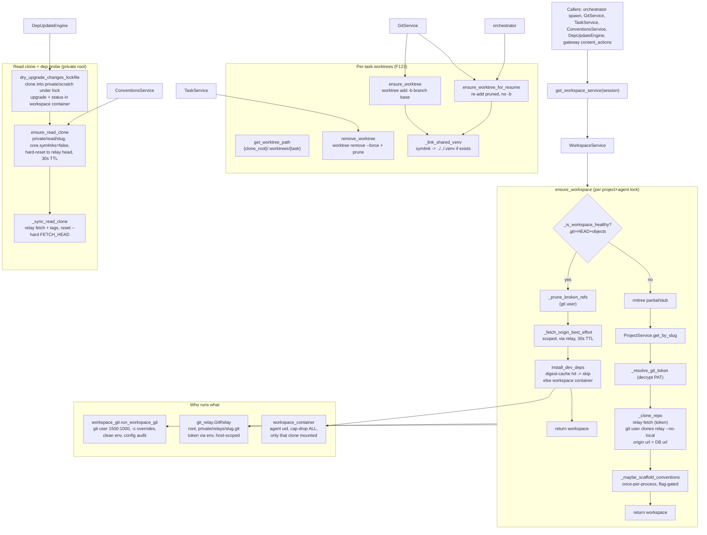

# workspace slice

## Purpose
WorkspaceService manages the per-agent git clone layout under {workspaces_root}/{project}/{team}/{agent}/, plus the F123 per-task linked worktrees under {clone_root}/.worktrees/{task}/. It clones (through the project's git relay), refresh-fetches, installs dev deps (in a throwaway workspace container), scaffolds the conventions standard on first clone, maintains a project-level read clone for the conventions engine under the orchestrator-only private root, and runs the read-only dep-upgrade probe. It is the filesystem/git-clone substrate every agent spawn and every git verb eventually lands on.

Every agent container mounts every clone read-write, so an agent controls every byte of every clone. The slice therefore never runs git (or anything else) in a workspace as root: workspace git goes through `roboco.services.workspace_git` (the git user, uid 1500, gid 1000, no capabilities, environment from scratch, program-starting settings pinned off on the command line, config audit first); every `origin` round-trip goes through the project's root-owned bare relay (`roboco.services.git_relay` + `git_origin`), the only repository a project token ever touches; and a workspace's own code (dep installs, toolchain smoke, dep probe) runs in `roboco.services.workspace_container` as the agent uid with no capabilities and no RoboCo network.

## Files
| Path | Role | LOC |
|---|---|---|
| roboco/services/workspace.py | WorkspaceService: path math, clone (via relay)/refresh/install deps, per-task worktrees, private read clone, dep-upgrade probe | 2125 |
| roboco/services/workspace_git.py | The workspace runner: every git command (and every other root-initiated process) in an agent workspace runs here as the git user; overrides, clean env, config audit, fd-safe group-write repair | 822 |
| roboco/services/git_relay.py | GitRelay: one root-owned bare repo per project under {private_data_root}/relays/<slug>.git that alone talks to origin with the project token; run_private_git for dispatcher-owned clones (read/release/scratch) | 468 |
| roboco/services/git_origin.py | Translates the origin-talking git commands RoboCo issues (fetch/push/ls-remote/pull/remote prune) into relay round-trips plus local git; refuses anything else; push_checkpoint_refs for Entire's checkpoint refs only | 308 |
| roboco/services/workspace_container.py | run_in_workspace_container: a workspace's own code runs in a throwaway `docker run --rm` as the agent uid (cap-drop ALL, no-new-privileges, only that clone mounted, bridge network, pids/mem/cpu limits, in-container timeout); run_offline_in_workspace_container: the same with no network and one identity-checked read-only extra mount (Entire's hooks) | 365 |
| roboco/utils/workspace_paths.py | clone_root_of: a worktree path's clone root (pure path logic) | 25 |
| roboco/services/project_hooks.py | A project's own gating git hooks (pre-commit, commit-msg, pre-push), located by git as the git user and run in the throwaway container before GitService's commit/push; refusal = git's; an Entire wrapper hook stands for the hook it moved aside; Entire's message hooks run between pre-commit and commit-msg | 207 |
| roboco/services/entire_hooks.py | Entire's commit hooks for agent commits (entire_enabled): prepare-commit-msg + commit-msg, post-commit (then group read on Entire's 0600 objects), in the sealed container with only the clone and the agent's transcript folder (read-only); checkpoint refs from Entire-Checkpoint trailers; Entire wrapper-hook detection | 197 |

## Key Symbols
| Name | Kind | File:Line | Responsibility |
|---|---|---|---|
| _uv_container_env | function | roboco/services/workspace.py:120 | Env for a uv command in the workspace container: pins UV_PYTHON_INSTALL_DIR to <clone_root>/.uv-python (worktree-aware via clone_root_of); the container entry script drops the image's /app/.venv pins |
| _monotonic | function | roboco/services/workspace.py:141 | Thin wrapper over time.monotonic so tests can patch it without breaking asyncio's own clock |
| _ensure_lock_for | function | roboco/services/workspace.py:162 | Return (lazy-create) the per (project_slug, agent_slug) asyncio.Lock serializing ensure_workspace/concurrent clones |
| WorkspaceError | class | roboco/services/workspace.py:172 | Exception raised on workspace/clone/worktree failures |
| _give_scratch_tree_to_agent_uid | function | roboco/services/workspace.py:213 | lchown a scratch tree under private_data_root (never agent-mounted) to the agent uid/gid before the workspace container runs in it; no-op unprivileged |
| _lockfile_digest | function | roboco/services/workspace.py:230 | SHA-256 over present lockfiles (uv.lock/pnpm-lock.yaml/package-lock.json/package.json) for idempotent dev-deps install; read as the git user |
| _detect_dep_commands | function | roboco/services/workspace.py:248 | Detect ecosystem + return (label, argv) install commands: uv sync --extra dev (optionally --python X), pnpm/npm |
| WorkspaceService | class | roboco/services/workspace.py:290 | Service: per-agent workspace path math, clone/refresh, worktrees, read clone, dep probe, dev-deps install |
| WorkspaceService.get_workspace_path | method | roboco/services/workspace.py:315 | Compute {root}/{project}/{team}/{agent}/ path; raise if team is None |
| WorkspaceService.get_clone_root_path | method | roboco/services/workspace.py:354 | Same as get_workspace_path; named separately to express clone-root vs worktree intent |
| WorkspaceService.get_worktree_path | method | roboco/services/workspace.py:368 | Per-task worktree path {clone_root}/.worktrees/{task_short_id}; raise on empty id |
| WorkspaceService._worktree_git | staticmethod | roboco/services/workspace.py:391 | run_workspace_git in the clone root (git user, overrides, audit), check optional |
| WorkspaceService._clone_root_default_branch | staticmethod | roboco/services/workspace.py:408 | Read origin/HEAD to get the default branch name ("main"); returns "" when unresolvable (cfe725da) |
| WorkspaceService._park_clone_root_off_branch | staticmethod | roboco/services/workspace.py:423 | Restore F123 invariant before worktree add: if clone root HEAD is the task branch, move back to default branch or detach so the branch ref is free for the worktree (cfe725da) |
| WorkspaceService._link_shared_venv | staticmethod | roboco/services/workspace.py:456 | Symlink worktree/.venv -> ../../.venv (as the git user) only if clone-root .venv exists; idempotent |
| WorkspaceService.ensure_worktree | method | roboco/services/workspace.py:487 | git worktree add -b <branch> <base> (or reuse existing branch); calls _park_clone_root_off_branch first; link venv |
| WorkspaceService.ensure_worktree_for_resume | method | roboco/services/workspace.py:523 | Re-add a pruned worktree on resume (no -b; branch ref survives); calls _park_clone_root_off_branch first; idempotent; link venv |
| WorkspaceService._fetch_branch_ref | method | roboco/services/workspace.py:592 | fetch origin <branch> into clone_root through the relay; best-effort (never raises); used by ensure_worktree_self_heal (536bbb64) |
| WorkspaceService._origin_git | method | roboco/services/workspace.py:618 | Serve one origin command for a repo through the project's relay (run_origin_command); local half runs as the git user (workspace) or root (dispatcher-owned); never raises |
| WorkspaceService._relay_for | method | roboco/services/workspace.py:647 | The project's GitRelay from its DB row (slug, git_url, decrypted token); None when unknown or no git_url |
| WorkspaceService.ensure_worktree_self_heal | method | roboco/services/workspace.py:658 | Orchestrator spawn-time chokepoint, role-aware (`can_author`, #692): a PRESENT worktree runs through `_refresh_present_worktree` first, so a worktree created once at first claim/`claim_review` no longer stays frozen at that commit across every later respawn. A vanished-clone re-attach still fetches the branch ref from origin when the local ref is absent (536bbb64); a surviving-ref-but-pruned-worktree re-add also runs the same refresh classification. |
| WorkspaceService._refresh_present_worktree | method | roboco/services/workspace.py:791 | Compares local `branch` HEAD against `origin/<branch>` (rev-list ahead/behind): behind-or-equal fast-forwards for every role, but never discards an author-capable role's (`can_author`) dirty uncommitted edits to do it; strictly ahead is always left alone (real unpushed work); diverged only hard-resets for a pure reader (QA/PR-gate/PM). Every reset is additionally guarded by `_safe_to_reset` (#692). |
| WorkspaceService._worktree_is_dirty / `_worktree_on_task_branch` / `_safe_to_reset` | methods | roboco/services/workspace.py:752 | Dirty-guard trio backing `_refresh_present_worktree`: a failed `git status` reads as dirty (fail toward preservation, never a false-clean reset); a reset only ever fires when the worktree is actually still checked out on `branch` (#692) |
| WorkspaceService.remove_worktree | method | roboco/services/workspace.py:882 | Best-effort git worktree remove --force + prune; no-op if gone (cancel/terminal/reaper evict) |
| WorkspaceService.delete_local_branch | method | roboco/services/workspace.py:894 | Best-effort `git branch -d/-D <branch>` in a clone; never raises; skips main/master/develop/empty; callers run it AFTER remove_worktree |
| WorkspaceService.resolve_workspace | method | roboco/services/workspace.py:917 | Look up agent (UUID or slug) -> team+slug -> workspace path; default team BACKEND |
| WorkspaceService._lookup_agent_or_raise | method | roboco/services/workspace.py:959 | Find agent by UUID or slug; raise WorkspaceError if missing |
| WorkspaceService._is_workspace_healthy | staticmethod | roboco/services/workspace.py:978 | True only if .git exists AND has HEAD + objects/ (rejects stub clones) |
| WorkspaceService._prune_broken_refs | staticmethod | roboco/services/workspace.py:988 | Delete .bak ref debris + loose refs whose content is neither sha nor symref, via a script run as the git user (never follows links); best-effort |
| WorkspaceService._fetch_origin_best_effort | method | roboco/services/workspace.py:1021 | Scoped (current + default branch) refresh fetch through the relay, so private repos refresh too; every failure warns (the token is always present, so an auth failure is a real one) |
| WorkspaceService._resolve_git_token | staticmethod | roboco/services/workspace.py:1087 | Decrypt project git token; raise WorkspaceError on decrypt failure or HTTPS-with-no-token |
| WorkspaceService.ensure_workspace | method | roboco/services/workspace.py:1109 | Idempotent ensure: healthy short-circuit (prune refs + relay fetch + install_deps) or rmtree partial then clone+scaffold; per (project,agent) lock |
| WorkspaceService._maybe_scaffold_conventions | method | roboco/services/workspace.py:1244 | Flag-gated once-per-process scaffold of .roboco/conventions.yml on a project's first clone; swallows all failures |
| WorkspaceService.ensure_read_clone | method | roboco/services/workspace.py:1276 | Ensure the project read clone at {private_data_root}/read/<slug> (core.symlinks=false; root-owned, never agent-mounted), hard-reset to the relay's `<head_branch>` (env-ladder head rung via `head_branch`); 30s TTL; force bypasses |
| WorkspaceService._read_clone_token | staticmethod | roboco/services/workspace.py:1349 | Decrypt project token for the relay; return None on failure (public repos ok) |
| WorkspaceService._create_read_clone | staticmethod | roboco/services/workspace.py:1365 | Relay fetch of the head branch, then root clones the relay (local file transport, core.symlinks=false) into the read-clone path; rmtree on failure |
| WorkspaceService._sync_read_clone | staticmethod | roboco/services/workspace.py:1400 | Relay fetch (head branch + tags), then fetch --tags --force from the relay + checkout + reset --hard FETCH_HEAD; best-effort |
| WorkspaceService._clone_repo | method | roboco/services/workspace.py:1441 | Relay fetches every branch from origin, then the git user clones the relay --no-local --no-tags --branch (no --single-branch); remote.origin.url set to the DB URL (display only); identity + fileMode; rmtree on any failure or timeout |
| WorkspaceService.install_dev_deps | method | roboco/services/workspace.py:1559 | Idempotent dev-deps install via lockfile digest marker; detected commands run in the workspace container; records toolchain marker |
| WorkspaceService._resolve_toolchain_target | staticmethod | roboco/services/workspace.py:1616 | Return target Python version when toolchain_match_enabled, else None |
| WorkspaceService._record_toolchain | method | roboco/services/workspace.py:1624 | Run the pytest --collect-only smoke (workspace container) under target python and write the .git/.roboco-toolchain marker as the git user |
| WorkspaceService._run_toolchain_smoke | staticmethod | roboco/services/workspace.py:1647 | Return ok/broken/unknown from pytest collect-only under the target interpreter (precision over recall) |
| WorkspaceService.read_toolchain_status | staticmethod | roboco/services/workspace.py:1687 | Read (python, status) from the toolchain marker as the git user; (None,None) when absent/unreadable |
| WorkspaceService._dep_install_cache_hit | staticmethod | roboco/services/workspace.py:1706 | True when stored digest equals current lockfile digest (skip install) |
| WorkspaceService._run_dep_install | staticmethod | roboco/services/workspace.py:1717 | Run one install command in the workspace container; container start failure/timeout logged; True only on exit 0 |
| WorkspaceService.dry_upgrade_changes_lockfile | method | roboco/services/workspace.py:1762 | Read-only dep-upgrade probe: local --no-hardlinks clone of the read clone into {private_data_root}/scratch under lock, handed to the agent uid, upgrade + git status run in the workspace container; fail-safe False |
| WorkspaceService._clone_local_into | staticmethod | roboco/services/workspace.py:1827 | git clone --local --no-hardlinks of read clone into throwaway dir (root, dispatcher-owned paths only) |
| WorkspaceService._probe_lockfile_on_clone | staticmethod | roboco/services/workspace.py:1842 | Run upgrade via shlex.split (no shell) + git status --porcelain on lock paths in the workspace container; False on non-zero |
| WorkspaceService.workspace_exists | method | roboco/services/workspace.py:1876 | Bool: workspace resolved and .git exists |
| WorkspaceService.list_workspaces | method | roboco/services/workspace.py:1888 | Scan {root}/{project}/*/* for dirs containing .git; return info dicts |
| WorkspaceService._resolve_branch_to_project_slug | method | roboco/services/workspace.py:1921 | Look up task by branch_name -> project slug; raise if no task or project missing |
| WorkspaceService.fetch_branch_for_inspection | method | roboco/services/workspace.py:1947 | Ensure workspace for QA/Doc/PM, fetch origin <branch> through the relay (both halves bounded by subprocess_timeout); TimeoutExpired -> GitTimeoutError; return workspace path |
| WorkspaceService.export_branch_motion | method | roboco/services/workspace.py:2026 | Fetch origin/<branch> through the relay into the read clone and git archive its motion/ subtree into a scratch dir (request_render QA source) |
| WorkspaceService.delete_workspace | method | roboco/services/workspace.py:2096 | rmtree the resolved workspace; True if deleted, False if absent |
| get_workspace_service | function | roboco/services/workspace.py:2123 | Factory: WorkspaceService(session) |
| workspace_git_overrides | function | roboco/services/workspace_git.py:115 | `-c` pairs on every workspace git command: core.hooksPath={git_support_dir}/hooks, no fsmonitor/ssh/askpass/editor/pager/credential/gpg programs, submodule recursion off, every transport but `file` never |
| workspace_git_env | function | roboco/services/workspace_git.py:129 | The full environment of a workspace git process, built from scratch (no ROBOCO_*/GIT_CONFIG_* inheritance; GIT_CONFIG_NOSYSTEM, HOME=/nonexistent, global config = workspace.gitconfig) |
| workspace_user_argv | function | roboco/services/workspace_git.py:198 | When root: setpriv --reuid=git_user_uid --regid=agent_gid --clear-groups --no-new-privs --inh-caps=-all; unprivileged: unchanged |
| run_as_workspace_user | function | roboco/services/workspace_git.py:217 | Run any command as the git user (umask 002, workspace env, cwd "/" by default) |
| workspace_git_argv | function | roboco/services/workspace_git.py:243 | git <overrides> <args>; adds --no-ext-diff --no-textconv to diff/log/show |
| run_workspace_git | function | roboco/services/workspace_git.py:251 | THE way to run git in an agent workspace: audit config, regroup once per clone, run as the git user, one EACCES-triggered repair + retry |
| archive_workspace_ref | function | roboco/services/workspace_git.py:323 | git archive --format=tar.gz <ref> of a workspace, as the git user |
| read_workspace_file / write_workspace_file | functions | roboco/services/workspace_git.py:352 | Read/write one workspace file as the git user (never root through an agent-planted symlink) |
| classify_git_config_key | function | roboco/services/workspace_git.py:484 | allowed / neutralized (an override pins it) / dangerous (an override cannot: filter.*, diff.*.textconv|command, merge.*.driver, url.*, include*, core.worktree, remote.*.uploadpack...) / unknown |
| audit_workspace_git_config | function | roboco/services/workspace_git.py:519 | Refuse (UnsafeWorkspaceGitConfigError) a clone whose .git is not a directory, has alternates, or whose config (repo + worktree configs, listed as the git user) holds a dangerous key; stat-signature cache; only under workspaces_root |
| workspace_hook_path | function | roboco/services/workspace_git.py:287 | Where plain git would find the project's own `<name>` hook (`rev-parse --git-path hooks/<name>` as the git user, every program override except the hooks path); None unless an executable file |
| records_entire_sessions / run_entire_message_hooks / run_entire_post_commit | functions | roboco/services/entire_hooks.py:79 | Gate (entire_enabled + a `*.json` in `<common dir>/entire-sessions`); Entire's prepare-commit-msg + commit-msg on COMMIT_EDITMSG, post-commit + `chmod g+r` on what the agent uid left under objects/ and refs/entire; sealed container, agent transcript folder mounted read-only at `/home/agent/.claude/projects/<encoded cwd>`; best-effort (logged) |
| checkpoint_refs / is_entire_hook / hook_entire_replaced | functions | roboco/services/entire_hooks.py:165 | Trailer values that are checkpoint ids (ULID) -> `refs/entire/checkpoints/<id[-2:]>/<id>`; a hook whose first lines carry `# Entire CLI hooks` (read as the git user, 512 bytes); its `<hook>.pre-entire` when executable |
| push_checkpoint_refs | function | roboco/services/git_origin.py:228 | Entire checkpoint refs only (anything else UnsupportedOriginCommandError): each taken into the relay with fsck, then one unforced push under the same names; staging refs dropped |
| find_project_hook / run_project_hook / run_commit_hooks | functions | roboco/services/project_hooks.py:86 | Locate a hook (skipped and logged outside the workspaces root); run it in the throwaway container with git's args and stdin (stdin file in the git dir, removed after); pre-commit then commit-msg through `COMMIT_EDITMSG` + `-F`; container failure or timeout refuses |
| make_clone_group_writable | function | roboco/services/workspace_git.py:774 | Root, fd-safe (os.fwalk + O_NOFOLLOW + fchown/fchmod): group agent_gid + g+rw (+x dirs) on every entry; skips node_modules/.venv/.uv-python/caches |
| prepare_clone_parent | function | roboco/services/workspace_git.py:680 | Root, by descriptor: mkdirat + O_NOFOLLOW open of each `<slug>/<team>` component (a planted symlink is refused), group agent_gid + g+rwx, so the git user can clone into a host-made 755 skeleton; unprivileged: mkdir -p |
| remove_workspace_tree | function | roboco/services/workspace_git.py:703 | Root `rm -rf` under the workspaces root: ancestors opened by descriptor with O_NOFOLLOW, then `shutil.rmtree(name, dir_fd=...)` (plain rmtree resolves ancestors, so a symlinked team dir would redirect the delete); unprivileged or private root: plain rmtree |
| GitRelay | class | roboco/services/git_relay.py:259 | One project's bare relay at {private_data_root}/relays/<slug>.git (root-owned, flock-serialized) |
| GitRelay.fetch_from_origin / ls_remote / push_to_origin | methods | roboco/services/git_relay.py:293 | The only git processes that see a token: root git in the relay, origin's single transport allowed, token as a host-scoped http.<scheme>://<host>/.extraheader via GIT_CONFIG_COUNT env (never argv, never a file), hooks /dev/null; push supports --force-with-lease=<ref>:<sha> |
| GitRelay.take_ref | method | roboco/services/git_relay.py:331 | Fetch a workspace ref into refs/roboco/incoming/<id> with fetch.fsckObjects; upload-pack runs in the workspace as the git user |
| run_private_git | function | roboco/services/git_relay.py:212 | Root git in a dispatcher-owned repo (relay/read/release/scratch): clean env, hooks /dev/null, only the file transport |
| relay_for / read_clone_path / release_clone_path / is_dispatcher_owned | functions | roboco/services/git_relay.py:433 | Relay from a project row; private-root paths; lexical under-private-root test |
| remove_pre_move_copies | function | roboco/services/git_relay.py:107 | Once per install (marker + flock in the private root): delete the old layout's `<slug>/_meta/conventions` read clones and `_release/<slug>` release clones under the workspaces root, only when still exactly that layout; run in a thread by the dispatcher's startup (`AgentOrchestrator.start`), best-effort |
| run_origin_command | function | roboco/services/git_origin.py:63 | fetch origin <specs> -> relay fetch + local fetch from the relay into refs/remotes/origin/*; push -> take_ref + relay push (+lease from the clone's tracking ref) + set_ref; ls-remote -> relay; pull --ff-only -> fetch + merge --ff-only; remote prune -> ls-remote diff; UnsupportedOriginCommandError for anything else (--depth, --force, tags, --rebase, other remotes) |
| run_in_workspace_container | function | roboco/services/workspace_container.py:155 | docker run --rm --user agent_uid:agent_gid --cap-drop ALL --no-new-privileges, -v <host clone root>:<same path>, network bridge, limits; in-container `timeout -k 10`; WorkspaceContainerError if it cannot start |
| run_offline_in_workspace_container / ReadOnlyMount | function / class | roboco/services/workspace_container.py:176 | The same run with `--network none`, stdout+stderr merged, plus one `-v <host>:<target>:ro` whose directory is reached here by an O_NOFOLLOW walk below a trusted root and checked by device/inode inside the container (exit 125 on mismatch) |
| workspace_container_image | function | roboco/services/workspace_container.py:318 | settings.workspace_container_image, else this orchestrator's own image id (cached) |

## Data Flow
Inputs: an AsyncSession, a project_slug, an agent_id (UUID or slug), optionally a git_url/default_branch/force. The orchestrator, GitService, TaskService, conventions service, dep_update_engine, and gateway content_actions all obtain a WorkspaceService via get_workspace_service(session) (or WorkspaceService(db) directly in the spawn path). Control flow on ensure_workspace: _lookup_agent_or_raise -> get_workspace_path -> acquire per-(project,agent) asyncio.Lock -> if _is_workspace_healthy (.git+HEAD+objects): prune broken refs (git user), scoped _fetch_origin_best_effort through the relay (30s TTL, force override), install_dev_deps (digest-cache hit short-circuits), return. Else: rmtree any partial/stub dir, ProjectService.get_by_slug, resolve the clone target branch via `head_branch(project)` (the env-ladder head rung — `roboco.models.env_branches`, shimmed from `default_branch` when no ladder is declared), _resolve_git_token (decrypt PAT; raise on HTTPS-with-no-token), _clone_repo (relay fetches every branch from origin with the token; the git user clones the relay --no-local --no-tags --branch; remote.origin.url set to the DB URL; identity/fileMode), install_dev_deps (workspace container), _maybe_scaffold_conventions (once-per-process, flag-gated). Per-task worktree path: get_clone_root_path + get_worktree_path (.worktrees/{task_short_id}); ensure_worktree runs git worktree add -b <branch> <base> (or reuses an existing branch ref) as the git user, then _link_shared_venv (symlink to clone-root .venv only if it exists). GitService.create_branch calls ensure_worktree; commit/rebase paths call ensure_worktree_for_resume via GitService._ensure_worktree_for_commit; the orchestrator's _ensure_worktree_before_spawn calls ensure_worktree_self_heal at EVERY spawn (post-#692), passing `can_author` from the spawning agent's role (`WORKTREE_AUTHOR_ROLES` — developer/documenter): a present worktree runs through `_refresh_present_worktree` (fast-forward when behind, leave alone when ahead, hard-reset only for a non-author reader when diverged) before venv-link; a vanished clone still fetches the branch ref from origin if the local ref is absent, and a surviving-ref-but-pruned worktree re-adds then runs the identical refresh; TaskService.complete/cancel call remove_worktree. ensure_read_clone is called by ConventionsService (and release readiness) for the project read clone at {private_data_root}/read/<slug>, hard-reset to the relay's head branch. dry_upgrade_changes_lockfile (dep_update_engine) clones the read clone --local --no-hardlinks into {private_data_root}/scratch under the read-clone lock, hands it to the agent uid, then runs dep_update_command and git status --porcelain on lockfile paths in the workspace container. Outputs: workspace Path (and side effects: on-disk clone/worktree, .venv symlink, .git/.roboco-dep-install + .git/.roboco-toolchain markers written as the git user). All git/subprocess work runs via asyncio.to_thread. Who runs what: workspace git = git user (uid 1500, gid 1000) via workspace_git; origin = the relay (root, token in env only); a workspace's own code = workspace container (agent uid); root itself never reads, writes or executes under workspaces_root except by descriptor with O_NOFOLLOW: the group-write repair, prepare_clone_parent and remove_workspace_tree.

## Mermaid


## Logical Tree
```
WorkspaceService slice
+-- Module-level helpers (workspace.py)
|   +-- _uv_container_env (UV_PYTHON_INSTALL_DIR pin, worktree-aware)
|   +-- _monotonic (test-patchable clock)
|   +-- _ensure_lock_for (per project+agent asyncio.Lock)
|   +-- _give_scratch_tree_to_agent_uid (private scratch only)
|   +-- _lockfile_digest / _detect_dep_commands
|   +-- markers: _DEP_INSTALL_MARKER, _TOOLCHAIN_MARKER
+-- WorkspaceError
+-- WorkspaceService
|   +-- Path math: get_workspace_path / get_clone_root_path / get_worktree_path
|   +-- Worktree ops: _clone_root_default_branch / _park_clone_root_off_branch / _worktree_git / _link_shared_venv / ensure_worktree / ensure_worktree_for_resume / _fetch_branch_ref / ensure_worktree_self_heal / remove_worktree / delete_local_branch
|   +-- Origin: _origin_git / _relay_for
|   +-- Agent lookup: resolve_workspace / _lookup_agent_or_raise
|   +-- Health + refs: _is_workspace_healthy / _prune_broken_refs / _fetch_origin_best_effort
|   +-- Token: _resolve_git_token / _read_clone_token
|   +-- Clone + ensure: ensure_workspace / _clone_repo / _maybe_scaffold_conventions
|   +-- Read clone: ensure_read_clone / _create_read_clone / _sync_read_clone
|   +-- Dev deps + toolchain: install_dev_deps / _resolve_toolchain_target / _record_toolchain / _run_toolchain_smoke / read_toolchain_status / _dep_install_cache_hit / _run_dep_install
|   +-- Dep-update probe: dry_upgrade_changes_lockfile / _clone_local_into / _probe_lockfile_on_clone
|   +-- Misc: workspace_exists / list_workspaces / _resolve_branch_to_project_slug / fetch_branch_for_inspection / export_branch_motion / delete_workspace
+-- get_workspace_service (factory)
+-- workspace_git.py: run_workspace_git / run_as_workspace_user / workspace_git_overrides / workspace_git_env / audit_workspace_git_config / classify_git_config_key / read|write_workspace_file / archive_workspace_ref / make_clone_group_writable
+-- git_relay.py: GitRelay (fetch_from_origin / ls_remote / push_to_origin / take_ref / set_ref / drop_ref) / run_private_git / relay_for / private paths
+-- git_origin.py: is_origin_command / run_origin_command / push_checkpoint_refs / OriginContext / UnsupportedOriginCommandError
+-- workspace_container.py: run_in_workspace_container / run_offline_in_workspace_container / ReadOnlyMount / workspace_container_image / host_path_for
+-- project_hooks.py: find_project_hook / run_project_hook / run_commit_hooks / skips_hooks
+-- entire_hooks.py: records_entire_sessions / run_entire_message_hooks / run_entire_post_commit / checkpoint_refs / is_entire_hook / hook_entire_replaced
```

## Dependencies
- Internal: roboco.config.settings, roboco.db.tables.AgentTable, roboco.db.tables.TaskTable, roboco.logging.get_logger, roboco.models.base.Team, roboco.models.env_branches.head_branch (env-ladder head-rung resolver backing the clone target in ensure_workspace and ensure_read_clone), roboco.services.toolchain.resolve_target_python, roboco.services.project.get_project_service / ProjectService, roboco.services.conventions.get_conventions_service / ConventionsService, roboco.services.workspace_git, roboco.services.git_relay, roboco.services.git_origin, roboco.services.workspace_container, roboco.utils.workspace_paths.clone_root_of, roboco.utils.crypto.EncryptionError, roboco.exceptions.GitTimeoutError, roboco.db.base.get_db_context (orchestrator spawn path)
- External: asyncio, contextlib, json, math, os, re, shlex, shutil, subprocess, tempfile, time, pathlib.Path, uuid.UUID, sqlalchemy.ext.asyncio.AsyncSession, sqlalchemy.select, hashlib (lazy in _lockfile_digest), fcntl (relay flock), `setpriv` (util-linux, orchestrator image), the docker CLI (workspace container)

## Entry Points

| Name | File | Trigger |
|---|---|---|
| ensure_workspace | roboco/services/workspace.py | GitService.create_branch_for_task / push / PR ops; orchestrator spawn ensure; gateway content_actions; called transitively by many verbs |
| ensure_worktree | roboco/services/workspace.py | GitService.create_branch_for_task on fresh claim (worktree add -b <branch> <base>) |
| ensure_worktree_for_resume | roboco/services/workspace.py | GitService._ensure_worktree_for_commit (commit/rebase paths) |
| ensure_worktree_self_heal | roboco/services/workspace.py | orchestrator._ensure_worktree_before_spawn before -w container launch (replaces the former ensure_worktree_for_resume call there; handles vanished clones + missing branch refs, and — post-#692 — refreshes an already-present worktree against origin at every respawn, role-aware via `can_author`) |
| remove_worktree | roboco/services/workspace.py | TaskService terminal/cancel paths + claim-rollback (mid-claim failure) |
| delete_local_branch | roboco/services/workspace.py | TaskService terminal/cancel paths (right after remove_worktree) + GitService.cleanup_stale_branches sweep |
| ensure_read_clone | roboco/services/workspace.py | ConventionsService.scaffold/effective-map reads (project-level conventions metadata) |
| dry_upgrade_changes_lockfile | roboco/services/workspace.py | DepUpdateEngine periodic probe loop |
| fetch_branch_for_inspection | roboco/services/workspace.py | gateway content_actions (QA/Documenter/PM need to read a dev branch) |
| read_toolchain_status | roboco/services/workspace.py | GitService spawn-time toolchain runnability check |
| list_workspaces / workspace_exists / delete_workspace | roboco/services/workspace.py | admin API routes / project service maintenance |

## Config Flags
- ROBOCO_WORKSPACES_ROOT (settings.workspaces_root; default /data/workspaces) — mounted read-write into EVERY agent container
- ROBOCO_PRIVATE_DATA_ROOT (settings.private_data_root; default /data/private) — orchestrator-only: relays/<slug>.git, read/<slug>, release/<slug>, scratch/; compose mounts ${ROBOCO_DATA_DIR:-./data}/private there
- ROBOCO_GIT_USER_UID (settings.git_user_uid; default 1500) — the uid workspace git drops to (`roboco-git` in the orchestrator image, primary gid agent_gid); must match the image build arg
- ROBOCO_GIT_SUPPORT_DIR (settings.git_support_dir; default /opt/roboco/git) — root-owned: hooks/ (the only hooks dir orchestrator-side git runs) and workspace.gitconfig
- ROBOCO_AGENT_UID / ROBOCO_AGENT_GID (settings.agent_uid / agent_gid; default 1000/1000) — the agent user; workspace containers run as it; the git user shares its gid
- ROBOCO_HOST_DATA_DIR (settings.host_data_dir) — host path of /data, for the workspace container's bind mount over the Docker socket
- ROBOCO_WORKSPACE_CONTAINER_IMAGE / _NETWORK / _MEMORY / _CPUS / _PIDS_LIMIT — the throwaway workspace container (default: own image, bridge, 4g, 2, 4096)
- ROBOCO_WORKSPACE_AUTO_CLONE (settings.workspace_auto_clone; default true)
- ROBOCO_WORKSPACE_CLONE_TIMEOUT (settings.workspace_clone_timeout; default 300s) - bounds clone + relay fetches + fetch_branch_for_inspection
- ROBOCO_WORKSPACE_REFRESH_FETCH_TIMEOUT_SECONDS (settings.workspace_refresh_fetch_timeout_seconds; default 60s) - bounds the healthy-clone scoped refresh fetch
- ROBOCO_WORKSPACE_INSTALL_DEV_DEPS (settings.workspace_install_dev_deps; default true) - gates post-clone dev-dep install
- ROBOCO_WORKSPACE_DEP_INSTALL_TIMEOUT_SECONDS (settings.workspace_dep_install_timeout_seconds; default 600s) - bounds uv sync / pnpm install / toolchain smoke / dep-upgrade probe (enforced inside the container too)
- ROBOCO_TOOLCHAIN_MATCH_ENABLED (settings.toolchain_match_enabled; default off) - gates provisioning against the target project's declared Python + the runnability smoke marker
- ROBOCO_CONVENTIONS_ENABLED (settings.conventions_enabled; default off) - gates the first-clone conventions scaffold PR

## Gotchas
- Never run git (or open a file) in an agent workspace any other way than workspace_git: every agent container mounts every clone read-write, so `.git/config`, hooks, attributes and the working tree are attacker-controlled. `tests/unit/services/test_git_runs_only_through_the_runners.py` fails the build on a `subprocess` git call outside the runners. Root in the orchestrator holds the Docker socket; the git user holds nothing.
- Git never discovers a workspace's repository: `workspace_repository_env` pins GIT_DIR / GIT_COMMON_DIR / GIT_WORK_TREE from the layout (a planted `.git/commondir` or a rewritten worktree gitfile would otherwise move config past the audit with no race; a clone's own `.git/commondir` is refused outright). A cwd under the workspaces root with no `.git` gets GIT_CEILING_DIRECTORIES, and `_clone_repo` clones from `/`.
- The throwaway container verifies its bind mount: dockerd resolves the source on the host (following symlinks), so the orchestrator takes the clone's device/inode through an O_NOFOLLOW descriptor walk (`workspace_dir_identity`) and the entry script refuses to run (exit 125) if its mount differs.
- The config audit is checked-then-used: an agent can rewrite `.git/config` between the audit and the command. The audit is defense in depth; the boundary is the privilege drop (git user: no token, no secret, no socket, no capability) plus the `-c` overrides, which beat every config file.
- No network transport is open to workspace git (`protocol.allow=never`, only `file`). Anything that must reach origin goes through `_origin_git` / GitService's origin routing and therefore through the relay; a new origin-talking git form must be added to `git_origin` (it refuses what it does not know rather than guessing).
- The relay is the only place a token lives at run time, as `GIT_CONFIG_KEY_n/VALUE_n` env scoped to origin's scheme+host. Never pass it in argv (visible in /proc) or write it to any config file.
- Read and release clones live under the private root and are checked out with `core.symlinks=false`: root reads them, and a committed symlink must stay a plain file there.
- Permissions: the git user and the agent share gid 1000 and both write with umask 002 (agent images run their entrypoints through `umask 002`). A clone made before this change, or one an agent wrote with a different umask, is repaired once per process per clone (`_regroup_clone_once`) and again on an EACCES retry, by root through the fd-safe `make_clone_group_writable` — never a path-following chown walk.
- Files the git user creates on the host are owned by uid 1500 (gid 1000, group-writable).
- The per-(project,agent) asyncio.Lock (_ENSURE_WORKSPACE_LOCKS) is process-local only. Across orchestrator processes (or restarts) two coroutines can still race the .git-exists check; the rmtree-partial-then-clone path assumes single-process serialization. The relay itself is flock-serialized per project across processes.
- _is_workspace_healthy requires .git + HEAD + objects/ — a stub clone from a failed `git clone` (only FETCH_HEAD) is intentionally rejected and re-cloned. A regression that loosens this check re-mounts agents on broken clones.
- 30s TTL fetch caches (_fetch_cache instance attr, _read_clone_synced module attr) are keyed by str(workspace); a Path that resolves to the same dir via a different route (worktree vs clone root) would not share a cache entry.
- _link_shared_venv only symlinks if clone_root/.venv EXISTS (F-fix 0f7d6929). On the very first claim, install_dev_deps provisions the venv AFTER ensure_worktree already ran — the symlink is skipped and a later ensure (resume/commit) self-heals it.
- _clone_repo does NOT pass --single-branch: agents/QA/doc must fetch peer feature branches. A regression adding --single-branch would silently break `checkout origin/feature/...`. It DOES pass --no-local: a real transfer, so nothing in the workspace is hardlinked to the root-owned relay.
- Both clone-failure except branches (CalledProcessError, TimeoutExpired) remove the workspace (remove_workspace_tree) before raising (F063 bb94e6ba). The clone never holds a token, so a surviving half-clone is a stale workspace, not a leak.
- Project hooks: a workspace commit/push runs the project's own `pre-commit` / `commit-msg` / `pre-push` in the throwaway container (~3.6 s per run on the NAS, measured 2026-10-28) only when one exists where git would look; husky shims (`.husky/_`) are not checked out in per-task worktrees, so — exactly as with plain git — husky hooks only fire for commits in a clone root. Two real hooks checked on copies 2026-10-28/29: hummin-cli's pre-commit refuses on its own Biome config; vexa-ai-backend's pre-push needs pnpm 11, which needed libatomic (now in the image), then fails in its own `scripts/gates.mjs` licenses gate after 191 s. A `pre-push` gets `project_hook_push_timeout_seconds` (240 s), not the push's network timeout (120 s).
- `write_workspace_file` gets the same once-per-process group repair as `run_workspace_git` (+ one retry on EACCES): an old clone's `.git` can be `1000:admin 775`, which the git user (gid 1000 only) cannot write.
- Never `shutil.rmtree` / `mkdir -p` / `chmod` a path under the workspaces root as root by its string path: the project and team dirs are agent-owned and can be swapped for a symlink. Use remove_workspace_tree / prepare_clone_parent (descriptor walk, O_NOFOLLOW). The production skeleton (`/data/workspaces/<slug>/<team>`) was made by the host user, mode 755, group admin — the git user cannot create a clone there until prepare_clone_parent regroups it.
- _maybe_scaffold_conventions uses a process-wide _SCAFFOLD_ATTEMPTED set: the scaffold is attempted at most once per project per orchestrator process. A first-clone failure is never retried within the same process lifetime.
- dry_upgrade_changes_lockfile holds the read-clone lock only for the local clone step, then releases it before the upgrade runs. Safe only because _sync_read_clone is the sole other mutator of the read clone.
- get_workspace_path raises WorkspaceError if team is None rather than producing a literal 'None' segment; resolve_workspace falls back to Team.BACKEND when agent.team is falsy — agents missing a team silently land under backend/.
- fetch_branch_for_inspection defaults to workspace_clone_timeout (300s) for a single-branch fetch; the evidence() caller passes its own leg budget via subprocess_timeout.
- delete_local_branch only detaches the ref; remove_worktree only detaches the worktree. Callers MUST run remove_worktree first — `git branch -d/-D` refuses a branch still checked out elsewhere in the clone (the worktree).

## Drift from CLAUDE.md
- CLAUDE.md (Git Credentials / Token flow) says 'HTTPS URLs require tokens - attempting to clone without a token will raise WorkspaceError' — matches _resolve_git_token (line 1087). No drift.
- CLAUDE.md (Multi-Agent Workspace Structure) says a Python workspace runs `uv sync --extra dev` (not plain `uv sync`) so the dev extra is present — matches _detect_dep_commands (line 248). No drift.
- CLAUDE.md (Work Sessions / fresh claim) says a fresh claim git-resets the workspace to a clean tree (`git reset --hard`) before checking out the new branch. ACTUAL code: F123 (67107f8a) replaced that reset+checkout with per-task `git worktree add` under {clone_root}/.worktrees/{task}/ — the reset --hard no longer runs on fresh claim. This is a real drift between the doc narrative and the post-F123 code.
- CLAUDE.md (Architectural Conventions Standard) says the read clone is pinned to the default branch's HEAD via WorkspaceService.ensure_read_clone — matches (line 1276; the clone now lives under the private root, not `_meta/conventions`). No drift.
- CLAUDE.md (Dependency-update bot) says WorkspaceService.dry_upgrade_changes_lockfile runs dep_update_command in a throwaway clone of the READ CLONE and the read clone is never mutated — matches (line 1758). No drift.


## Changes Since Baseline

| SHA | Subject | Impact |
|---|---|---|
| bb94e6ba | [F063] workspace._clone_repo: rmtree half-configured clone on failure | Both clone-failure except branches (CalledProcessError, TimeoutExpired) now shutil.rmtree the workspace before raising WorkspaceError, so a half-configured clone with the PAT still in .git/config cannot survive and be re-mounted by the next ensure_workspace health short-circuit. |
| c3057bb3 | Updated domain | Trivial: git config user.email domain bump in _clone_repo's _configure_git (now {slug}@roboco.tech). No behavior change beyond commit author email. |
| 1a773e45 | [F116] hold the read-clone lock across the dep-probe local clone | dry_upgrade_changes_lockfile split into _clone_local_into (run UNDER the _meta-conventions lock) + _probe_lockfile_on_clone (lock-free on the independent copy), closing a race where a concurrent ensure_read_clone hard-reset could mutate the read clone mid-clone. |
| 3441e371 | [sweep] strip Fxxx audit-ID tokens + trim bloated comments/docstrings | Comment/docstring prose only — no code-line edits in workspace.py. Reduced narrative bulk; no behavioral change. |
| 67107f8a | [F123] per-task git worktrees — coordinator PM roots no longer clobber each other | Major: added get_clone_root_path/get_worktree_path/ensure_worktree/ensure_worktree_for_resume/remove_worktree/_link_shared_venv/_worktree_git + _resolve_clone_root + _uv_subprocess_env worktree-awareness. Replaced the fresh-claim `git reset --hard` + `checkout -b` with `git worktree add` under {clone_root}/.worktrees/{task}/ so a coordinator PM holding multiple in_progress roots no longer clobbers one root's working tree by checking out another's branch. .venv symlinked from worktree to clone root; .uv-python gitignored. |
| 0f7d6929 | [F-fix] gate the worktree .venv symlink on the clone-root venv existing | _link_shared_venv now no-ops when clone_root/.venv does not yet exist (instead of dangling a symlink), so uv no longer errors or silently re-syncs a worktree-local venv in the near-zero gap before install_dev_deps provisions the clone-root venv. A later ensure self-heals the link. |

> Post-snapshot updates (since 2026-06-29): 5 commits touched workspace.py. (1) 9faf2763 [hotfix] strip VIRTUAL_ENV + UV_PROJECT_ENVIRONMENT from _uv_subprocess_env so workspace uv calls stop warning about the image-baked /app/.venv pin. (2) cfe725da [hotfix] worktree: clone root left on the task branch caused fatal "already checked out" on every worktree add re-dispatch — added _clone_root_default_branch + _park_clone_root_off_branch; ensure_worktree and ensure_worktree_for_resume now call _park_clone_root_off_branch before the add to restore the F123 invariant. (3) 536bbb64 (logical-gap sweep PR#286) added _fetch_branch_ref + ensure_worktree_self_heal: the orchestrator's _ensure_worktree_before_spawn now calls ensure_worktree_self_heal instead of bare ensure_worktree_for_resume so a vanished clone (redeploy/disk loss) that left no local branch ref recovers the pushed commits from origin before re-attaching. (4) 3aff6e04 and 15effce0 (gap-fill PRs #285/#283) contributed earlier worktree + dep-probe plumbing (the _clone_local_into / _probe_lockfile_on_clone split already captured in the baseline).
>
> Further post-snapshot update (#534, env-branches ladder): `ensure_workspace`'s fresh-clone branch and `ensure_read_clone` both resolve their target branch via `roboco.models.env_branches.head_branch(project)` — the env-ladder's head rung — instead of reading `project.default_branch` directly. A project with no declared ladder resolves to the identical `default_branch` value via the read-time shim, so this is behavior-preserving until the CEO declares a real ladder in the panel.
>
> (open PR #548, branch `feature/wave-2-hygiene-charts`, 2026-07-17) Added `delete_local_branch` (line 787) so `TaskService`'s cancel/terminal-completion cleanup and `GitService.cleanup_stale_branches` can reap a spent local branch ref, not just the worktree — previously every task an agent ever claimed leaked a permanent `refs/heads/{branch}` in that agent's clone.
>
> `987eb09c` (PR #692, "role-aware worktree refresh at every spawn", 2026-07-24) Closed the frozen-worktree-across-respawns bug behind a live multi-round QA/PR-gate bounce loop: `ensure_worktree_self_heal` gained a `can_author` parameter (from `foundation.identity.WORKTREE_AUTHOR_ROLES` — developer/documenter) and now runs every PRESENT or re-added worktree through the new `_refresh_present_worktree` before venv-link + chown, not just a vanished-clone re-attach. Behind-or-equal fast-forwards for every role (an author's dirty tree is left untouched to do it); strictly ahead is always left alone; diverged only hard-resets for a pure reader. `conventions_check_for_task`'s list-vs-content gap closes as a side effect — a reviewer's worktree is current as of spawn.
>
> (branch `feature/claude/dispatcher-git-hardening`, 2026-10-28) Dispatcher hardening: agents control every byte of every clone, so (1) a workspace's own code (dep installs, toolchain smoke, dep probe; plus the gateway quality gate and codegen) moved into a throwaway container as the agent uid (`workspace_container.py`); (2) every workspace git command runs as the git user through `workspace_git.py` (setpriv drop, clean env, `-c` overrides, config audit, `--no-ext-diff --no-textconv`), replacing root git under `safe.directory '*'` — which had run repo-configured hooks (`core.hooksPath=.husky/_` on 3 of 112 NAS clones) as root; (3) the token moved out of every workspace process into a per-project relay (`git_relay.py` + `git_origin.py`) — no `http.extraheader` / PAT-in-URL on any workspace git, no post-clone scrub/leak-scan needed; (4) read clone and release clone moved to the orchestrator-only private root with `core.symlinks=false`; (5) the chown walk, owned-marker, `_inject_token_into_url` and `_assert_no_pat_leak` are gone (shared gid + umask 002 + fd-safe regroup instead). Forge REST calls take the repo from the DB `git_url`, never the clone's `remote.origin.url`.

## Regression Risks

| Title | File:Line | Claim | Severity |
|---|---|---|---|
| Worktree .venv symlink self-heal depends on a later ensure firing | roboco/services/workspace.py:456 | ensure_worktree (fresh claim) runs _link_shared_venv BEFORE install_dev_deps provisions clone_root/.venv, so the symlink is skipped on the first claim. The shared-venv optimization only self-heals if a later ensure (resume/commit via _ensure_worktree_for_commit) re-runs _link_shared_venv. If the agent commits via a path that does not re-invoke ensure and uv re-syncs a worktree-local .venv first, the lexists guard prevents replacing the real dir and the worktree is stuck with a duplicated venv. The F-fix mitigated the dangling-symlink case but did not close the already-clobbered-venv recovery (explicitly out of scope per commit msg). | medium |
| ensure_worktree reuses an existing branch ref without validating it points at base | roboco/services/workspace.py:487 | When branch_exists is True (re-claim after rollback) ensure_worktree runs `worktree add <worktree> <branch>` with no -b and no base. If the surviving branch ref was left at an unexpected commit (e.g. a prior partial rebase, or a force-pushed-and-locally-stale ref), the worktree is created at that commit, not at the intended base. RESOLVED for the orchestrator spawn path (#692): `ensure_worktree_self_heal` now runs every re-add through `_refresh_present_worktree`, which fetches origin and reconciles the ref before the agent starts working. The GitService commit path (`_ensure_worktree_for_commit` → `ensure_worktree_for_resume`) still calls the bare, unrefreshed re-add — residual risk there only. | low |
| ensure_worktree_for_resume silently re-adds a worktree whose branch was force-updated remotely | roboco/services/workspace.py:523 | On resume via GitService._ensure_worktree_for_commit, ensure_worktree_for_resume re-adds the worktree from the surviving local branch ref (no fetch, no base). If the branch was force-pushed remotely while the agent was down and the local ref is stale, the agent resumes on the old commits with no warning. RESOLVED for the orchestrator spawn path: `ensure_worktree_self_heal` (#692) now runs a PRESENT worktree — and a re-added one recovered from a surviving ref — through the same `_refresh_present_worktree` classification at every respawn (fast-forward when behind, reset only for a non-author role when diverged), not just after a vanished clone. The GitService commit path still uses the bare, unrefreshed `ensure_worktree_for_resume`. | low |
| dry_upgrade probe lock gap could race a future interleaved sync | roboco/services/workspace.py:1758 | The dep-update probe acquires the _meta-conventions lock only around _clone_local_into and releases it before _probe_lockfile_on_clone. The commit msg argues this is safe because any concurrent _sync_read_clone completes under the lock first. This holds ONLY because _sync_read_clone is the sole other holder; if a future change adds a third concurrent mutator of the read clone that interleaves between the release and re-acquire (none today), the local clone could read a half-mutated source. Fragile invariant documented only in the commit, not enforced. | low |
| _fetch_origin_best_effort TTL cache not shared between clone root and worktree paths | roboco/services/workspace.py:1181 | _fetch_cache is keyed by str(workspace) on the instance. ensure_workspace is called with the clone-root path, but a worktree-path caller (none currently call ensure_workspace directly with a worktree path, but clone_root_of exists to support the worktree-aware uv env) would get a separate cache entry. Not a current bug, but a future worktree-aware ensure_workspace call could double-fetch. | low |

## Health
WorkspaceService is a mature, heavily-instrumented slice with strong defensive hygiene: per-(project,agent) asyncio locks, partial-clone detection + rmtree, a real .git+HEAD+objects health check, scoped + TTL-cached refresh fetches, no token in any workspace process at all (every origin round-trip goes through the per-project relay), workspace git that never runs as root (git user, overrides, config audit), a workspace's own code confined to a throwaway container, idempotent lockfile-digest-gated dev-deps install, and F123 per-task worktrees that eliminated the coordinator-PM clobber. The F063 + F116 + F123 + F-fix wave closed real deploy-blocker races (PAT leak on half-configured clone, read-clone mid-clone race, root-clobber, dangling venv symlink). Residual risk is concentrated in the worktree venv-symlink timing (first-claim skip depends on a later ensure to self-heal), the GitService commit path's resume re-add still reusing a possibly-stale local branch ref without a fetch (the orchestrator spawn path's own version of this is now resolved by #692's role-aware `_refresh_present_worktree`), and the process-local (not cross-process) ensure-workspace lock. The slice diverges from CLAUDE.md's "fresh claim git reset --hard" narrative — by design, post-F123 — and that doc drift should be reconciled. Overall integrity is high; the regression risks are edge-case rather than core-path.
